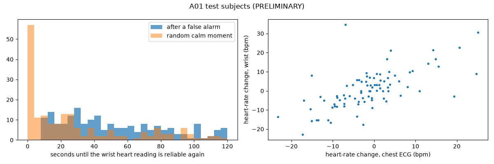

# A01 — What happens to heart rate after a false-alarm jolt in everyday life? (ANALYSIS ONLY, PRELIMINARY)

Everyday-life recordings (PPG-DaLiA). The final numbers are from the 10 **test** people; dev is in `reports/A01_tables.md`. Nothing here changes any model, rule, setting or the demo app. Definitions were fixed in `config/a01_post_event_hr.yaml` before any result. All numbers come from `reports/A01_tables.md` and `results/2026-10-12_A01_post_event_hr/`, produced by `scripts/a01_post_event_hr.py`.

## Plain-language summary
- **561 false alarms** ("Most sensitive" check-ins) happened in 23.6 hours of normal life for the 10 test people. None of them were real danger.
- **After a jolt, the wrist heart reading is usually not trustworthy for a long time:**
  - only **35%** of false alarms got a reliable wrist heart reading back within 2 minutes;
  - the median wait was **42 s** among those that did; 90% within 102 s;
  - only 11% were back within 30 s;
  - at random calm moments, 46% recovered within 2 minutes (median 17 s).
- **Usable heart change:** only **16%** of false alarms gave a usable before-vs-after heart change from the wrist. The rest had no reliable reading before or after.
- **Activities:** recovery was worst in cycling (8% recovered), walking (4%) and stairs (15%), and best when driving (73%) or working (100%, n = 9).
- **After everyday false alarms, heart rate mostly does not jump.** Chest-ECG truth, 30 s after the alarm, all 561 events:

  | Rise in the first 30 s | ≥ 10 bpm | ≥ 15 bpm | ≥ 20 bpm |
  |---|---|---|---|
  | After false alarms | 15% | 9% | 4% |
  | At random calm moments | 9% | 4% | 3% |

  - Where the wrist did recover, measuring from the moment it recovered, the ECG change was usually a small *drop* (median −3.8 bpm), as people slowed down.
- **Wrist vs ECG:** where both could be measured (87 events), the wrist change followed the ECG change reasonably (correlation 0.7; average gap 5.8 bpm).

**Descriptive, not a chosen rule; not evidence about real danger events.** If a future rule required a heart-rate rise of X bpm before escalating, it would affect roughly Y% of everyday false alarms by ECG truth, and Z% by the wrist reading:

| X (bpm) | Y: ECG, 30 s after the alarm | Z: wrist (only the 16% that could be measured) |
|---|---|---|
| 10 | 15% | 13% |
| 15 | 9% | 8% |
| 20 | 4% | 6% |

For the other **84%** of false alarms, the wrist cannot give a before/after answer within the time used here.

## Subsets (test)
- **"Balanced" (V1-tiered) check-ins (278):** recovered 39%, median 41 s; ECG rise ≥ 15 bpm in 11%.
- **"Quietest" (V0-stillness) check-ins (26):** recovered 81%, median 15 s. That is expected, because the person had become still.

## Limitations
- There are no real danger events here. This shows only the false-alarm side; the true-alarm side needs other datasets.
- Exercise changes heart rate on its own (cycling, stairs, table soccer), and that can look like arousal.
- The data come from a lab-style daily-life protocol: 15 young adults, one watch type.
- The movement model was trained on a different device (device-gap AUC 0.72–0.84, M01).
- Matched controls fell short: 399 drawn of 561 requested, because few calm moments are ≥ 60 s from any alarm in some activities.
- Wrist recovery uses the same strict reliability rule as the fusion: quality ≥ 0.9 and not moving much.

