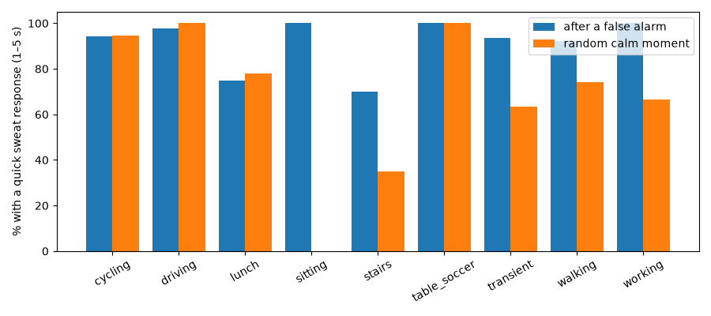

# A02 — Does skin sweat (EDA) react quickly after jolts and during stress? (ANALYSIS ONLY, PRELIMINARY)

EDA (skin conductance) is **not** part of the frozen sensor set; this is an optional-extra experiment. The definitions were fixed in `config/a02_eda.yaml` before any result. Nothing was adopted. All numbers come from `reports/A02_tables.md` and `results/2026-10-12_A02_eda/`, produced by `scripts/a02_eda.py`.
- **Part 1:** PPG-DaLiA, 10 **test** people; dev is in the tables.
- **Part 2:** WESAD, all 15 people.

## Plain-language summary
- **Data check:**
  - wrist EDA is sampled 4 times per second in both datasets, in microsiemens, with no gaps;
  - PPG-DaLiA has a few near-zero readings (poor skin contact): on average 0.08% of samples, up to 0.77% in one person;
  - WESAD has almost none.
- **In everyday life, the wrist "sweat signal" reacts almost all the time,** so a quick reaction after a jolt tells us little:
  - a quick sweat response (within 1–5 s) followed **93%** of false-alarm jolts, but also **72%** of random calm moments;
  - during cycling, driving and table soccer, the rate is about the same after jolts and at calm moments (94–100% for both);
  - the background rate is high: 39 responses per minute while cycling, 37 in table soccer, 33 driving, but only **3 per minute when sitting**.
- **Small differences:** stairs (70% after jolts vs 35% at calm moments), moving between activities (94% vs 63%) and walking (92% vs 74%).
- **During stress (WESAD), the sweat signal clearly changes:**

  | Condition | Responses per minute | Slow (tonic) level |
  |---|---|---|
  | Stress | **20.9** | 3.4 µS |
  | Calm baseline | 7.6 | 1.3 µS |
  | Amusement | 6.2 | |
  | Meditation | 4.4 | |

  - The difference holds for **all 15 people** (average effect size d = 2.8 ± 1.9).
- **Conclusion (descriptive, nothing adopted):**
  - A "quick sweat response after a jolt" could only be informative when the person is **calm or sitting**; there the background rate is low.
  - During exercise, driving and active daily life, the wrist sweat signal is too busy to help.
  - EDA does track **sustained stress** well in the lab. That fits a slower "is this person stressed?" signal better than a fast "was this jolt scary?" check.

## Limitations
- There are no real danger events. WESAD stress is a sustained lab task, not a single scare.
- The response threshold was fixed in advance (0.01 µS, Boucsein 2012). On wrist data during movement it counts very many small responses, which partly explains the high everyday rates. A stricter amplitude would give lower rates, but it was not tuned here.
- The slow/fast split uses a forward-only filter, so that "before" values never see the future. This differs from the usual two-way filters.
- Exercise sweating and wrist motion both affect EDA. Only a simple artefact rule (Kleckner et al. 2018) was used.
- Events and controls are those of A01, so the A01 control shortfall (399 of 561) carries over.

