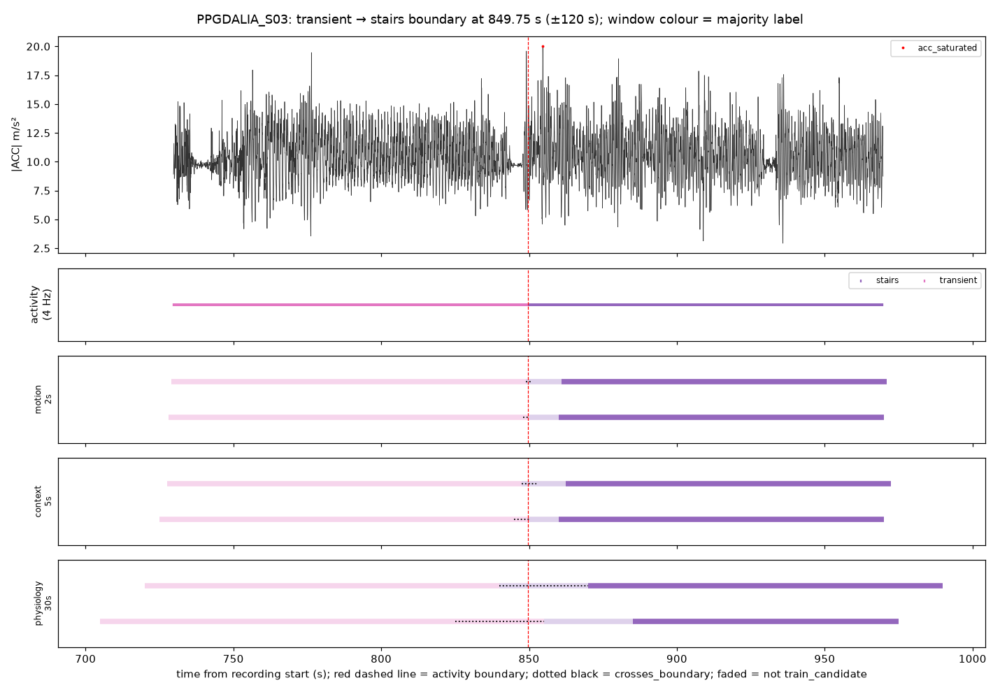

# D02 tables (windows smoke_v2) — auto-generated by scripts/d02_smoke_report.py

Inputs: `data/interim/ppg_dalia/normalized_signals_smoke_v1`, `data/interim/ppg_dalia/windows_smoke_v2`. Windowing config `config/windowing_v2.yaml`. Normalisation commit 1022b0a, windowing commit 4d89fee.

## 1. Invariant checks

179 of 179 checks passed.

| subject_id | check | passed |
|---|---|---|
| PPGDALIA_S03 | equal durations acc/bvp/activity {'acc': 8741.0, 'bvp': 8741.0, 'activity': 8741.0} | pass |
| PPGDALIA_S03 | hr_ref count 4367 == floor((D-8)/2)+1 = 4367 | pass |
| PPGDALIA_S03 | acc*64 integer-valued (max deviation 0.00e+00) | pass |
| PPGDALIA_S03 | acc counts within E4 range [-128, 127] (got -128..127) | pass |
| PPGDALIA_S03 | |acc| <= 19.6133 m/s^2 | pass |
| PPGDALIA_S03 | acc factor 9.80665 applied exactly | pass |
| PPGDALIA_S03 | wrist_acc: NaN count 0 == 0 | pass |
| PPGDALIA_S03 | wrist_bvp: NaN count 0 == 0 | pass |
| PPGDALIA_S03 | hr_ref: NaN count 0 == 0 | pass |
| PPGDALIA_S03 | every activity code maps to a label | pass |
| PPGDALIA_S03 | row counts equal raw sample counts | pass |
| PPGDALIA_S03 | label seconds in Layer A equal raw pkl label seconds | pass |
| PPGDALIA_S06 | equal durations acc/bvp/activity {'acc': 5250.0, 'bvp': 5250.0, 'activity': 5250.0} | pass |
| PPGDALIA_S06 | hr_ref count 2622 == floor((D-8)/2)+1 = 2622 | pass |
| PPGDALIA_S06 | acc*64 integer-valued (max deviation 0.00e+00) | pass |
| PPGDALIA_S06 | acc counts within E4 range [-128, 127] (got -128..127) | pass |
| PPGDALIA_S06 | |acc| <= 19.6133 m/s^2 | pass |
| PPGDALIA_S06 | acc factor 9.80665 applied exactly | pass |
| PPGDALIA_S06 | wrist_acc: NaN count 0 == 0 | pass |
| PPGDALIA_S06 | wrist_bvp: NaN count 0 == 0 | pass |
| PPGDALIA_S06 | hr_ref: NaN count 0 == 0 | pass |
| PPGDALIA_S06 | every activity code maps to a label | pass |
| PPGDALIA_S06 | row counts equal raw sample counts | pass |
| PPGDALIA_S06 | label seconds in Layer A equal raw pkl label seconds | pass |
| PPGDALIA_S06 | S6 duration 5250.0 == 5250 s (pkl valid only to 5250 s) | pass |
| PPGDALIA_S06 | S6 has no lunch/walking/working (found []) | pass |
| PPGDALIA_S03 | window count 8740 == floor((D-w)/step)+1 = 8740 | pass |
| PPGDALIA_S03 | acc: every window has exactly 64 samples (got [64]) | pass |
| PPGDALIA_S03 | bvp: every window has exactly 128 samples (got [128]) | pass |
| PPGDALIA_S03 | act: every window has exactly 8 samples (got [8]) | pass |
| PPGDALIA_S03 | no window extends past the recording end | pass |
| PPGDALIA_S03 | 0 <= start, end <= D | pass |
| PPGDALIA_S03 | window_id unique | pass |
| PPGDALIA_S03 | no window spans two subjects or recordings | pass |
| PPGDALIA_S03 | namespaced subject IDs valid | pass |
| PPGDALIA_S03 | purity in (0, 1] | pass |
| PPGDALIA_S03 | crosses_boundary <=> purity < 1 | pass |
| PPGDALIA_S03 | purity recomputed from activity samples matches | pass |
| PPGDALIA_S03 | arousal_class is null for every PPG-DaLiA window (decision B) | pass |
| PPGDALIA_S03 | motion_event_class normal_adl for every window (P3) | pass |
| PPGDALIA_S03 | seconds_to_nearest_boundary matches a brute-force recomputation | pass |
| PPGDALIA_S03 | boundary-crossing windows have distance 0 | pass |
| PPGDALIA_S03 | train_candidate only with seconds_to_nearest_boundary >= 10 s | pass |
| PPGDALIA_S03 | pure training-label windows within the margin are false_alert_eval (kept) | pass |
| PPGDALIA_S03 | train_candidate <=> training label & purity >= threshold & margin met | pass |
| PPGDALIA_S03 | train_candidate only for training labels with purity >= threshold | pass |
| PPGDALIA_S03 | no train_candidate with null/TODO context | pass |
| PPGDALIA_S03 | lunch/transient never train_candidate | pass |
| PPGDALIA_S03 | every window has an eval_role | pass |
| PPGDALIA_S03 | n_hr_ref / has_hr_ref match a brute-force count | pass |
| PPGDALIA_S03 | no missing ACC/BVP samples | pass |
| PPGDALIA_S03 | window count 3495 == floor((D-w)/step)+1 = 3495 | pass |
| PPGDALIA_S03 | acc: every window has exactly 160 samples (got [160]) | pass |
| PPGDALIA_S03 | bvp: every window has exactly 320 samples (got [320]) | pass |
| PPGDALIA_S03 | act: every window has exactly 20 samples (got [20]) | pass |
| PPGDALIA_S03 | window count 581 == floor((D-w)/step)+1 = 581 | pass |
| PPGDALIA_S03 | acc: every window has exactly 960 samples (got [960]) | pass |
| PPGDALIA_S03 | bvp: every window has exactly 1920 samples (got [1920]) | pass |
| PPGDALIA_S03 | act: every window has exactly 120 samples (got [120]) | pass |
| PPGDALIA_S06 | window count 5249 == floor((D-w)/step)+1 = 5249 | pass |
| PPGDALIA_S06 | acc: every window has exactly 64 samples (got [64]) | pass |
| PPGDALIA_S06 | bvp: every window has exactly 128 samples (got [128]) | pass |
| PPGDALIA_S06 | act: every window has exactly 8 samples (got [8]) | pass |
| PPGDALIA_S06 | no window extends past the recording end | pass |
| PPGDALIA_S06 | 0 <= start, end <= D | pass |
| PPGDALIA_S06 | window_id unique | pass |
| PPGDALIA_S06 | no window spans two subjects or recordings | pass |
| PPGDALIA_S06 | namespaced subject IDs valid | pass |
| PPGDALIA_S06 | purity in (0, 1] | pass |
| PPGDALIA_S06 | crosses_boundary <=> purity < 1 | pass |
| PPGDALIA_S06 | purity recomputed from activity samples matches | pass |
| PPGDALIA_S06 | arousal_class is null for every PPG-DaLiA window (decision B) | pass |
| PPGDALIA_S06 | motion_event_class normal_adl for every window (P3) | pass |
| PPGDALIA_S06 | seconds_to_nearest_boundary matches a brute-force recomputation | pass |
| PPGDALIA_S06 | boundary-crossing windows have distance 0 | pass |
| PPGDALIA_S06 | train_candidate only with seconds_to_nearest_boundary >= 10 s | pass |
| PPGDALIA_S06 | pure training-label windows within the margin are false_alert_eval (kept) | pass |
| PPGDALIA_S06 | train_candidate <=> training label & purity >= threshold & margin met | pass |
| PPGDALIA_S06 | train_candidate only for training labels with purity >= threshold | pass |
| PPGDALIA_S06 | no train_candidate with null/TODO context | pass |
| PPGDALIA_S06 | lunch/transient never train_candidate | pass |
| PPGDALIA_S06 | every window has an eval_role | pass |
| PPGDALIA_S06 | n_hr_ref / has_hr_ref match a brute-force count | pass |
| PPGDALIA_S06 | no missing ACC/BVP samples | pass |
| PPGDALIA_S06 | window count 2099 == floor((D-w)/step)+1 = 2099 | pass |
| PPGDALIA_S06 | acc: every window has exactly 160 samples (got [160]) | pass |
| PPGDALIA_S06 | bvp: every window has exactly 320 samples (got [320]) | pass |
| PPGDALIA_S06 | act: every window has exactly 20 samples (got [20]) | pass |
| PPGDALIA_S06 | window count 349 == floor((D-w)/step)+1 = 349 | pass |
| PPGDALIA_S06 | acc: every window has exactly 960 samples (got [960]) | pass |
| PPGDALIA_S06 | bvp: every window has exactly 1920 samples (got [1920]) | pass |
| PPGDALIA_S06 | act: every window has exactly 120 samples (got [120]) | pass |
| ALL | window_id unique across subjects | pass |

## 2. Recordings

| subject_id | duration_s | acc samples | bvp samples | activity samples | hr_ref values | expected hr_ref | acc_saturated (% samples) |
|---|---|---|---|---|---|---|---|
| PPGDALIA_S03 | 8741.0 | 279712 | 559424 | 34964 | 4367 | 4367 | 0.2878 |
| PPGDALIA_S06 | 5250.0 | 168000 | 336000 | 21000 | 2622 | 2622 | 0.378 |

## 3. Label seconds: Layer A vs D00a report table

Max abs difference: 0.0 s (D00a rounded to whole seconds).

| subject_id | label | Layer A (s) | D00a table (s) | abs diff (s) |
|---|---|---|---|---|
| PPGDALIA_S03 | transient | 2016.0 | 2016 | 0.0 |
| PPGDALIA_S03 | sitting | 600.0 | 600 | 0.0 |
| PPGDALIA_S03 | stairs | 435.0 | 435 | 0.0 |
| PPGDALIA_S03 | table_soccer | 293.0 | 293 | 0.0 |
| PPGDALIA_S03 | cycling | 379.0 | 379 | 0.0 |
| PPGDALIA_S03 | driving | 910.0 | 910 | 0.0 |
| PPGDALIA_S03 | lunch | 2160.0 | 2160 | 0.0 |
| PPGDALIA_S03 | walking | 738.0 | 738 | 0.0 |
| PPGDALIA_S03 | working | 1210.0 | 1210 | 0.0 |
| PPGDALIA_S06 | transient | 2297.0 | 2297 | 0.0 |
| PPGDALIA_S06 | sitting | 633.0 | 633 | 0.0 |
| PPGDALIA_S06 | stairs | 430.0 | 430 | 0.0 |
| PPGDALIA_S06 | table_soccer | 309.0 | 309 | 0.0 |
| PPGDALIA_S06 | cycling | 533.0 | 533 | 0.0 |
| PPGDALIA_S06 | driving | 1048.0 | 1048 | 0.0 |
| PPGDALIA_S06 | lunch | 0.0 | 0 | 0.0 |
| PPGDALIA_S06 | walking | 0.0 | 0 | 0.0 |
| PPGDALIA_S06 | working | 0.0 | 0 | 0.0 |

## 4. Window counts (expected = floor((D − w)/step) + 1)

| subject_id | window | n | expected | crosses_boundary (%) | min purity | has_hr_ref (%) |
|---|---|---|---|---|---|---|
| PPGDALIA_S03 | motion_2s | 8740 | 8740 | 0.35 | 0.5 | 0.0 |
| PPGDALIA_S03 | context_5s | 3495 | 3495 | 0.86 | 0.55 | 0.0 |
| PPGDALIA_S03 | physiology_30s | 581 | 581 | 5.16 | 0.525 | 100.0 |
| PPGDALIA_S06 | motion_2s | 5249 | 5249 | 0.38 | 0.625 | 0.0 |
| PPGDALIA_S06 | context_5s | 2099 | 2099 | 0.95 | 0.55 | 0.0 |
| PPGDALIA_S06 | physiology_30s | 349 | 349 | 5.73 | 0.508 | 100.0 |

## 5. Windows per eval_role

**motion_2s**

| subject_id | false_alert_eval | false_alert_eval_only | train_candidate |
|---|---|---|---|
| PPGDALIA_S03 | 4315 | 14 | 4411 |
| PPGDALIA_S06 | 2396 | 10 | 2843 |

**context_5s**

| subject_id | false_alert_eval | false_alert_eval_only | train_candidate |
|---|---|---|---|
| PPGDALIA_S03 | 1724 | 14 | 1757 |
| PPGDALIA_S06 | 957 | 10 | 1132 |

**physiology_30s**

| subject_id | false_alert_eval | false_alert_eval_only | train_candidate |
|---|---|---|---|
| PPGDALIA_S03 | 286 | 14 | 281 |
| PPGDALIA_S06 | 158 | 10 | 181 |

## 5b. eval_role per subject and activity (majority label)

tc = train_candidate, fae = false_alert_eval, fae_only = false_alert_eval_only.

**motion_2s**

| subject_id | original_label | tc | fae | fae_only | total |
|---|---|---|---|---|---|
| PPGDALIA_S03 | cycling | 357 | 20 | 2 | 379 |
| PPGDALIA_S03 | driving | 888 | 20 | 2 | 910 |
| PPGDALIA_S03 | lunch | 0 | 2160 | 0 | 2160 |
| PPGDALIA_S03 | sitting | 578 | 20 | 2 | 600 |
| PPGDALIA_S03 | stairs | 413 | 20 | 2 | 435 |
| PPGDALIA_S03 | table_soccer | 271 | 20 | 2 | 293 |
| PPGDALIA_S03 | transient | 0 | 2015 | 0 | 2015 |
| PPGDALIA_S03 | walking | 716 | 20 | 2 | 738 |
| PPGDALIA_S03 | working | 1188 | 20 | 2 | 1210 |
| PPGDALIA_S06 | cycling | 511 | 20 | 2 | 533 |
| PPGDALIA_S06 | driving | 1026 | 20 | 2 | 1048 |
| PPGDALIA_S06 | sitting | 611 | 20 | 2 | 633 |
| PPGDALIA_S06 | stairs | 408 | 20 | 2 | 430 |
| PPGDALIA_S06 | table_soccer | 287 | 20 | 2 | 309 |
| PPGDALIA_S06 | transient | 0 | 2296 | 0 | 2296 |

**motion_2s: all subjects**

| original_label | tc | fae | fae_only | total |
|---|---|---|---|---|
| cycling | 868 | 40 | 4 | 912 |
| driving | 1914 | 40 | 4 | 1958 |
| lunch | 0 | 2160 | 0 | 2160 |
| sitting | 1189 | 40 | 4 | 1233 |
| stairs | 821 | 40 | 4 | 865 |
| table_soccer | 558 | 40 | 4 | 602 |
| transient | 0 | 4311 | 0 | 4311 |
| walking | 716 | 20 | 2 | 738 |
| working | 1188 | 20 | 2 | 1210 |

**context_5s**

| subject_id | original_label | tc | fae | fae_only | total |
|---|---|---|---|---|---|
| PPGDALIA_S03 | cycling | 142 | 8 | 2 | 152 |
| PPGDALIA_S03 | driving | 354 | 8 | 2 | 364 |
| PPGDALIA_S03 | lunch | 0 | 864 | 0 | 864 |
| PPGDALIA_S03 | sitting | 230 | 8 | 2 | 240 |
| PPGDALIA_S03 | stairs | 164 | 8 | 2 | 174 |
| PPGDALIA_S03 | table_soccer | 107 | 8 | 2 | 117 |
| PPGDALIA_S03 | transient | 0 | 804 | 0 | 804 |
| PPGDALIA_S03 | walking | 286 | 8 | 2 | 296 |
| PPGDALIA_S03 | working | 474 | 8 | 2 | 484 |
| PPGDALIA_S06 | cycling | 203 | 8 | 2 | 213 |
| PPGDALIA_S06 | driving | 409 | 8 | 2 | 419 |
| PPGDALIA_S06 | sitting | 244 | 8 | 2 | 254 |
| PPGDALIA_S06 | stairs | 162 | 8 | 2 | 172 |
| PPGDALIA_S06 | table_soccer | 114 | 8 | 2 | 124 |
| PPGDALIA_S06 | transient | 0 | 917 | 0 | 917 |

**context_5s: all subjects**

| original_label | tc | fae | fae_only | total |
|---|---|---|---|---|
| cycling | 345 | 16 | 4 | 365 |
| driving | 763 | 16 | 4 | 783 |
| lunch | 0 | 864 | 0 | 864 |
| sitting | 474 | 16 | 4 | 494 |
| stairs | 326 | 16 | 4 | 346 |
| table_soccer | 221 | 16 | 4 | 241 |
| transient | 0 | 1721 | 0 | 1721 |
| walking | 286 | 8 | 2 | 296 |
| working | 474 | 8 | 2 | 484 |

**physiology_30s**

| subject_id | original_label | tc | fae | fae_only | total |
|---|---|---|---|---|---|
| PPGDALIA_S03 | cycling | 22 | 2 | 2 | 26 |
| PPGDALIA_S03 | driving | 57 | 2 | 2 | 61 |
| PPGDALIA_S03 | lunch | 0 | 144 | 0 | 144 |
| PPGDALIA_S03 | sitting | 37 | 1 | 2 | 40 |
| PPGDALIA_S03 | stairs | 25 | 2 | 2 | 29 |
| PPGDALIA_S03 | table_soccer | 17 | 0 | 2 | 19 |
| PPGDALIA_S03 | transient | 0 | 132 | 0 | 132 |
| PPGDALIA_S03 | walking | 46 | 1 | 2 | 49 |
| PPGDALIA_S03 | working | 77 | 2 | 2 | 81 |
| PPGDALIA_S06 | cycling | 32 | 2 | 2 | 36 |
| PPGDALIA_S06 | driving | 67 | 0 | 2 | 69 |
| PPGDALIA_S06 | sitting | 39 | 1 | 2 | 42 |
| PPGDALIA_S06 | stairs | 25 | 2 | 2 | 29 |
| PPGDALIA_S06 | table_soccer | 18 | 0 | 2 | 20 |
| PPGDALIA_S06 | transient | 0 | 153 | 0 | 153 |

**physiology_30s: all subjects**

| original_label | tc | fae | fae_only | total |
|---|---|---|---|---|
| cycling | 54 | 4 | 4 | 62 |
| driving | 124 | 2 | 4 | 130 |
| lunch | 0 | 144 | 0 | 144 |
| sitting | 76 | 2 | 4 | 82 |
| stairs | 50 | 4 | 4 | 58 |
| table_soccer | 35 | 0 | 4 | 39 |
| transient | 0 | 285 | 0 | 285 |
| walking | 46 | 1 | 2 | 49 |
| working | 77 | 2 | 2 | 81 |

## 5c. Effect of the 10 s boundary margin

Pure (purity 1.0) training-label windows, and how many the margin moved to false_alert_eval.

| subject_id | window | pure training windows | moved by margin | moved (%) |
|---|---|---|---|---|
| PPGDALIA_S03 | motion_2s | 4551 | 140 | 3.08 |
| PPGDALIA_S06 | motion_2s | 2943 | 100 | 3.4 |
| PPGDALIA_S03 | context_5s | 1813 | 56 | 3.09 |
| PPGDALIA_S06 | context_5s | 1172 | 40 | 3.41 |
| PPGDALIA_S03 | physiology_30s | 291 | 10 | 3.44 |
| PPGDALIA_S06 | physiology_30s | 186 | 5 | 2.69 |

**All subjects**

| window | pure training windows | moved by margin | moved (%) |
|---|---|---|---|
| context_5s | 2985 | 96 | 3.22 |
| motion_2s | 7494 | 240 | 3.2 |
| physiology_30s | 477 | 15 | 3.14 |

## 6. Windows per majority label (per subject)

**motion_2s**

| subject_id | cycling | driving | lunch | sitting | stairs | table_soccer | transient | walking | working |
|---|---|---|---|---|---|---|---|---|---|
| PPGDALIA_S03 | 379 | 910 | 2160 | 600 | 435 | 293 | 2015 | 738 | 1210 |
| PPGDALIA_S06 | 533 | 1048 | 0 | 633 | 430 | 309 | 2296 | 0 | 0 |

**context_5s**

| subject_id | cycling | driving | lunch | sitting | stairs | table_soccer | transient | walking | working |
|---|---|---|---|---|---|---|---|---|---|
| PPGDALIA_S03 | 152 | 364 | 864 | 240 | 174 | 117 | 804 | 296 | 484 |
| PPGDALIA_S06 | 213 | 419 | 0 | 254 | 172 | 124 | 917 | 0 | 0 |

**physiology_30s**

| subject_id | cycling | driving | lunch | sitting | stairs | table_soccer | transient | walking | working |
|---|---|---|---|---|---|---|---|---|---|
| PPGDALIA_S03 | 26 | 61 | 144 | 40 | 29 | 19 | 132 | 49 | 81 |
| PPGDALIA_S06 | 36 | 69 | 0 | 42 | 29 | 20 | 153 | 0 | 0 |

## 7. Saturation summary (fraction of ACC samples at the E4 rail)

| subject_id | label | acc samples | saturated (%) |
|---|---|---|---|
| PPGDALIA_S03 | cycling | 12128 | 4.576 |
| PPGDALIA_S03 | driving | 29120 | 0.007 |
| PPGDALIA_S03 | lunch | 69120 | 0.013 |
| PPGDALIA_S03 | sitting | 19200 | 0.0 |
| PPGDALIA_S03 | stairs | 13920 | 0.496 |
| PPGDALIA_S03 | table_soccer | 9376 | 0.192 |
| PPGDALIA_S03 | transient | 64512 | 0.144 |
| PPGDALIA_S03 | walking | 23616 | 0.165 |
| PPGDALIA_S03 | working | 38720 | 0.052 |
| PPGDALIA_S06 | cycling | 17056 | 0.651 |
| PPGDALIA_S06 | driving | 33536 | 0.107 |
| PPGDALIA_S06 | sitting | 20256 | 0.0 |
| PPGDALIA_S06 | stairs | 13760 | 0.007 |
| PPGDALIA_S06 | table_soccer | 9888 | 2.478 |
| PPGDALIA_S06 | transient | 73504 | 0.329 |

Same, as subject × activity (% saturated samples; blank = activity absent):

| subject_id | cycling | driving | lunch | sitting | stairs | table_soccer | transient | walking | working |
|---|---|---|---|---|---|---|---|---|---|
| PPGDALIA_S03 | 4.576 | 0.007 | 0.013 | 0.0 | 0.496 | 0.192 | 0.144 | 0.165 | 0.052 |
| PPGDALIA_S06 | 0.651 | 0.107 |  | 0.0 | 0.007 | 2.478 | 0.329 |  |  |

Motion 2 s windows containing ≥1 saturated sample (%):

| subject_id | windows_with_any | max_frac |
|---|---|---|
| PPGDALIA_S03 | 4.97 | 0.640625 |
| PPGDALIA_S06 | 9.14 | 0.25 |

## 8. Boundary views (user request C)

Boundary = first onset of `stairs`; plot spans ±120 s; tables list windows overlapping ±10 s (motion, context) or ±30 s (physiology) of the boundary.

### PPGDALIA_S03: transient → stairs at 849.75 s

**motion_2s**

| window_id | window_start | window_end | original_label | label_purity | crosses_boundary | seconds_to_nearest_boundary | context_class | eval_role | acc_saturated_frac |
|---|---|---|---|---|---|---|---|---|---|
| PPGDALIA_S03_mot2_000838 | 838.000 | 840.000 | transient | 1.000 | False | 9.750 | None | false_alert_eval | 0.000 |
| PPGDALIA_S03_mot2_000839 | 839.000 | 841.000 | transient | 1.000 | False | 8.750 | None | false_alert_eval | 0.000 |
| PPGDALIA_S03_mot2_000840 | 840.000 | 842.000 | transient | 1.000 | False | 7.750 | None | false_alert_eval | 0.000 |
| PPGDALIA_S03_mot2_000841 | 841.000 | 843.000 | transient | 1.000 | False | 6.750 | None | false_alert_eval | 0.000 |
| PPGDALIA_S03_mot2_000842 | 842.000 | 844.000 | transient | 1.000 | False | 5.750 | None | false_alert_eval | 0.000 |
| PPGDALIA_S03_mot2_000843 | 843.000 | 845.000 | transient | 1.000 | False | 4.750 | None | false_alert_eval | 0.000 |
| PPGDALIA_S03_mot2_000844 | 844.000 | 846.000 | transient | 1.000 | False | 3.750 | None | false_alert_eval | 0.000 |
| PPGDALIA_S03_mot2_000845 | 845.000 | 847.000 | transient | 1.000 | False | 2.750 | None | false_alert_eval | 0.000 |
| PPGDALIA_S03_mot2_000846 | 846.000 | 848.000 | transient | 1.000 | False | 1.750 | None | false_alert_eval | 0.000 |
| PPGDALIA_S03_mot2_000847 | 847.000 | 849.000 | transient | 1.000 | False | 0.750 | None | false_alert_eval | 0.000 |
| PPGDALIA_S03_mot2_000848 | 848.000 | 850.000 | transient | 0.875 | True | 0.000 | None | false_alert_eval | 0.000 |
| PPGDALIA_S03_mot2_000849 | 849.000 | 851.000 | stairs | 0.625 | True | 0.000 | vigorous_activity | false_alert_eval_only | 0.000 |
| PPGDALIA_S03_mot2_000850 | 850.000 | 852.000 | stairs | 1.000 | False | 0.250 | vigorous_activity | false_alert_eval | 0.000 |
| PPGDALIA_S03_mot2_000851 | 851.000 | 853.000 | stairs | 1.000 | False | 1.250 | vigorous_activity | false_alert_eval | 0.000 |
| PPGDALIA_S03_mot2_000852 | 852.000 | 854.000 | stairs | 1.000 | False | 2.250 | vigorous_activity | false_alert_eval | 0.000 |
| PPGDALIA_S03_mot2_000853 | 853.000 | 855.000 | stairs | 1.000 | False | 3.250 | vigorous_activity | false_alert_eval | 0.016 |
| PPGDALIA_S03_mot2_000854 | 854.000 | 856.000 | stairs | 1.000 | False | 4.250 | vigorous_activity | false_alert_eval | 0.016 |
| PPGDALIA_S03_mot2_000855 | 855.000 | 857.000 | stairs | 1.000 | False | 5.250 | vigorous_activity | false_alert_eval | 0.000 |
| PPGDALIA_S03_mot2_000856 | 856.000 | 858.000 | stairs | 1.000 | False | 6.250 | vigorous_activity | false_alert_eval | 0.000 |
| PPGDALIA_S03_mot2_000857 | 857.000 | 859.000 | stairs | 1.000 | False | 7.250 | vigorous_activity | false_alert_eval | 0.000 |
| PPGDALIA_S03_mot2_000858 | 858.000 | 860.000 | stairs | 1.000 | False | 8.250 | vigorous_activity | false_alert_eval | 0.000 |
| PPGDALIA_S03_mot2_000859 | 859.000 | 861.000 | stairs | 1.000 | False | 9.250 | vigorous_activity | false_alert_eval | 0.000 |

**context_5s**

| window_id | window_start | window_end | original_label | label_purity | crosses_boundary | seconds_to_nearest_boundary | context_class | eval_role | acc_saturated_frac |
|---|---|---|---|---|---|---|---|---|---|
| PPGDALIA_S03_ctx5_000334 | 835.000 | 840.000 | transient | 1.000 | False | 9.750 | None | false_alert_eval | 0.000 |
| PPGDALIA_S03_ctx5_000335 | 837.500 | 842.500 | transient | 1.000 | False | 7.250 | None | false_alert_eval | 0.000 |
| PPGDALIA_S03_ctx5_000336 | 840.000 | 845.000 | transient | 1.000 | False | 4.750 | None | false_alert_eval | 0.000 |
| PPGDALIA_S03_ctx5_000337 | 842.500 | 847.500 | transient | 1.000 | False | 2.250 | None | false_alert_eval | 0.000 |
| PPGDALIA_S03_ctx5_000338 | 845.000 | 850.000 | transient | 0.950 | True | 0.000 | None | false_alert_eval | 0.000 |
| PPGDALIA_S03_ctx5_000339 | 847.500 | 852.500 | stairs | 0.550 | True | 0.000 | vigorous_activity | false_alert_eval_only | 0.000 |
| PPGDALIA_S03_ctx5_000340 | 850.000 | 855.000 | stairs | 1.000 | False | 0.250 | vigorous_activity | false_alert_eval | 0.006 |
| PPGDALIA_S03_ctx5_000341 | 852.500 | 857.500 | stairs | 1.000 | False | 2.750 | vigorous_activity | false_alert_eval | 0.006 |
| PPGDALIA_S03_ctx5_000342 | 855.000 | 860.000 | stairs | 1.000 | False | 5.250 | vigorous_activity | false_alert_eval | 0.000 |
| PPGDALIA_S03_ctx5_000343 | 857.500 | 862.500 | stairs | 1.000 | False | 7.750 | vigorous_activity | false_alert_eval | 0.000 |

**physiology_30s**

| window_id | window_start | window_end | original_label | label_purity | crosses_boundary | seconds_to_nearest_boundary | context_class | eval_role | acc_saturated_frac |
|---|---|---|---|---|---|---|---|---|---|
| PPGDALIA_S03_phy30_000053 | 795.000 | 825.000 | transient | 1.000 | False | 24.750 | None | false_alert_eval | 0.000 |
| PPGDALIA_S03_phy30_000054 | 810.000 | 840.000 | transient | 1.000 | False | 9.750 | None | false_alert_eval | 0.000 |
| PPGDALIA_S03_phy30_000055 | 825.000 | 855.000 | transient | 0.825 | True | 0.000 | None | false_alert_eval | 0.001 |
| PPGDALIA_S03_phy30_000056 | 840.000 | 870.000 | stairs | 0.675 | True | 0.000 | vigorous_activity | false_alert_eval_only | 0.001 |
| PPGDALIA_S03_phy30_000057 | 855.000 | 885.000 | stairs | 1.000 | False | 5.250 | vigorous_activity | false_alert_eval | 0.000 |
| PPGDALIA_S03_phy30_000058 | 870.000 | 900.000 | stairs | 1.000 | False | 20.250 | vigorous_activity | train_candidate | 0.000 |

### PPGDALIA_S06: transient → stairs at 922.25 s

**motion_2s**

| window_id | window_start | window_end | original_label | label_purity | crosses_boundary | seconds_to_nearest_boundary | context_class | eval_role | acc_saturated_frac |
|---|---|---|---|---|---|---|---|---|---|
| PPGDALIA_S06_mot2_000911 | 911.000 | 913.000 | transient | 1.000 | False | 9.250 | None | false_alert_eval | 0.000 |
| PPGDALIA_S06_mot2_000912 | 912.000 | 914.000 | transient | 1.000 | False | 8.250 | None | false_alert_eval | 0.000 |
| PPGDALIA_S06_mot2_000913 | 913.000 | 915.000 | transient | 1.000 | False | 7.250 | None | false_alert_eval | 0.000 |
| PPGDALIA_S06_mot2_000914 | 914.000 | 916.000 | transient | 1.000 | False | 6.250 | None | false_alert_eval | 0.000 |
| PPGDALIA_S06_mot2_000915 | 915.000 | 917.000 | transient | 1.000 | False | 5.250 | None | false_alert_eval | 0.000 |
| PPGDALIA_S06_mot2_000916 | 916.000 | 918.000 | transient | 1.000 | False | 4.250 | None | false_alert_eval | 0.000 |
| PPGDALIA_S06_mot2_000917 | 917.000 | 919.000 | transient | 1.000 | False | 3.250 | None | false_alert_eval | 0.000 |
| PPGDALIA_S06_mot2_000918 | 918.000 | 920.000 | transient | 1.000 | False | 2.250 | None | false_alert_eval | 0.000 |
| PPGDALIA_S06_mot2_000919 | 919.000 | 921.000 | transient | 1.000 | False | 1.250 | None | false_alert_eval | 0.000 |
| PPGDALIA_S06_mot2_000920 | 920.000 | 922.000 | transient | 1.000 | False | 0.250 | None | false_alert_eval | 0.000 |
| PPGDALIA_S06_mot2_000921 | 921.000 | 923.000 | transient | 0.625 | True | 0.000 | None | false_alert_eval | 0.000 |
| PPGDALIA_S06_mot2_000922 | 922.000 | 924.000 | stairs | 0.875 | True | 0.000 | vigorous_activity | false_alert_eval_only | 0.000 |
| PPGDALIA_S06_mot2_000923 | 923.000 | 925.000 | stairs | 1.000 | False | 0.750 | vigorous_activity | false_alert_eval | 0.000 |
| PPGDALIA_S06_mot2_000924 | 924.000 | 926.000 | stairs | 1.000 | False | 1.750 | vigorous_activity | false_alert_eval | 0.000 |
| PPGDALIA_S06_mot2_000925 | 925.000 | 927.000 | stairs | 1.000 | False | 2.750 | vigorous_activity | false_alert_eval | 0.000 |
| PPGDALIA_S06_mot2_000926 | 926.000 | 928.000 | stairs | 1.000 | False | 3.750 | vigorous_activity | false_alert_eval | 0.000 |
| PPGDALIA_S06_mot2_000927 | 927.000 | 929.000 | stairs | 1.000 | False | 4.750 | vigorous_activity | false_alert_eval | 0.000 |
| PPGDALIA_S06_mot2_000928 | 928.000 | 930.000 | stairs | 1.000 | False | 5.750 | vigorous_activity | false_alert_eval | 0.000 |
| PPGDALIA_S06_mot2_000929 | 929.000 | 931.000 | stairs | 1.000 | False | 6.750 | vigorous_activity | false_alert_eval | 0.000 |
| PPGDALIA_S06_mot2_000930 | 930.000 | 932.000 | stairs | 1.000 | False | 7.750 | vigorous_activity | false_alert_eval | 0.000 |
| PPGDALIA_S06_mot2_000931 | 931.000 | 933.000 | stairs | 1.000 | False | 8.750 | vigorous_activity | false_alert_eval | 0.000 |
| PPGDALIA_S06_mot2_000932 | 932.000 | 934.000 | stairs | 1.000 | False | 9.750 | vigorous_activity | false_alert_eval | 0.000 |

**context_5s**

| window_id | window_start | window_end | original_label | label_purity | crosses_boundary | seconds_to_nearest_boundary | context_class | eval_role | acc_saturated_frac |
|---|---|---|---|---|---|---|---|---|---|
| PPGDALIA_S06_ctx5_000363 | 907.500 | 912.500 | transient | 1.000 | False | 9.750 | None | false_alert_eval | 0.000 |
| PPGDALIA_S06_ctx5_000364 | 910.000 | 915.000 | transient | 1.000 | False | 7.250 | None | false_alert_eval | 0.000 |
| PPGDALIA_S06_ctx5_000365 | 912.500 | 917.500 | transient | 1.000 | False | 4.750 | None | false_alert_eval | 0.000 |
| PPGDALIA_S06_ctx5_000366 | 915.000 | 920.000 | transient | 1.000 | False | 2.250 | None | false_alert_eval | 0.000 |
| PPGDALIA_S06_ctx5_000367 | 917.500 | 922.500 | transient | 0.950 | True | 0.000 | None | false_alert_eval | 0.000 |
| PPGDALIA_S06_ctx5_000368 | 920.000 | 925.000 | stairs | 0.550 | True | 0.000 | vigorous_activity | false_alert_eval_only | 0.000 |
| PPGDALIA_S06_ctx5_000369 | 922.500 | 927.500 | stairs | 1.000 | False | 0.250 | vigorous_activity | false_alert_eval | 0.000 |
| PPGDALIA_S06_ctx5_000370 | 925.000 | 930.000 | stairs | 1.000 | False | 2.750 | vigorous_activity | false_alert_eval | 0.000 |
| PPGDALIA_S06_ctx5_000371 | 927.500 | 932.500 | stairs | 1.000 | False | 5.250 | vigorous_activity | false_alert_eval | 0.000 |
| PPGDALIA_S06_ctx5_000372 | 930.000 | 935.000 | stairs | 1.000 | False | 7.750 | vigorous_activity | false_alert_eval | 0.000 |

**physiology_30s**

| window_id | window_start | window_end | original_label | label_purity | crosses_boundary | seconds_to_nearest_boundary | context_class | eval_role | acc_saturated_frac |
|---|---|---|---|---|---|---|---|---|---|
| PPGDALIA_S06_phy30_000058 | 870.000 | 900.000 | transient | 1.000 | False | 22.250 | None | false_alert_eval | 0.000 |
| PPGDALIA_S06_phy30_000059 | 885.000 | 915.000 | transient | 1.000 | False | 7.250 | None | false_alert_eval | 0.000 |
| PPGDALIA_S06_phy30_000060 | 900.000 | 930.000 | transient | 0.742 | True | 0.000 | None | false_alert_eval | 0.000 |
| PPGDALIA_S06_phy30_000061 | 915.000 | 945.000 | stairs | 0.758 | True | 0.000 | vigorous_activity | false_alert_eval_only | 0.000 |
| PPGDALIA_S06_phy30_000062 | 930.000 | 960.000 | stairs | 1.000 | False | 7.750 | vigorous_activity | false_alert_eval | 0.000 |
| PPGDALIA_S06_phy30_000063 | 945.000 | 975.000 | stairs | 1.000 | False | 22.750 | vigorous_activity | train_candidate | 0.000 |

## 9. Determinism (independent re-run compared table by table)

| file | result |
|---|---|
| PPGDALIA_S03/activity.parquet | identical |
| PPGDALIA_S03/hr_ref.parquet | identical |
| PPGDALIA_S03/wrist_acc.parquet | identical |
| PPGDALIA_S03/wrist_bvp.parquet | identical |
| PPGDALIA_S06/activity.parquet | identical |
| PPGDALIA_S06/hr_ref.parquet | identical |
| PPGDALIA_S06/wrist_acc.parquet | identical |
| PPGDALIA_S06/wrist_bvp.parquet | identical |
| context_5s.parquet | identical |
| motion_2s.parquet | identical |
| physiology_30s.parquet | identical |
| window_counts_by_label_role.csv | identical |

metadata/ppg_dalia_subjects_smoke_v1.csv: identical
