# D02 tables (windows v1) — auto-generated by scripts/d02_smoke_report.py

Inputs: `data/interim/ppg_dalia/normalized_signals_v1`, `data/interim/ppg_dalia/windows_v1`. Windowing config `config/windowing_v2.yaml`. Normalisation commit 4d89fee, windowing commit 4d89fee.

## 1. Invariant checks

1310 of 1310 checks passed.

| subject_id | check | passed |
|---|---|---|
| PPGDALIA_S01 | equal durations acc/bvp/activity {'acc': 9212.0, 'bvp': 9212.0, 'activity': 9212.0} | pass |
| PPGDALIA_S01 | hr_ref count 4603 == floor((D-8)/2)+1 = 4603 | pass |
| PPGDALIA_S01 | acc*64 integer-valued (max deviation 0.00e+00) | pass |
| PPGDALIA_S01 | acc counts within E4 range [-128, 127] (got -128..127) | pass |
| PPGDALIA_S01 | |acc| <= 19.6133 m/s^2 | pass |
| PPGDALIA_S01 | acc factor 9.80665 applied exactly | pass |
| PPGDALIA_S01 | wrist_acc: NaN count 0 == 0 | pass |
| PPGDALIA_S01 | wrist_bvp: NaN count 0 == 0 | pass |
| PPGDALIA_S01 | hr_ref: NaN count 0 == 0 | pass |
| PPGDALIA_S01 | every activity code maps to a label | pass |
| PPGDALIA_S01 | row counts equal raw sample counts | pass |
| PPGDALIA_S01 | label seconds in Layer A equal raw pkl label seconds | pass |
| PPGDALIA_S02 | equal durations acc/bvp/activity {'acc': 8205.0, 'bvp': 8205.0, 'activity': 8205.0} | pass |
| PPGDALIA_S02 | hr_ref count 4099 == floor((D-8)/2)+1 = 4099 | pass |
| PPGDALIA_S02 | acc*64 integer-valued (max deviation 0.00e+00) | pass |
| PPGDALIA_S02 | acc counts within E4 range [-128, 127] (got -128..127) | pass |
| PPGDALIA_S02 | |acc| <= 19.6133 m/s^2 | pass |
| PPGDALIA_S02 | acc factor 9.80665 applied exactly | pass |
| PPGDALIA_S02 | wrist_acc: NaN count 0 == 0 | pass |
| PPGDALIA_S02 | wrist_bvp: NaN count 0 == 0 | pass |
| PPGDALIA_S02 | hr_ref: NaN count 0 == 0 | pass |
| PPGDALIA_S02 | every activity code maps to a label | pass |
| PPGDALIA_S02 | row counts equal raw sample counts | pass |
| PPGDALIA_S02 | label seconds in Layer A equal raw pkl label seconds | pass |
| PPGDALIA_S03 | equal durations acc/bvp/activity {'acc': 8741.0, 'bvp': 8741.0, 'activity': 8741.0} | pass |
| PPGDALIA_S03 | hr_ref count 4367 == floor((D-8)/2)+1 = 4367 | pass |
| PPGDALIA_S03 | acc*64 integer-valued (max deviation 0.00e+00) | pass |
| PPGDALIA_S03 | acc counts within E4 range [-128, 127] (got -128..127) | pass |
| PPGDALIA_S03 | |acc| <= 19.6133 m/s^2 | pass |
| PPGDALIA_S03 | acc factor 9.80665 applied exactly | pass |
| PPGDALIA_S03 | wrist_acc: NaN count 0 == 0 | pass |
| PPGDALIA_S03 | wrist_bvp: NaN count 0 == 0 | pass |
| PPGDALIA_S03 | hr_ref: NaN count 0 == 0 | pass |
| PPGDALIA_S03 | every activity code maps to a label | pass |
| PPGDALIA_S03 | row counts equal raw sample counts | pass |
| PPGDALIA_S03 | label seconds in Layer A equal raw pkl label seconds | pass |
| PPGDALIA_S04 | equal durations acc/bvp/activity {'acc': 9150.0, 'bvp': 9150.0, 'activity': 9150.0} | pass |
| PPGDALIA_S04 | hr_ref count 4572 == floor((D-8)/2)+1 = 4572 | pass |
| PPGDALIA_S04 | acc*64 integer-valued (max deviation 0.00e+00) | pass |
| PPGDALIA_S04 | acc counts within E4 range [-128, 127] (got -128..127) | pass |
| PPGDALIA_S04 | |acc| <= 19.6133 m/s^2 | pass |
| PPGDALIA_S04 | acc factor 9.80665 applied exactly | pass |
| PPGDALIA_S04 | wrist_acc: NaN count 0 == 0 | pass |
| PPGDALIA_S04 | wrist_bvp: NaN count 0 == 0 | pass |
| PPGDALIA_S04 | hr_ref: NaN count 0 == 0 | pass |
| PPGDALIA_S04 | every activity code maps to a label | pass |
| PPGDALIA_S04 | row counts equal raw sample counts | pass |
| PPGDALIA_S04 | label seconds in Layer A equal raw pkl label seconds | pass |
| PPGDALIA_S05 | equal durations acc/bvp/activity {'acc': 9305.0, 'bvp': 9305.0, 'activity': 9305.0} | pass |
| PPGDALIA_S05 | hr_ref count 4649 == floor((D-8)/2)+1 = 4649 | pass |
| PPGDALIA_S05 | acc*64 integer-valued (max deviation 0.00e+00) | pass |
| PPGDALIA_S05 | acc counts within E4 range [-128, 127] (got -128..127) | pass |
| PPGDALIA_S05 | |acc| <= 19.6133 m/s^2 | pass |
| PPGDALIA_S05 | acc factor 9.80665 applied exactly | pass |
| PPGDALIA_S05 | wrist_acc: NaN count 0 == 0 | pass |
| PPGDALIA_S05 | wrist_bvp: NaN count 0 == 0 | pass |
| PPGDALIA_S05 | hr_ref: NaN count 0 == 0 | pass |
| PPGDALIA_S05 | every activity code maps to a label | pass |
| PPGDALIA_S05 | row counts equal raw sample counts | pass |
| PPGDALIA_S05 | label seconds in Layer A equal raw pkl label seconds | pass |
| PPGDALIA_S06 | equal durations acc/bvp/activity {'acc': 5250.0, 'bvp': 5250.0, 'activity': 5250.0} | pass |
| PPGDALIA_S06 | hr_ref count 2622 == floor((D-8)/2)+1 = 2622 | pass |
| PPGDALIA_S06 | acc*64 integer-valued (max deviation 0.00e+00) | pass |
| PPGDALIA_S06 | acc counts within E4 range [-128, 127] (got -128..127) | pass |
| PPGDALIA_S06 | |acc| <= 19.6133 m/s^2 | pass |
| PPGDALIA_S06 | acc factor 9.80665 applied exactly | pass |
| PPGDALIA_S06 | wrist_acc: NaN count 0 == 0 | pass |
| PPGDALIA_S06 | wrist_bvp: NaN count 0 == 0 | pass |
| PPGDALIA_S06 | hr_ref: NaN count 0 == 0 | pass |
| PPGDALIA_S06 | every activity code maps to a label | pass |
| PPGDALIA_S06 | row counts equal raw sample counts | pass |
| PPGDALIA_S06 | label seconds in Layer A equal raw pkl label seconds | pass |
| PPGDALIA_S06 | S6 duration 5250.0 == 5250 s (pkl valid only to 5250 s) | pass |
| PPGDALIA_S06 | S6 has no lunch/walking/working (found []) | pass |
| PPGDALIA_S07 | equal durations acc/bvp/activity {'acc': 9343.0, 'bvp': 9343.0, 'activity': 9343.0} | pass |
| PPGDALIA_S07 | hr_ref count 4668 == floor((D-8)/2)+1 = 4668 | pass |
| PPGDALIA_S07 | acc*64 integer-valued (max deviation 0.00e+00) | pass |
| PPGDALIA_S07 | acc counts within E4 range [-128, 127] (got -128..127) | pass |
| PPGDALIA_S07 | |acc| <= 19.6133 m/s^2 | pass |
| PPGDALIA_S07 | acc factor 9.80665 applied exactly | pass |
| PPGDALIA_S07 | wrist_acc: NaN count 0 == 0 | pass |
| PPGDALIA_S07 | wrist_bvp: NaN count 0 == 0 | pass |
| PPGDALIA_S07 | hr_ref: NaN count 0 == 0 | pass |
| PPGDALIA_S07 | every activity code maps to a label | pass |
| PPGDALIA_S07 | row counts equal raw sample counts | pass |
| PPGDALIA_S07 | label seconds in Layer A equal raw pkl label seconds | pass |
| PPGDALIA_S08 | equal durations acc/bvp/activity {'acc': 8080.0, 'bvp': 8080.0, 'activity': 8080.0} | pass |
| PPGDALIA_S08 | hr_ref count 4037 == floor((D-8)/2)+1 = 4037 | pass |
| PPGDALIA_S08 | acc*64 integer-valued (max deviation 0.00e+00) | pass |
| PPGDALIA_S08 | acc counts within E4 range [-128, 127] (got -128..127) | pass |
| PPGDALIA_S08 | |acc| <= 19.6133 m/s^2 | pass |
| PPGDALIA_S08 | acc factor 9.80665 applied exactly | pass |
| PPGDALIA_S08 | wrist_acc: NaN count 0 == 0 | pass |
| PPGDALIA_S08 | wrist_bvp: NaN count 0 == 0 | pass |
| PPGDALIA_S08 | hr_ref: NaN count 0 == 0 | pass |
| PPGDALIA_S08 | every activity code maps to a label | pass |
| PPGDALIA_S08 | row counts equal raw sample counts | pass |
| PPGDALIA_S08 | label seconds in Layer A equal raw pkl label seconds | pass |
| PPGDALIA_S09 | equal durations acc/bvp/activity {'acc': 8560.0, 'bvp': 8560.0, 'activity': 8560.0} | pass |
| PPGDALIA_S09 | hr_ref count 4277 == floor((D-8)/2)+1 = 4277 | pass |
| PPGDALIA_S09 | acc*64 integer-valued (max deviation 0.00e+00) | pass |
| PPGDALIA_S09 | acc counts within E4 range [-128, 127] (got -128..127) | pass |
| PPGDALIA_S09 | |acc| <= 19.6133 m/s^2 | pass |
| PPGDALIA_S09 | acc factor 9.80665 applied exactly | pass |
| PPGDALIA_S09 | wrist_acc: NaN count 0 == 0 | pass |
| PPGDALIA_S09 | wrist_bvp: NaN count 0 == 0 | pass |
| PPGDALIA_S09 | hr_ref: NaN count 0 == 0 | pass |
| PPGDALIA_S09 | every activity code maps to a label | pass |
| PPGDALIA_S09 | row counts equal raw sample counts | pass |
| PPGDALIA_S09 | label seconds in Layer A equal raw pkl label seconds | pass |
| PPGDALIA_S10 | equal durations acc/bvp/activity {'acc': 10648.0, 'bvp': 10648.0, 'activity': 10648.0} | pass |
| PPGDALIA_S10 | hr_ref count 5321 == floor((D-8)/2)+1 = 5321 | pass |
| PPGDALIA_S10 | acc*64 integer-valued (max deviation 0.00e+00) | pass |
| PPGDALIA_S10 | acc counts within E4 range [-128, 127] (got -128..127) | pass |
| PPGDALIA_S10 | |acc| <= 19.6133 m/s^2 | pass |
| PPGDALIA_S10 | acc factor 9.80665 applied exactly | pass |
| PPGDALIA_S10 | wrist_acc: NaN count 0 == 0 | pass |
| PPGDALIA_S10 | wrist_bvp: NaN count 0 == 0 | pass |
| PPGDALIA_S10 | hr_ref: NaN count 0 == 0 | pass |
| PPGDALIA_S10 | every activity code maps to a label | pass |
| PPGDALIA_S10 | row counts equal raw sample counts | pass |
| PPGDALIA_S10 | label seconds in Layer A equal raw pkl label seconds | pass |
| PPGDALIA_S11 | equal durations acc/bvp/activity {'acc': 9048.0, 'bvp': 9048.0, 'activity': 9048.0} | pass |
| PPGDALIA_S11 | hr_ref count 4521 == floor((D-8)/2)+1 = 4521 | pass |
| PPGDALIA_S11 | acc*64 integer-valued (max deviation 0.00e+00) | pass |
| PPGDALIA_S11 | acc counts within E4 range [-128, 127] (got -128..127) | pass |
| PPGDALIA_S11 | |acc| <= 19.6133 m/s^2 | pass |
| PPGDALIA_S11 | acc factor 9.80665 applied exactly | pass |
| PPGDALIA_S11 | wrist_acc: NaN count 0 == 0 | pass |
| PPGDALIA_S11 | wrist_bvp: NaN count 0 == 0 | pass |
| PPGDALIA_S11 | hr_ref: NaN count 0 == 0 | pass |
| PPGDALIA_S11 | every activity code maps to a label | pass |
| PPGDALIA_S11 | row counts equal raw sample counts | pass |
| PPGDALIA_S11 | label seconds in Layer A equal raw pkl label seconds | pass |
| PPGDALIA_S12 | equal durations acc/bvp/activity {'acc': 7914.0, 'bvp': 7914.0, 'activity': 7914.0} | pass |
| PPGDALIA_S12 | hr_ref count 3954 == floor((D-8)/2)+1 = 3954 | pass |
| PPGDALIA_S12 | acc*64 integer-valued (max deviation 0.00e+00) | pass |
| PPGDALIA_S12 | acc counts within E4 range [-128, 127] (got -128..127) | pass |
| PPGDALIA_S12 | |acc| <= 19.6133 m/s^2 | pass |
| PPGDALIA_S12 | acc factor 9.80665 applied exactly | pass |
| PPGDALIA_S12 | wrist_acc: NaN count 0 == 0 | pass |
| PPGDALIA_S12 | wrist_bvp: NaN count 0 == 0 | pass |
| PPGDALIA_S12 | hr_ref: NaN count 0 == 0 | pass |
| PPGDALIA_S12 | every activity code maps to a label | pass |
| PPGDALIA_S12 | row counts equal raw sample counts | pass |
| PPGDALIA_S12 | label seconds in Layer A equal raw pkl label seconds | pass |
| PPGDALIA_S13 | equal durations acc/bvp/activity {'acc': 9136.0, 'bvp': 9136.0, 'activity': 9136.0} | pass |
| PPGDALIA_S13 | hr_ref count 4565 == floor((D-8)/2)+1 = 4565 | pass |
| PPGDALIA_S13 | acc*64 integer-valued (max deviation 0.00e+00) | pass |
| PPGDALIA_S13 | acc counts within E4 range [-128, 127] (got -128..127) | pass |
| PPGDALIA_S13 | |acc| <= 19.6133 m/s^2 | pass |
| PPGDALIA_S13 | acc factor 9.80665 applied exactly | pass |
| PPGDALIA_S13 | wrist_acc: NaN count 0 == 0 | pass |
| PPGDALIA_S13 | wrist_bvp: NaN count 0 == 0 | pass |
| PPGDALIA_S13 | hr_ref: NaN count 0 == 0 | pass |
| PPGDALIA_S13 | every activity code maps to a label | pass |
| PPGDALIA_S13 | row counts equal raw sample counts | pass |
| PPGDALIA_S13 | label seconds in Layer A equal raw pkl label seconds | pass |
| PPGDALIA_S14 | equal durations acc/bvp/activity {'acc': 8958.0, 'bvp': 8958.0, 'activity': 8958.0} | pass |
| PPGDALIA_S14 | hr_ref count 4476 == floor((D-8)/2)+1 = 4476 | pass |
| PPGDALIA_S14 | acc*64 integer-valued (max deviation 0.00e+00) | pass |
| PPGDALIA_S14 | acc counts within E4 range [-128, 127] (got -128..127) | pass |
| PPGDALIA_S14 | |acc| <= 19.6133 m/s^2 | pass |
| PPGDALIA_S14 | acc factor 9.80665 applied exactly | pass |
| PPGDALIA_S14 | wrist_acc: NaN count 0 == 0 | pass |
| PPGDALIA_S14 | wrist_bvp: NaN count 0 == 0 | pass |
| PPGDALIA_S14 | hr_ref: NaN count 0 == 0 | pass |
| PPGDALIA_S14 | every activity code maps to a label | pass |
| PPGDALIA_S14 | row counts equal raw sample counts | pass |
| PPGDALIA_S14 | label seconds in Layer A equal raw pkl label seconds | pass |
| PPGDALIA_S15 | equal durations acc/bvp/activity {'acc': 7939.0, 'bvp': 7939.0, 'activity': 7939.0} | pass |
| PPGDALIA_S15 | hr_ref count 3966 == floor((D-8)/2)+1 = 3966 | pass |
| PPGDALIA_S15 | acc*64 integer-valued (max deviation 0.00e+00) | pass |
| PPGDALIA_S15 | acc counts within E4 range [-128, 127] (got -128..127) | pass |
| PPGDALIA_S15 | |acc| <= 19.6133 m/s^2 | pass |
| PPGDALIA_S15 | acc factor 9.80665 applied exactly | pass |
| PPGDALIA_S15 | wrist_acc: NaN count 0 == 0 | pass |
| PPGDALIA_S15 | wrist_bvp: NaN count 0 == 0 | pass |
| PPGDALIA_S15 | hr_ref: NaN count 0 == 0 | pass |
| PPGDALIA_S15 | every activity code maps to a label | pass |
| PPGDALIA_S15 | row counts equal raw sample counts | pass |
| PPGDALIA_S15 | label seconds in Layer A equal raw pkl label seconds | pass |
| PPGDALIA_S01 | window count 9211 == floor((D-w)/step)+1 = 9211 | pass |
| PPGDALIA_S01 | acc: every window has exactly 64 samples (got [64]) | pass |
| PPGDALIA_S01 | bvp: every window has exactly 128 samples (got [128]) | pass |
| PPGDALIA_S01 | act: every window has exactly 8 samples (got [8]) | pass |
| PPGDALIA_S01 | no window extends past the recording end | pass |
| PPGDALIA_S01 | 0 <= start, end <= D | pass |
| PPGDALIA_S01 | window_id unique | pass |
| PPGDALIA_S01 | no window spans two subjects or recordings | pass |
| PPGDALIA_S01 | namespaced subject IDs valid | pass |
| PPGDALIA_S01 | purity in (0, 1] | pass |
| PPGDALIA_S01 | crosses_boundary <=> purity < 1 | pass |
| PPGDALIA_S01 | purity recomputed from activity samples matches | pass |
| PPGDALIA_S01 | arousal_class is null for every PPG-DaLiA window (decision B) | pass |
| PPGDALIA_S01 | motion_event_class normal_adl for every window (P3) | pass |
| PPGDALIA_S01 | seconds_to_nearest_boundary matches a brute-force recomputation | pass |
| PPGDALIA_S01 | boundary-crossing windows have distance 0 | pass |
| PPGDALIA_S01 | train_candidate only with seconds_to_nearest_boundary >= 10 s | pass |
| PPGDALIA_S01 | pure training-label windows within the margin are false_alert_eval (kept) | pass |
| PPGDALIA_S01 | train_candidate <=> training label & purity >= threshold & margin met | pass |
| PPGDALIA_S01 | train_candidate only for training labels with purity >= threshold | pass |
| PPGDALIA_S01 | no train_candidate with null/TODO context | pass |
| PPGDALIA_S01 | lunch/transient never train_candidate | pass |
| PPGDALIA_S01 | every window has an eval_role | pass |
| PPGDALIA_S01 | n_hr_ref / has_hr_ref match a brute-force count | pass |
| PPGDALIA_S01 | no missing ACC/BVP samples | pass |
| PPGDALIA_S01 | window count 3683 == floor((D-w)/step)+1 = 3683 | pass |
| PPGDALIA_S01 | acc: every window has exactly 160 samples (got [160]) | pass |
| PPGDALIA_S01 | bvp: every window has exactly 320 samples (got [320]) | pass |
| PPGDALIA_S01 | act: every window has exactly 20 samples (got [20]) | pass |
| PPGDALIA_S01 | window count 613 == floor((D-w)/step)+1 = 613 | pass |
| PPGDALIA_S01 | acc: every window has exactly 960 samples (got [960]) | pass |
| PPGDALIA_S01 | bvp: every window has exactly 1920 samples (got [1920]) | pass |
| PPGDALIA_S01 | act: every window has exactly 120 samples (got [120]) | pass |
| PPGDALIA_S02 | window count 8204 == floor((D-w)/step)+1 = 8204 | pass |
| PPGDALIA_S02 | acc: every window has exactly 64 samples (got [64]) | pass |
| PPGDALIA_S02 | bvp: every window has exactly 128 samples (got [128]) | pass |
| PPGDALIA_S02 | act: every window has exactly 8 samples (got [8]) | pass |
| PPGDALIA_S02 | no window extends past the recording end | pass |
| PPGDALIA_S02 | 0 <= start, end <= D | pass |
| PPGDALIA_S02 | window_id unique | pass |
| PPGDALIA_S02 | no window spans two subjects or recordings | pass |
| PPGDALIA_S02 | namespaced subject IDs valid | pass |
| PPGDALIA_S02 | purity in (0, 1] | pass |
| PPGDALIA_S02 | crosses_boundary <=> purity < 1 | pass |
| PPGDALIA_S02 | purity recomputed from activity samples matches | pass |
| PPGDALIA_S02 | arousal_class is null for every PPG-DaLiA window (decision B) | pass |
| PPGDALIA_S02 | motion_event_class normal_adl for every window (P3) | pass |
| PPGDALIA_S02 | seconds_to_nearest_boundary matches a brute-force recomputation | pass |
| PPGDALIA_S02 | boundary-crossing windows have distance 0 | pass |
| PPGDALIA_S02 | train_candidate only with seconds_to_nearest_boundary >= 10 s | pass |
| PPGDALIA_S02 | pure training-label windows within the margin are false_alert_eval (kept) | pass |
| PPGDALIA_S02 | train_candidate <=> training label & purity >= threshold & margin met | pass |
| PPGDALIA_S02 | train_candidate only for training labels with purity >= threshold | pass |
| PPGDALIA_S02 | no train_candidate with null/TODO context | pass |
| PPGDALIA_S02 | lunch/transient never train_candidate | pass |
| PPGDALIA_S02 | every window has an eval_role | pass |
| PPGDALIA_S02 | n_hr_ref / has_hr_ref match a brute-force count | pass |
| PPGDALIA_S02 | no missing ACC/BVP samples | pass |
| PPGDALIA_S02 | window count 3281 == floor((D-w)/step)+1 = 3281 | pass |
| PPGDALIA_S02 | acc: every window has exactly 160 samples (got [160]) | pass |
| PPGDALIA_S02 | bvp: every window has exactly 320 samples (got [320]) | pass |
| PPGDALIA_S02 | act: every window has exactly 20 samples (got [20]) | pass |
| PPGDALIA_S02 | window count 546 == floor((D-w)/step)+1 = 546 | pass |
| PPGDALIA_S02 | acc: every window has exactly 960 samples (got [960]) | pass |
| PPGDALIA_S02 | bvp: every window has exactly 1920 samples (got [1920]) | pass |
| PPGDALIA_S02 | act: every window has exactly 120 samples (got [120]) | pass |
| PPGDALIA_S03 | window count 8740 == floor((D-w)/step)+1 = 8740 | pass |
| PPGDALIA_S03 | acc: every window has exactly 64 samples (got [64]) | pass |
| PPGDALIA_S03 | bvp: every window has exactly 128 samples (got [128]) | pass |
| PPGDALIA_S03 | act: every window has exactly 8 samples (got [8]) | pass |
| PPGDALIA_S03 | no window extends past the recording end | pass |
| PPGDALIA_S03 | 0 <= start, end <= D | pass |
| PPGDALIA_S03 | window_id unique | pass |
| PPGDALIA_S03 | no window spans two subjects or recordings | pass |
| PPGDALIA_S03 | namespaced subject IDs valid | pass |
| PPGDALIA_S03 | purity in (0, 1] | pass |
| PPGDALIA_S03 | crosses_boundary <=> purity < 1 | pass |
| PPGDALIA_S03 | purity recomputed from activity samples matches | pass |
| PPGDALIA_S03 | arousal_class is null for every PPG-DaLiA window (decision B) | pass |
| PPGDALIA_S03 | motion_event_class normal_adl for every window (P3) | pass |
| PPGDALIA_S03 | seconds_to_nearest_boundary matches a brute-force recomputation | pass |
| PPGDALIA_S03 | boundary-crossing windows have distance 0 | pass |
| PPGDALIA_S03 | train_candidate only with seconds_to_nearest_boundary >= 10 s | pass |
| PPGDALIA_S03 | pure training-label windows within the margin are false_alert_eval (kept) | pass |
| PPGDALIA_S03 | train_candidate <=> training label & purity >= threshold & margin met | pass |
| PPGDALIA_S03 | train_candidate only for training labels with purity >= threshold | pass |
| PPGDALIA_S03 | no train_candidate with null/TODO context | pass |
| PPGDALIA_S03 | lunch/transient never train_candidate | pass |
| PPGDALIA_S03 | every window has an eval_role | pass |
| PPGDALIA_S03 | n_hr_ref / has_hr_ref match a brute-force count | pass |
| PPGDALIA_S03 | no missing ACC/BVP samples | pass |
| PPGDALIA_S03 | window count 3495 == floor((D-w)/step)+1 = 3495 | pass |
| PPGDALIA_S03 | acc: every window has exactly 160 samples (got [160]) | pass |
| PPGDALIA_S03 | bvp: every window has exactly 320 samples (got [320]) | pass |
| PPGDALIA_S03 | act: every window has exactly 20 samples (got [20]) | pass |
| PPGDALIA_S03 | window count 581 == floor((D-w)/step)+1 = 581 | pass |
| PPGDALIA_S03 | acc: every window has exactly 960 samples (got [960]) | pass |
| PPGDALIA_S03 | bvp: every window has exactly 1920 samples (got [1920]) | pass |
| PPGDALIA_S03 | act: every window has exactly 120 samples (got [120]) | pass |
| PPGDALIA_S04 | window count 9149 == floor((D-w)/step)+1 = 9149 | pass |
| PPGDALIA_S04 | acc: every window has exactly 64 samples (got [64]) | pass |
| PPGDALIA_S04 | bvp: every window has exactly 128 samples (got [128]) | pass |
| PPGDALIA_S04 | act: every window has exactly 8 samples (got [8]) | pass |
| PPGDALIA_S04 | no window extends past the recording end | pass |
| PPGDALIA_S04 | 0 <= start, end <= D | pass |
| PPGDALIA_S04 | window_id unique | pass |
| PPGDALIA_S04 | no window spans two subjects or recordings | pass |
| PPGDALIA_S04 | namespaced subject IDs valid | pass |
| PPGDALIA_S04 | purity in (0, 1] | pass |
| PPGDALIA_S04 | crosses_boundary <=> purity < 1 | pass |
| PPGDALIA_S04 | purity recomputed from activity samples matches | pass |
| PPGDALIA_S04 | arousal_class is null for every PPG-DaLiA window (decision B) | pass |
| PPGDALIA_S04 | motion_event_class normal_adl for every window (P3) | pass |
| PPGDALIA_S04 | seconds_to_nearest_boundary matches a brute-force recomputation | pass |
| PPGDALIA_S04 | boundary-crossing windows have distance 0 | pass |
| PPGDALIA_S04 | train_candidate only with seconds_to_nearest_boundary >= 10 s | pass |
| PPGDALIA_S04 | pure training-label windows within the margin are false_alert_eval (kept) | pass |
| PPGDALIA_S04 | train_candidate <=> training label & purity >= threshold & margin met | pass |
| PPGDALIA_S04 | train_candidate only for training labels with purity >= threshold | pass |
| PPGDALIA_S04 | no train_candidate with null/TODO context | pass |
| PPGDALIA_S04 | lunch/transient never train_candidate | pass |
| PPGDALIA_S04 | every window has an eval_role | pass |
| PPGDALIA_S04 | n_hr_ref / has_hr_ref match a brute-force count | pass |
| PPGDALIA_S04 | no missing ACC/BVP samples | pass |
| PPGDALIA_S04 | window count 3659 == floor((D-w)/step)+1 = 3659 | pass |
| PPGDALIA_S04 | acc: every window has exactly 160 samples (got [160]) | pass |
| PPGDALIA_S04 | bvp: every window has exactly 320 samples (got [320]) | pass |
| PPGDALIA_S04 | act: every window has exactly 20 samples (got [20]) | pass |
| PPGDALIA_S04 | window count 609 == floor((D-w)/step)+1 = 609 | pass |
| PPGDALIA_S04 | acc: every window has exactly 960 samples (got [960]) | pass |
| PPGDALIA_S04 | bvp: every window has exactly 1920 samples (got [1920]) | pass |
| PPGDALIA_S04 | act: every window has exactly 120 samples (got [120]) | pass |
| PPGDALIA_S05 | window count 9304 == floor((D-w)/step)+1 = 9304 | pass |
| PPGDALIA_S05 | acc: every window has exactly 64 samples (got [64]) | pass |
| PPGDALIA_S05 | bvp: every window has exactly 128 samples (got [128]) | pass |
| PPGDALIA_S05 | act: every window has exactly 8 samples (got [8]) | pass |
| PPGDALIA_S05 | no window extends past the recording end | pass |
| PPGDALIA_S05 | 0 <= start, end <= D | pass |
| PPGDALIA_S05 | window_id unique | pass |
| PPGDALIA_S05 | no window spans two subjects or recordings | pass |
| PPGDALIA_S05 | namespaced subject IDs valid | pass |
| PPGDALIA_S05 | purity in (0, 1] | pass |
| PPGDALIA_S05 | crosses_boundary <=> purity < 1 | pass |
| PPGDALIA_S05 | purity recomputed from activity samples matches | pass |
| PPGDALIA_S05 | arousal_class is null for every PPG-DaLiA window (decision B) | pass |
| PPGDALIA_S05 | motion_event_class normal_adl for every window (P3) | pass |
| PPGDALIA_S05 | seconds_to_nearest_boundary matches a brute-force recomputation | pass |
| PPGDALIA_S05 | boundary-crossing windows have distance 0 | pass |
| PPGDALIA_S05 | train_candidate only with seconds_to_nearest_boundary >= 10 s | pass |
| PPGDALIA_S05 | pure training-label windows within the margin are false_alert_eval (kept) | pass |
| PPGDALIA_S05 | train_candidate <=> training label & purity >= threshold & margin met | pass |
| PPGDALIA_S05 | train_candidate only for training labels with purity >= threshold | pass |
| PPGDALIA_S05 | no train_candidate with null/TODO context | pass |
| PPGDALIA_S05 | lunch/transient never train_candidate | pass |
| PPGDALIA_S05 | every window has an eval_role | pass |
| PPGDALIA_S05 | n_hr_ref / has_hr_ref match a brute-force count | pass |
| PPGDALIA_S05 | no missing ACC/BVP samples | pass |
| PPGDALIA_S05 | window count 3721 == floor((D-w)/step)+1 = 3721 | pass |
| PPGDALIA_S05 | acc: every window has exactly 160 samples (got [160]) | pass |
| PPGDALIA_S05 | bvp: every window has exactly 320 samples (got [320]) | pass |
| PPGDALIA_S05 | act: every window has exactly 20 samples (got [20]) | pass |
| PPGDALIA_S05 | window count 619 == floor((D-w)/step)+1 = 619 | pass |
| PPGDALIA_S05 | acc: every window has exactly 960 samples (got [960]) | pass |
| PPGDALIA_S05 | bvp: every window has exactly 1920 samples (got [1920]) | pass |
| PPGDALIA_S05 | act: every window has exactly 120 samples (got [120]) | pass |
| PPGDALIA_S06 | window count 5249 == floor((D-w)/step)+1 = 5249 | pass |
| PPGDALIA_S06 | acc: every window has exactly 64 samples (got [64]) | pass |
| PPGDALIA_S06 | bvp: every window has exactly 128 samples (got [128]) | pass |
| PPGDALIA_S06 | act: every window has exactly 8 samples (got [8]) | pass |
| PPGDALIA_S06 | no window extends past the recording end | pass |
| PPGDALIA_S06 | 0 <= start, end <= D | pass |
| PPGDALIA_S06 | window_id unique | pass |
| PPGDALIA_S06 | no window spans two subjects or recordings | pass |
| PPGDALIA_S06 | namespaced subject IDs valid | pass |
| PPGDALIA_S06 | purity in (0, 1] | pass |
| PPGDALIA_S06 | crosses_boundary <=> purity < 1 | pass |
| PPGDALIA_S06 | purity recomputed from activity samples matches | pass |
| PPGDALIA_S06 | arousal_class is null for every PPG-DaLiA window (decision B) | pass |
| PPGDALIA_S06 | motion_event_class normal_adl for every window (P3) | pass |
| PPGDALIA_S06 | seconds_to_nearest_boundary matches a brute-force recomputation | pass |
| PPGDALIA_S06 | boundary-crossing windows have distance 0 | pass |
| PPGDALIA_S06 | train_candidate only with seconds_to_nearest_boundary >= 10 s | pass |
| PPGDALIA_S06 | pure training-label windows within the margin are false_alert_eval (kept) | pass |
| PPGDALIA_S06 | train_candidate <=> training label & purity >= threshold & margin met | pass |
| PPGDALIA_S06 | train_candidate only for training labels with purity >= threshold | pass |
| PPGDALIA_S06 | no train_candidate with null/TODO context | pass |
| PPGDALIA_S06 | lunch/transient never train_candidate | pass |
| PPGDALIA_S06 | every window has an eval_role | pass |
| PPGDALIA_S06 | n_hr_ref / has_hr_ref match a brute-force count | pass |
| PPGDALIA_S06 | no missing ACC/BVP samples | pass |
| PPGDALIA_S06 | window count 2099 == floor((D-w)/step)+1 = 2099 | pass |
| PPGDALIA_S06 | acc: every window has exactly 160 samples (got [160]) | pass |
| PPGDALIA_S06 | bvp: every window has exactly 320 samples (got [320]) | pass |
| PPGDALIA_S06 | act: every window has exactly 20 samples (got [20]) | pass |
| PPGDALIA_S06 | window count 349 == floor((D-w)/step)+1 = 349 | pass |
| PPGDALIA_S06 | acc: every window has exactly 960 samples (got [960]) | pass |
| PPGDALIA_S06 | bvp: every window has exactly 1920 samples (got [1920]) | pass |
| PPGDALIA_S06 | act: every window has exactly 120 samples (got [120]) | pass |
| PPGDALIA_S07 | window count 9342 == floor((D-w)/step)+1 = 9342 | pass |
| PPGDALIA_S07 | acc: every window has exactly 64 samples (got [64]) | pass |
| PPGDALIA_S07 | bvp: every window has exactly 128 samples (got [128]) | pass |
| PPGDALIA_S07 | act: every window has exactly 8 samples (got [8]) | pass |
| PPGDALIA_S07 | no window extends past the recording end | pass |
| PPGDALIA_S07 | 0 <= start, end <= D | pass |
| PPGDALIA_S07 | window_id unique | pass |
| PPGDALIA_S07 | no window spans two subjects or recordings | pass |
| PPGDALIA_S07 | namespaced subject IDs valid | pass |
| PPGDALIA_S07 | purity in (0, 1] | pass |
| PPGDALIA_S07 | crosses_boundary <=> purity < 1 | pass |
| PPGDALIA_S07 | purity recomputed from activity samples matches | pass |
| PPGDALIA_S07 | arousal_class is null for every PPG-DaLiA window (decision B) | pass |
| PPGDALIA_S07 | motion_event_class normal_adl for every window (P3) | pass |
| PPGDALIA_S07 | seconds_to_nearest_boundary matches a brute-force recomputation | pass |
| PPGDALIA_S07 | boundary-crossing windows have distance 0 | pass |
| PPGDALIA_S07 | train_candidate only with seconds_to_nearest_boundary >= 10 s | pass |
| PPGDALIA_S07 | pure training-label windows within the margin are false_alert_eval (kept) | pass |
| PPGDALIA_S07 | train_candidate <=> training label & purity >= threshold & margin met | pass |
| PPGDALIA_S07 | train_candidate only for training labels with purity >= threshold | pass |
| PPGDALIA_S07 | no train_candidate with null/TODO context | pass |
| PPGDALIA_S07 | lunch/transient never train_candidate | pass |
| PPGDALIA_S07 | every window has an eval_role | pass |
| PPGDALIA_S07 | n_hr_ref / has_hr_ref match a brute-force count | pass |
| PPGDALIA_S07 | no missing ACC/BVP samples | pass |
| PPGDALIA_S07 | window count 3736 == floor((D-w)/step)+1 = 3736 | pass |
| PPGDALIA_S07 | acc: every window has exactly 160 samples (got [160]) | pass |
| PPGDALIA_S07 | bvp: every window has exactly 320 samples (got [320]) | pass |
| PPGDALIA_S07 | act: every window has exactly 20 samples (got [20]) | pass |
| PPGDALIA_S07 | window count 621 == floor((D-w)/step)+1 = 621 | pass |
| PPGDALIA_S07 | acc: every window has exactly 960 samples (got [960]) | pass |
| PPGDALIA_S07 | bvp: every window has exactly 1920 samples (got [1920]) | pass |
| PPGDALIA_S07 | act: every window has exactly 120 samples (got [120]) | pass |
| PPGDALIA_S08 | window count 8079 == floor((D-w)/step)+1 = 8079 | pass |
| PPGDALIA_S08 | acc: every window has exactly 64 samples (got [64]) | pass |
| PPGDALIA_S08 | bvp: every window has exactly 128 samples (got [128]) | pass |
| PPGDALIA_S08 | act: every window has exactly 8 samples (got [8]) | pass |
| PPGDALIA_S08 | no window extends past the recording end | pass |
| PPGDALIA_S08 | 0 <= start, end <= D | pass |
| PPGDALIA_S08 | window_id unique | pass |
| PPGDALIA_S08 | no window spans two subjects or recordings | pass |
| PPGDALIA_S08 | namespaced subject IDs valid | pass |
| PPGDALIA_S08 | purity in (0, 1] | pass |
| PPGDALIA_S08 | crosses_boundary <=> purity < 1 | pass |
| PPGDALIA_S08 | purity recomputed from activity samples matches | pass |
| PPGDALIA_S08 | arousal_class is null for every PPG-DaLiA window (decision B) | pass |
| PPGDALIA_S08 | motion_event_class normal_adl for every window (P3) | pass |
| PPGDALIA_S08 | seconds_to_nearest_boundary matches a brute-force recomputation | pass |
| PPGDALIA_S08 | boundary-crossing windows have distance 0 | pass |
| PPGDALIA_S08 | train_candidate only with seconds_to_nearest_boundary >= 10 s | pass |
| PPGDALIA_S08 | pure training-label windows within the margin are false_alert_eval (kept) | pass |
| PPGDALIA_S08 | train_candidate <=> training label & purity >= threshold & margin met | pass |
| PPGDALIA_S08 | train_candidate only for training labels with purity >= threshold | pass |
| PPGDALIA_S08 | no train_candidate with null/TODO context | pass |
| PPGDALIA_S08 | lunch/transient never train_candidate | pass |
| PPGDALIA_S08 | every window has an eval_role | pass |
| PPGDALIA_S08 | n_hr_ref / has_hr_ref match a brute-force count | pass |
| PPGDALIA_S08 | no missing ACC/BVP samples | pass |
| PPGDALIA_S08 | window count 3231 == floor((D-w)/step)+1 = 3231 | pass |
| PPGDALIA_S08 | acc: every window has exactly 160 samples (got [160]) | pass |
| PPGDALIA_S08 | bvp: every window has exactly 320 samples (got [320]) | pass |
| PPGDALIA_S08 | act: every window has exactly 20 samples (got [20]) | pass |
| PPGDALIA_S08 | window count 537 == floor((D-w)/step)+1 = 537 | pass |
| PPGDALIA_S08 | acc: every window has exactly 960 samples (got [960]) | pass |
| PPGDALIA_S08 | bvp: every window has exactly 1920 samples (got [1920]) | pass |
| PPGDALIA_S08 | act: every window has exactly 120 samples (got [120]) | pass |
| PPGDALIA_S09 | window count 8559 == floor((D-w)/step)+1 = 8559 | pass |
| PPGDALIA_S09 | acc: every window has exactly 64 samples (got [64]) | pass |
| PPGDALIA_S09 | bvp: every window has exactly 128 samples (got [128]) | pass |
| PPGDALIA_S09 | act: every window has exactly 8 samples (got [8]) | pass |
| PPGDALIA_S09 | no window extends past the recording end | pass |
| PPGDALIA_S09 | 0 <= start, end <= D | pass |
| PPGDALIA_S09 | window_id unique | pass |
| PPGDALIA_S09 | no window spans two subjects or recordings | pass |
| PPGDALIA_S09 | namespaced subject IDs valid | pass |
| PPGDALIA_S09 | purity in (0, 1] | pass |
| PPGDALIA_S09 | crosses_boundary <=> purity < 1 | pass |
| PPGDALIA_S09 | purity recomputed from activity samples matches | pass |
| PPGDALIA_S09 | arousal_class is null for every PPG-DaLiA window (decision B) | pass |
| PPGDALIA_S09 | motion_event_class normal_adl for every window (P3) | pass |
| PPGDALIA_S09 | seconds_to_nearest_boundary matches a brute-force recomputation | pass |
| PPGDALIA_S09 | boundary-crossing windows have distance 0 | pass |
| PPGDALIA_S09 | train_candidate only with seconds_to_nearest_boundary >= 10 s | pass |
| PPGDALIA_S09 | pure training-label windows within the margin are false_alert_eval (kept) | pass |
| PPGDALIA_S09 | train_candidate <=> training label & purity >= threshold & margin met | pass |
| PPGDALIA_S09 | train_candidate only for training labels with purity >= threshold | pass |
| PPGDALIA_S09 | no train_candidate with null/TODO context | pass |
| PPGDALIA_S09 | lunch/transient never train_candidate | pass |
| PPGDALIA_S09 | every window has an eval_role | pass |
| PPGDALIA_S09 | n_hr_ref / has_hr_ref match a brute-force count | pass |
| PPGDALIA_S09 | no missing ACC/BVP samples | pass |
| PPGDALIA_S09 | window count 3423 == floor((D-w)/step)+1 = 3423 | pass |
| PPGDALIA_S09 | acc: every window has exactly 160 samples (got [160]) | pass |
| PPGDALIA_S09 | bvp: every window has exactly 320 samples (got [320]) | pass |
| PPGDALIA_S09 | act: every window has exactly 20 samples (got [20]) | pass |
| PPGDALIA_S09 | window count 569 == floor((D-w)/step)+1 = 569 | pass |
| PPGDALIA_S09 | acc: every window has exactly 960 samples (got [960]) | pass |
| PPGDALIA_S09 | bvp: every window has exactly 1920 samples (got [1920]) | pass |
| PPGDALIA_S09 | act: every window has exactly 120 samples (got [120]) | pass |
| PPGDALIA_S10 | window count 10647 == floor((D-w)/step)+1 = 10647 | pass |
| PPGDALIA_S10 | acc: every window has exactly 64 samples (got [64]) | pass |
| PPGDALIA_S10 | bvp: every window has exactly 128 samples (got [128]) | pass |
| PPGDALIA_S10 | act: every window has exactly 8 samples (got [8]) | pass |
| PPGDALIA_S10 | no window extends past the recording end | pass |
| PPGDALIA_S10 | 0 <= start, end <= D | pass |
| PPGDALIA_S10 | window_id unique | pass |
| PPGDALIA_S10 | no window spans two subjects or recordings | pass |
| PPGDALIA_S10 | namespaced subject IDs valid | pass |
| PPGDALIA_S10 | purity in (0, 1] | pass |
| PPGDALIA_S10 | crosses_boundary <=> purity < 1 | pass |
| PPGDALIA_S10 | purity recomputed from activity samples matches | pass |
| PPGDALIA_S10 | arousal_class is null for every PPG-DaLiA window (decision B) | pass |
| PPGDALIA_S10 | motion_event_class normal_adl for every window (P3) | pass |
| PPGDALIA_S10 | seconds_to_nearest_boundary matches a brute-force recomputation | pass |
| PPGDALIA_S10 | boundary-crossing windows have distance 0 | pass |
| PPGDALIA_S10 | train_candidate only with seconds_to_nearest_boundary >= 10 s | pass |
| PPGDALIA_S10 | pure training-label windows within the margin are false_alert_eval (kept) | pass |
| PPGDALIA_S10 | train_candidate <=> training label & purity >= threshold & margin met | pass |
| PPGDALIA_S10 | train_candidate only for training labels with purity >= threshold | pass |
| PPGDALIA_S10 | no train_candidate with null/TODO context | pass |
| PPGDALIA_S10 | lunch/transient never train_candidate | pass |
| PPGDALIA_S10 | every window has an eval_role | pass |
| PPGDALIA_S10 | n_hr_ref / has_hr_ref match a brute-force count | pass |
| PPGDALIA_S10 | no missing ACC/BVP samples | pass |
| PPGDALIA_S10 | window count 4258 == floor((D-w)/step)+1 = 4258 | pass |
| PPGDALIA_S10 | acc: every window has exactly 160 samples (got [160]) | pass |
| PPGDALIA_S10 | bvp: every window has exactly 320 samples (got [320]) | pass |
| PPGDALIA_S10 | act: every window has exactly 20 samples (got [20]) | pass |
| PPGDALIA_S10 | window count 708 == floor((D-w)/step)+1 = 708 | pass |
| PPGDALIA_S10 | acc: every window has exactly 960 samples (got [960]) | pass |
| PPGDALIA_S10 | bvp: every window has exactly 1920 samples (got [1920]) | pass |
| PPGDALIA_S10 | act: every window has exactly 120 samples (got [120]) | pass |
| PPGDALIA_S11 | window count 9047 == floor((D-w)/step)+1 = 9047 | pass |
| PPGDALIA_S11 | acc: every window has exactly 64 samples (got [64]) | pass |
| PPGDALIA_S11 | bvp: every window has exactly 128 samples (got [128]) | pass |
| PPGDALIA_S11 | act: every window has exactly 8 samples (got [8]) | pass |
| PPGDALIA_S11 | no window extends past the recording end | pass |
| PPGDALIA_S11 | 0 <= start, end <= D | pass |
| PPGDALIA_S11 | window_id unique | pass |
| PPGDALIA_S11 | no window spans two subjects or recordings | pass |
| PPGDALIA_S11 | namespaced subject IDs valid | pass |
| PPGDALIA_S11 | purity in (0, 1] | pass |
| PPGDALIA_S11 | crosses_boundary <=> purity < 1 | pass |
| PPGDALIA_S11 | purity recomputed from activity samples matches | pass |
| PPGDALIA_S11 | arousal_class is null for every PPG-DaLiA window (decision B) | pass |
| PPGDALIA_S11 | motion_event_class normal_adl for every window (P3) | pass |
| PPGDALIA_S11 | seconds_to_nearest_boundary matches a brute-force recomputation | pass |
| PPGDALIA_S11 | boundary-crossing windows have distance 0 | pass |
| PPGDALIA_S11 | train_candidate only with seconds_to_nearest_boundary >= 10 s | pass |
| PPGDALIA_S11 | pure training-label windows within the margin are false_alert_eval (kept) | pass |
| PPGDALIA_S11 | train_candidate <=> training label & purity >= threshold & margin met | pass |
| PPGDALIA_S11 | train_candidate only for training labels with purity >= threshold | pass |
| PPGDALIA_S11 | no train_candidate with null/TODO context | pass |
| PPGDALIA_S11 | lunch/transient never train_candidate | pass |
| PPGDALIA_S11 | every window has an eval_role | pass |
| PPGDALIA_S11 | n_hr_ref / has_hr_ref match a brute-force count | pass |
| PPGDALIA_S11 | no missing ACC/BVP samples | pass |
| PPGDALIA_S11 | window count 3618 == floor((D-w)/step)+1 = 3618 | pass |
| PPGDALIA_S11 | acc: every window has exactly 160 samples (got [160]) | pass |
| PPGDALIA_S11 | bvp: every window has exactly 320 samples (got [320]) | pass |
| PPGDALIA_S11 | act: every window has exactly 20 samples (got [20]) | pass |
| PPGDALIA_S11 | window count 602 == floor((D-w)/step)+1 = 602 | pass |
| PPGDALIA_S11 | acc: every window has exactly 960 samples (got [960]) | pass |
| PPGDALIA_S11 | bvp: every window has exactly 1920 samples (got [1920]) | pass |
| PPGDALIA_S11 | act: every window has exactly 120 samples (got [120]) | pass |
| PPGDALIA_S12 | window count 7913 == floor((D-w)/step)+1 = 7913 | pass |
| PPGDALIA_S12 | acc: every window has exactly 64 samples (got [64]) | pass |
| PPGDALIA_S12 | bvp: every window has exactly 128 samples (got [128]) | pass |
| PPGDALIA_S12 | act: every window has exactly 8 samples (got [8]) | pass |
| PPGDALIA_S12 | no window extends past the recording end | pass |
| PPGDALIA_S12 | 0 <= start, end <= D | pass |
| PPGDALIA_S12 | window_id unique | pass |
| PPGDALIA_S12 | no window spans two subjects or recordings | pass |
| PPGDALIA_S12 | namespaced subject IDs valid | pass |
| PPGDALIA_S12 | purity in (0, 1] | pass |
| PPGDALIA_S12 | crosses_boundary <=> purity < 1 | pass |
| PPGDALIA_S12 | purity recomputed from activity samples matches | pass |
| PPGDALIA_S12 | arousal_class is null for every PPG-DaLiA window (decision B) | pass |
| PPGDALIA_S12 | motion_event_class normal_adl for every window (P3) | pass |
| PPGDALIA_S12 | seconds_to_nearest_boundary matches a brute-force recomputation | pass |
| PPGDALIA_S12 | boundary-crossing windows have distance 0 | pass |
| PPGDALIA_S12 | train_candidate only with seconds_to_nearest_boundary >= 10 s | pass |
| PPGDALIA_S12 | pure training-label windows within the margin are false_alert_eval (kept) | pass |
| PPGDALIA_S12 | train_candidate <=> training label & purity >= threshold & margin met | pass |
| PPGDALIA_S12 | train_candidate only for training labels with purity >= threshold | pass |
| PPGDALIA_S12 | no train_candidate with null/TODO context | pass |
| PPGDALIA_S12 | lunch/transient never train_candidate | pass |
| PPGDALIA_S12 | every window has an eval_role | pass |
| PPGDALIA_S12 | n_hr_ref / has_hr_ref match a brute-force count | pass |
| PPGDALIA_S12 | no missing ACC/BVP samples | pass |
| PPGDALIA_S12 | window count 3164 == floor((D-w)/step)+1 = 3164 | pass |
| PPGDALIA_S12 | acc: every window has exactly 160 samples (got [160]) | pass |
| PPGDALIA_S12 | bvp: every window has exactly 320 samples (got [320]) | pass |
| PPGDALIA_S12 | act: every window has exactly 20 samples (got [20]) | pass |
| PPGDALIA_S12 | window count 526 == floor((D-w)/step)+1 = 526 | pass |
| PPGDALIA_S12 | acc: every window has exactly 960 samples (got [960]) | pass |
| PPGDALIA_S12 | bvp: every window has exactly 1920 samples (got [1920]) | pass |
| PPGDALIA_S12 | act: every window has exactly 120 samples (got [120]) | pass |
| PPGDALIA_S13 | window count 9135 == floor((D-w)/step)+1 = 9135 | pass |
| PPGDALIA_S13 | acc: every window has exactly 64 samples (got [64]) | pass |
| PPGDALIA_S13 | bvp: every window has exactly 128 samples (got [128]) | pass |
| PPGDALIA_S13 | act: every window has exactly 8 samples (got [8]) | pass |
| PPGDALIA_S13 | no window extends past the recording end | pass |
| PPGDALIA_S13 | 0 <= start, end <= D | pass |
| PPGDALIA_S13 | window_id unique | pass |
| PPGDALIA_S13 | no window spans two subjects or recordings | pass |
| PPGDALIA_S13 | namespaced subject IDs valid | pass |
| PPGDALIA_S13 | purity in (0, 1] | pass |
| PPGDALIA_S13 | crosses_boundary <=> purity < 1 | pass |
| PPGDALIA_S13 | purity recomputed from activity samples matches | pass |
| PPGDALIA_S13 | arousal_class is null for every PPG-DaLiA window (decision B) | pass |
| PPGDALIA_S13 | motion_event_class normal_adl for every window (P3) | pass |
| PPGDALIA_S13 | seconds_to_nearest_boundary matches a brute-force recomputation | pass |
| PPGDALIA_S13 | boundary-crossing windows have distance 0 | pass |
| PPGDALIA_S13 | train_candidate only with seconds_to_nearest_boundary >= 10 s | pass |
| PPGDALIA_S13 | pure training-label windows within the margin are false_alert_eval (kept) | pass |
| PPGDALIA_S13 | train_candidate <=> training label & purity >= threshold & margin met | pass |
| PPGDALIA_S13 | train_candidate only for training labels with purity >= threshold | pass |
| PPGDALIA_S13 | no train_candidate with null/TODO context | pass |
| PPGDALIA_S13 | lunch/transient never train_candidate | pass |
| PPGDALIA_S13 | every window has an eval_role | pass |
| PPGDALIA_S13 | n_hr_ref / has_hr_ref match a brute-force count | pass |
| PPGDALIA_S13 | no missing ACC/BVP samples | pass |
| PPGDALIA_S13 | window count 3653 == floor((D-w)/step)+1 = 3653 | pass |
| PPGDALIA_S13 | acc: every window has exactly 160 samples (got [160]) | pass |
| PPGDALIA_S13 | bvp: every window has exactly 320 samples (got [320]) | pass |
| PPGDALIA_S13 | act: every window has exactly 20 samples (got [20]) | pass |
| PPGDALIA_S13 | window count 608 == floor((D-w)/step)+1 = 608 | pass |
| PPGDALIA_S13 | acc: every window has exactly 960 samples (got [960]) | pass |
| PPGDALIA_S13 | bvp: every window has exactly 1920 samples (got [1920]) | pass |
| PPGDALIA_S13 | act: every window has exactly 120 samples (got [120]) | pass |
| PPGDALIA_S14 | window count 8957 == floor((D-w)/step)+1 = 8957 | pass |
| PPGDALIA_S14 | acc: every window has exactly 64 samples (got [64]) | pass |
| PPGDALIA_S14 | bvp: every window has exactly 128 samples (got [128]) | pass |
| PPGDALIA_S14 | act: every window has exactly 8 samples (got [8]) | pass |
| PPGDALIA_S14 | no window extends past the recording end | pass |
| PPGDALIA_S14 | 0 <= start, end <= D | pass |
| PPGDALIA_S14 | window_id unique | pass |
| PPGDALIA_S14 | no window spans two subjects or recordings | pass |
| PPGDALIA_S14 | namespaced subject IDs valid | pass |
| PPGDALIA_S14 | purity in (0, 1] | pass |
| PPGDALIA_S14 | crosses_boundary <=> purity < 1 | pass |
| PPGDALIA_S14 | purity recomputed from activity samples matches | pass |
| PPGDALIA_S14 | arousal_class is null for every PPG-DaLiA window (decision B) | pass |
| PPGDALIA_S14 | motion_event_class normal_adl for every window (P3) | pass |
| PPGDALIA_S14 | seconds_to_nearest_boundary matches a brute-force recomputation | pass |
| PPGDALIA_S14 | boundary-crossing windows have distance 0 | pass |
| PPGDALIA_S14 | train_candidate only with seconds_to_nearest_boundary >= 10 s | pass |
| PPGDALIA_S14 | pure training-label windows within the margin are false_alert_eval (kept) | pass |
| PPGDALIA_S14 | train_candidate <=> training label & purity >= threshold & margin met | pass |
| PPGDALIA_S14 | train_candidate only for training labels with purity >= threshold | pass |
| PPGDALIA_S14 | no train_candidate with null/TODO context | pass |
| PPGDALIA_S14 | lunch/transient never train_candidate | pass |
| PPGDALIA_S14 | every window has an eval_role | pass |
| PPGDALIA_S14 | n_hr_ref / has_hr_ref match a brute-force count | pass |
| PPGDALIA_S14 | no missing ACC/BVP samples | pass |
| PPGDALIA_S14 | window count 3582 == floor((D-w)/step)+1 = 3582 | pass |
| PPGDALIA_S14 | acc: every window has exactly 160 samples (got [160]) | pass |
| PPGDALIA_S14 | bvp: every window has exactly 320 samples (got [320]) | pass |
| PPGDALIA_S14 | act: every window has exactly 20 samples (got [20]) | pass |
| PPGDALIA_S14 | window count 596 == floor((D-w)/step)+1 = 596 | pass |
| PPGDALIA_S14 | acc: every window has exactly 960 samples (got [960]) | pass |
| PPGDALIA_S14 | bvp: every window has exactly 1920 samples (got [1920]) | pass |
| PPGDALIA_S14 | act: every window has exactly 120 samples (got [120]) | pass |
| PPGDALIA_S15 | window count 7938 == floor((D-w)/step)+1 = 7938 | pass |
| PPGDALIA_S15 | acc: every window has exactly 64 samples (got [64]) | pass |
| PPGDALIA_S15 | bvp: every window has exactly 128 samples (got [128]) | pass |
| PPGDALIA_S15 | act: every window has exactly 8 samples (got [8]) | pass |
| PPGDALIA_S15 | no window extends past the recording end | pass |
| PPGDALIA_S15 | 0 <= start, end <= D | pass |
| PPGDALIA_S15 | window_id unique | pass |
| PPGDALIA_S15 | no window spans two subjects or recordings | pass |
| PPGDALIA_S15 | namespaced subject IDs valid | pass |
| PPGDALIA_S15 | purity in (0, 1] | pass |
| PPGDALIA_S15 | crosses_boundary <=> purity < 1 | pass |
| PPGDALIA_S15 | purity recomputed from activity samples matches | pass |
| PPGDALIA_S15 | arousal_class is null for every PPG-DaLiA window (decision B) | pass |
| PPGDALIA_S15 | motion_event_class normal_adl for every window (P3) | pass |
| PPGDALIA_S15 | seconds_to_nearest_boundary matches a brute-force recomputation | pass |
| PPGDALIA_S15 | boundary-crossing windows have distance 0 | pass |
| PPGDALIA_S15 | train_candidate only with seconds_to_nearest_boundary >= 10 s | pass |
| PPGDALIA_S15 | pure training-label windows within the margin are false_alert_eval (kept) | pass |
| PPGDALIA_S15 | train_candidate <=> training label & purity >= threshold & margin met | pass |
| PPGDALIA_S15 | train_candidate only for training labels with purity >= threshold | pass |
| PPGDALIA_S15 | no train_candidate with null/TODO context | pass |
| PPGDALIA_S15 | lunch/transient never train_candidate | pass |
| PPGDALIA_S15 | every window has an eval_role | pass |
| PPGDALIA_S15 | n_hr_ref / has_hr_ref match a brute-force count | pass |
| PPGDALIA_S15 | no missing ACC/BVP samples | pass |
| PPGDALIA_S15 | window count 3174 == floor((D-w)/step)+1 = 3174 | pass |
| PPGDALIA_S15 | acc: every window has exactly 160 samples (got [160]) | pass |
| PPGDALIA_S15 | bvp: every window has exactly 320 samples (got [320]) | pass |
| PPGDALIA_S15 | act: every window has exactly 20 samples (got [20]) | pass |
| PPGDALIA_S15 | window count 528 == floor((D-w)/step)+1 = 528 | pass |
| PPGDALIA_S15 | acc: every window has exactly 960 samples (got [960]) | pass |
| PPGDALIA_S15 | bvp: every window has exactly 1920 samples (got [1920]) | pass |
| PPGDALIA_S15 | act: every window has exactly 120 samples (got [120]) | pass |
| ALL | window_id unique across subjects | pass |

## 2. Recordings

| subject_id | duration_s | acc samples | bvp samples | activity samples | hr_ref values | expected hr_ref | acc_saturated (% samples) |
|---|---|---|---|---|---|---|---|
| PPGDALIA_S01 | 9212.0 | 294784 | 589568 | 36848 | 4603 | 4603 | 0.2178 |
| PPGDALIA_S02 | 8205.0 | 262560 | 525120 | 32820 | 4099 | 4099 | 0.3721 |
| PPGDALIA_S03 | 8741.0 | 279712 | 559424 | 34964 | 4367 | 4367 | 0.2878 |
| PPGDALIA_S04 | 9150.0 | 292800 | 585600 | 36600 | 4572 | 4572 | 0.2896 |
| PPGDALIA_S05 | 9305.0 | 297760 | 595520 | 37220 | 4649 | 4649 | 0.1988 |
| PPGDALIA_S06 | 5250.0 | 168000 | 336000 | 21000 | 2622 | 2622 | 0.378 |
| PPGDALIA_S07 | 9343.0 | 298976 | 597952 | 37372 | 4668 | 4668 | 0.1207 |
| PPGDALIA_S08 | 8080.0 | 258560 | 517120 | 32320 | 4037 | 4037 | 0.1744 |
| PPGDALIA_S09 | 8560.0 | 273920 | 547840 | 34240 | 4277 | 4277 | 0.2654 |
| PPGDALIA_S10 | 10648.0 | 340736 | 681472 | 42592 | 5321 | 5321 | 0.1893 |
| PPGDALIA_S11 | 9048.0 | 289536 | 579072 | 36192 | 4521 | 4521 | 0.2811 |
| PPGDALIA_S12 | 7914.0 | 253248 | 506496 | 31656 | 3954 | 3954 | 0.2468 |
| PPGDALIA_S13 | 9136.0 | 292352 | 584704 | 36544 | 4565 | 4565 | 0.1474 |
| PPGDALIA_S14 | 8958.0 | 286656 | 573312 | 35832 | 4476 | 4476 | 0.1347 |
| PPGDALIA_S15 | 7939.0 | 254048 | 508096 | 31756 | 3966 | 3966 | 0.211 |

## 3. Label seconds: Layer A vs D00a report table

Max abs difference: 0.0 s (D00a rounded to whole seconds).

| subject_id | label | Layer A (s) | D00a table (s) | abs diff (s) |
|---|---|---|---|---|
| PPGDALIA_S01 | transient | 2281.0 | 2281 | 0.0 |
| PPGDALIA_S01 | sitting | 700.0 | 700 | 0.0 |
| PPGDALIA_S01 | stairs | 287.0 | 287 | 0.0 |
| PPGDALIA_S01 | table_soccer | 345.0 | 345 | 0.0 |
| PPGDALIA_S01 | cycling | 412.0 | 412 | 0.0 |
| PPGDALIA_S01 | driving | 889.0 | 889 | 0.0 |
| PPGDALIA_S01 | lunch | 2355.0 | 2355 | 0.0 |
| PPGDALIA_S01 | walking | 754.0 | 754 | 0.0 |
| PPGDALIA_S01 | working | 1189.0 | 1189 | 0.0 |
| PPGDALIA_S02 | transient | 2527.0 | 2527 | 0.0 |
| PPGDALIA_S02 | sitting | 600.0 | 600 | 0.0 |
| PPGDALIA_S02 | stairs | 267.0 | 267 | 0.0 |
| PPGDALIA_S02 | table_soccer | 304.0 | 304 | 0.0 |
| PPGDALIA_S02 | cycling | 387.0 | 387 | 0.0 |
| PPGDALIA_S02 | driving | 920.0 | 920 | 0.0 |
| PPGDALIA_S02 | lunch | 1220.0 | 1220 | 0.0 |
| PPGDALIA_S02 | walking | 689.0 | 689 | 0.0 |
| PPGDALIA_S02 | working | 1291.0 | 1291 | 0.0 |
| PPGDALIA_S03 | transient | 2016.0 | 2016 | 0.0 |
| PPGDALIA_S03 | sitting | 600.0 | 600 | 0.0 |
| PPGDALIA_S03 | stairs | 435.0 | 435 | 0.0 |
| PPGDALIA_S03 | table_soccer | 293.0 | 293 | 0.0 |
| PPGDALIA_S03 | cycling | 379.0 | 379 | 0.0 |
| PPGDALIA_S03 | driving | 910.0 | 910 | 0.0 |
| PPGDALIA_S03 | lunch | 2160.0 | 2160 | 0.0 |
| PPGDALIA_S03 | walking | 738.0 | 738 | 0.0 |
| PPGDALIA_S03 | working | 1210.0 | 1210 | 0.0 |
| PPGDALIA_S04 | transient | 2518.0 | 2518 | 0.0 |
| PPGDALIA_S04 | sitting | 570.0 | 570 | 0.0 |
| PPGDALIA_S04 | stairs | 523.0 | 523 | 0.0 |
| PPGDALIA_S04 | table_soccer | 328.0 | 328 | 0.0 |
| PPGDALIA_S04 | cycling | 475.0 | 475 | 0.0 |
| PPGDALIA_S04 | driving | 1007.0 | 1007 | 0.0 |
| PPGDALIA_S04 | lunch | 1895.0 | 1895 | 0.0 |
| PPGDALIA_S04 | walking | 594.0 | 594 | 0.0 |
| PPGDALIA_S04 | working | 1240.0 | 1240 | 0.0 |
| PPGDALIA_S05 | transient | 2574.0 | 2574 | 0.0 |
| PPGDALIA_S05 | sitting | 600.0 | 600 | 0.0 |
| PPGDALIA_S05 | stairs | 465.0 | 465 | 0.0 |
| PPGDALIA_S05 | table_soccer | 290.0 | 290 | 0.0 |
| PPGDALIA_S05 | cycling | 432.0 | 432 | 0.0 |
| PPGDALIA_S05 | driving | 830.0 | 830 | 0.0 |
| PPGDALIA_S05 | lunch | 2255.0 | 2255 | 0.0 |
| PPGDALIA_S05 | walking | 589.0 | 589 | 0.0 |
| PPGDALIA_S05 | working | 1270.0 | 1270 | 0.0 |
| PPGDALIA_S06 | transient | 2297.0 | 2297 | 0.0 |
| PPGDALIA_S06 | sitting | 633.0 | 633 | 0.0 |
| PPGDALIA_S06 | stairs | 430.0 | 430 | 0.0 |
| PPGDALIA_S06 | table_soccer | 309.0 | 309 | 0.0 |
| PPGDALIA_S06 | cycling | 533.0 | 533 | 0.0 |
| PPGDALIA_S06 | driving | 1048.0 | 1048 | 0.0 |
| PPGDALIA_S06 | lunch | 0.0 | 0 | 0.0 |
| PPGDALIA_S06 | walking | 0.0 | 0 | 0.0 |
| PPGDALIA_S06 | working | 0.0 | 0 | 0.0 |
| PPGDALIA_S07 | transient | 2198.0 | 2198 | 0.0 |
| PPGDALIA_S07 | sitting | 618.0 | 618 | 0.0 |
| PPGDALIA_S07 | stairs | 406.0 | 406 | 0.0 |
| PPGDALIA_S07 | table_soccer | 274.0 | 274 | 0.0 |
| PPGDALIA_S07 | cycling | 503.0 | 503 | 0.0 |
| PPGDALIA_S07 | driving | 1035.0 | 1035 | 0.0 |
| PPGDALIA_S07 | lunch | 2425.0 | 2425 | 0.0 |
| PPGDALIA_S07 | walking | 709.0 | 709 | 0.0 |
| PPGDALIA_S07 | working | 1175.0 | 1175 | 0.0 |
| PPGDALIA_S08 | transient | 2082.0 | 2082 | 0.0 |
| PPGDALIA_S08 | sitting | 600.0 | 600 | 0.0 |
| PPGDALIA_S08 | stairs | 412.0 | 412 | 0.0 |
| PPGDALIA_S08 | table_soccer | 323.0 | 323 | 0.0 |
| PPGDALIA_S08 | cycling | 420.0 | 420 | 0.0 |
| PPGDALIA_S08 | driving | 770.0 | 770 | 0.0 |
| PPGDALIA_S08 | lunch | 1800.0 | 1800 | 0.0 |
| PPGDALIA_S08 | walking | 481.0 | 481 | 0.0 |
| PPGDALIA_S08 | working | 1192.0 | 1192 | 0.0 |
| PPGDALIA_S09 | transient | 2007.0 | 2007 | 0.0 |
| PPGDALIA_S09 | sitting | 600.0 | 600 | 0.0 |
| PPGDALIA_S09 | stairs | 483.0 | 483 | 0.0 |
| PPGDALIA_S09 | table_soccer | 285.0 | 285 | 0.0 |
| PPGDALIA_S09 | cycling | 554.0 | 554 | 0.0 |
| PPGDALIA_S09 | driving | 955.0 | 955 | 0.0 |
| PPGDALIA_S09 | lunch | 1842.0 | 1842 | 0.0 |
| PPGDALIA_S09 | walking | 589.0 | 589 | 0.0 |
| PPGDALIA_S09 | working | 1245.0 | 1245 | 0.0 |
| PPGDALIA_S10 | transient | 3542.0 | 3542 | 0.0 |
| PPGDALIA_S10 | sitting | 598.0 | 598 | 0.0 |
| PPGDALIA_S10 | stairs | 467.0 | 467 | 0.0 |
| PPGDALIA_S10 | table_soccer | 305.0 | 305 | 0.0 |
| PPGDALIA_S10 | cycling | 488.0 | 488 | 0.0 |
| PPGDALIA_S10 | driving | 937.0 | 937 | 0.0 |
| PPGDALIA_S10 | lunch | 2084.0 | 2084 | 0.0 |
| PPGDALIA_S10 | walking | 1082.0 | 1082 | 0.0 |
| PPGDALIA_S10 | working | 1145.0 | 1145 | 0.0 |
| PPGDALIA_S11 | transient | 2035.0 | 2035 | 0.0 |
| PPGDALIA_S11 | sitting | 600.0 | 600 | 0.0 |
| PPGDALIA_S11 | stairs | 457.0 | 457 | 0.0 |
| PPGDALIA_S11 | table_soccer | 324.0 | 324 | 0.0 |
| PPGDALIA_S11 | cycling | 490.0 | 490 | 0.0 |
| PPGDALIA_S11 | driving | 860.0 | 860 | 0.0 |
| PPGDALIA_S11 | lunch | 2408.0 | 2408 | 0.0 |
| PPGDALIA_S11 | walking | 654.0 | 654 | 0.0 |
| PPGDALIA_S11 | working | 1220.0 | 1220 | 0.0 |
| PPGDALIA_S12 | transient | 1994.0 | 1994 | 0.0 |
| PPGDALIA_S12 | sitting | 602.0 | 602 | 0.0 |
| PPGDALIA_S12 | stairs | 484.0 | 484 | 0.0 |
| PPGDALIA_S12 | table_soccer | 280.0 | 280 | 0.0 |
| PPGDALIA_S12 | cycling | 480.0 | 480 | 0.0 |
| PPGDALIA_S12 | driving | 890.0 | 890 | 0.0 |
| PPGDALIA_S12 | lunch | 1460.0 | 1460 | 0.0 |
| PPGDALIA_S12 | walking | 529.0 | 529 | 0.0 |
| PPGDALIA_S12 | working | 1195.0 | 1195 | 0.0 |
| PPGDALIA_S13 | transient | 2387.0 | 2387 | 0.0 |
| PPGDALIA_S13 | sitting | 605.0 | 605 | 0.0 |
| PPGDALIA_S13 | stairs | 497.0 | 497 | 0.0 |
| PPGDALIA_S13 | table_soccer | 290.0 | 290 | 0.0 |
| PPGDALIA_S13 | cycling | 498.0 | 498 | 0.0 |
| PPGDALIA_S13 | driving | 897.0 | 897 | 0.0 |
| PPGDALIA_S13 | lunch | 2028.0 | 2028 | 0.0 |
| PPGDALIA_S13 | walking | 709.0 | 709 | 0.0 |
| PPGDALIA_S13 | working | 1225.0 | 1225 | 0.0 |
| PPGDALIA_S14 | transient | 2562.0 | 2562 | 0.0 |
| PPGDALIA_S14 | sitting | 608.0 | 608 | 0.0 |
| PPGDALIA_S14 | stairs | 456.0 | 456 | 0.0 |
| PPGDALIA_S14 | table_soccer | 325.0 | 325 | 0.0 |
| PPGDALIA_S14 | cycling | 502.0 | 502 | 0.0 |
| PPGDALIA_S14 | driving | 954.0 | 954 | 0.0 |
| PPGDALIA_S14 | lunch | 1731.0 | 1731 | 0.0 |
| PPGDALIA_S14 | walking | 615.0 | 615 | 0.0 |
| PPGDALIA_S14 | working | 1205.0 | 1205 | 0.0 |
| PPGDALIA_S15 | transient | 2063.0 | 2063 | 0.0 |
| PPGDALIA_S15 | sitting | 611.0 | 611 | 0.0 |
| PPGDALIA_S15 | stairs | 419.0 | 419 | 0.0 |
| PPGDALIA_S15 | table_soccer | 354.0 | 354 | 0.0 |
| PPGDALIA_S15 | cycling | 405.0 | 405 | 0.0 |
| PPGDALIA_S15 | driving | 785.0 | 785 | 0.0 |
| PPGDALIA_S15 | lunch | 1440.0 | 1440 | 0.0 |
| PPGDALIA_S15 | walking | 659.0 | 659 | 0.0 |
| PPGDALIA_S15 | working | 1203.0 | 1203 | 0.0 |

## 4. Window counts (expected = floor((D − w)/step) + 1)

| subject_id | window | n | expected | crosses_boundary (%) | min purity | has_hr_ref (%) |
|---|---|---|---|---|---|---|
| PPGDALIA_S01 | motion_2s | 9211 | 9211 | 0.17 | 0.5 | 0.0 |
| PPGDALIA_S01 | context_5s | 3683 | 3683 | 0.57 | 0.5 | 0.0 |
| PPGDALIA_S01 | physiology_30s | 613 | 613 | 4.73 | 0.5 | 100.0 |
| PPGDALIA_S02 | motion_2s | 8204 | 8204 | 0.38 | 0.5 | 0.0 |
| PPGDALIA_S02 | context_5s | 3281 | 3281 | 0.88 | 0.5 | 0.0 |
| PPGDALIA_S02 | physiology_30s | 546 | 546 | 5.49 | 0.517 | 100.0 |
| PPGDALIA_S03 | motion_2s | 8740 | 8740 | 0.35 | 0.5 | 0.0 |
| PPGDALIA_S03 | context_5s | 3495 | 3495 | 0.86 | 0.55 | 0.0 |
| PPGDALIA_S03 | physiology_30s | 581 | 581 | 5.16 | 0.525 | 100.0 |
| PPGDALIA_S04 | motion_2s | 9149 | 9149 | 0.17 | 0.5 | 0.0 |
| PPGDALIA_S04 | context_5s | 3659 | 3659 | 0.55 | 0.5 | 0.0 |
| PPGDALIA_S04 | physiology_30s | 609 | 609 | 4.43 | 0.5 | 100.0 |
| PPGDALIA_S05 | motion_2s | 9304 | 9304 | 0.17 | 0.5 | 0.0 |
| PPGDALIA_S05 | context_5s | 3721 | 3721 | 0.81 | 0.6 | 0.0 |
| PPGDALIA_S05 | physiology_30s | 619 | 619 | 4.85 | 0.567 | 100.0 |
| PPGDALIA_S06 | motion_2s | 5249 | 5249 | 0.38 | 0.625 | 0.0 |
| PPGDALIA_S06 | context_5s | 2099 | 2099 | 0.95 | 0.55 | 0.0 |
| PPGDALIA_S06 | physiology_30s | 349 | 349 | 5.73 | 0.508 | 100.0 |
| PPGDALIA_S07 | motion_2s | 9342 | 9342 | 0.33 | 0.5 | 0.0 |
| PPGDALIA_S07 | context_5s | 3736 | 3736 | 0.83 | 0.45 | 0.0 |
| PPGDALIA_S07 | physiology_30s | 621 | 621 | 4.83 | 0.525 | 100.0 |
| PPGDALIA_S08 | motion_2s | 8079 | 8079 | 0.2 | 0.5 | 0.0 |
| PPGDALIA_S08 | context_5s | 3231 | 3231 | 0.65 | 0.5 | 0.0 |
| PPGDALIA_S08 | physiology_30s | 537 | 537 | 5.03 | 0.5 | 100.0 |
| PPGDALIA_S09 | motion_2s | 8559 | 8559 | 0.36 | 0.5 | 0.0 |
| PPGDALIA_S09 | context_5s | 3423 | 3423 | 0.88 | 0.55 | 0.0 |
| PPGDALIA_S09 | physiology_30s | 569 | 569 | 5.27 | 0.508 | 100.0 |
| PPGDALIA_S10 | motion_2s | 10647 | 10647 | 0.15 | 0.5 | 0.0 |
| PPGDALIA_S10 | context_5s | 4258 | 4258 | 0.59 | 0.5 | 0.0 |
| PPGDALIA_S10 | physiology_30s | 708 | 708 | 3.95 | 0.5 | 100.0 |
| PPGDALIA_S11 | motion_2s | 9047 | 9047 | 0.34 | 0.5 | 0.0 |
| PPGDALIA_S11 | context_5s | 3618 | 3618 | 0.8 | 0.4 | 0.0 |
| PPGDALIA_S11 | physiology_30s | 602 | 602 | 4.98 | 0.517 | 100.0 |
| PPGDALIA_S12 | motion_2s | 7913 | 7913 | 0.39 | 0.5 | 0.0 |
| PPGDALIA_S12 | context_5s | 3164 | 3164 | 0.92 | 0.5 | 0.0 |
| PPGDALIA_S12 | physiology_30s | 526 | 526 | 5.7 | 0.55 | 100.0 |
| PPGDALIA_S13 | motion_2s | 9135 | 9135 | 0.34 | 0.5 | 0.0 |
| PPGDALIA_S13 | context_5s | 3653 | 3653 | 0.82 | 0.55 | 0.0 |
| PPGDALIA_S13 | physiology_30s | 608 | 608 | 4.93 | 0.525 | 100.0 |
| PPGDALIA_S14 | motion_2s | 8957 | 8957 | 0.18 | 0.5 | 0.0 |
| PPGDALIA_S14 | context_5s | 3582 | 3582 | 0.59 | 0.5 | 0.0 |
| PPGDALIA_S14 | physiology_30s | 596 | 596 | 4.7 | 0.5 | 100.0 |
| PPGDALIA_S15 | motion_2s | 7938 | 7938 | 0.39 | 0.5 | 0.0 |
| PPGDALIA_S15 | context_5s | 3174 | 3174 | 0.69 | 0.5 | 0.0 |
| PPGDALIA_S15 | physiology_30s | 528 | 528 | 5.68 | 0.517 | 100.0 |

## 5. Windows per eval_role

**motion_2s**

| subject_id | false_alert_eval | false_alert_eval_only | train_candidate |
|---|---|---|---|
| PPGDALIA_S01 | 4775 | 7 | 4429 |
| PPGDALIA_S02 | 3886 | 14 | 4304 |
| PPGDALIA_S03 | 4315 | 14 | 4411 |
| PPGDALIA_S04 | 4552 | 7 | 4590 |
| PPGDALIA_S05 | 4968 | 7 | 4329 |
| PPGDALIA_S06 | 2396 | 10 | 2843 |
| PPGDALIA_S07 | 4762 | 14 | 4566 |
| PPGDALIA_S08 | 4021 | 7 | 4051 |
| PPGDALIA_S09 | 3988 | 14 | 4557 |
| PPGDALIA_S10 | 5765 | 7 | 4875 |
| PPGDALIA_S11 | 4582 | 14 | 4451 |
| PPGDALIA_S12 | 3593 | 14 | 4306 |
| PPGDALIA_S13 | 4554 | 14 | 4567 |
| PPGDALIA_S14 | 4432 | 7 | 4518 |
| PPGDALIA_S15 | 3642 | 14 | 4282 |

**context_5s**

| subject_id | false_alert_eval | false_alert_eval_only | train_candidate |
|---|---|---|---|
| PPGDALIA_S01 | 1910 | 9 | 1764 |
| PPGDALIA_S02 | 1553 | 14 | 1714 |
| PPGDALIA_S03 | 1724 | 14 | 1757 |
| PPGDALIA_S04 | 1819 | 10 | 1830 |
| PPGDALIA_S05 | 1986 | 14 | 1721 |
| PPGDALIA_S06 | 957 | 10 | 1132 |
| PPGDALIA_S07 | 1904 | 15 | 1817 |
| PPGDALIA_S08 | 1608 | 10 | 1613 |
| PPGDALIA_S09 | 1594 | 14 | 1815 |
| PPGDALIA_S10 | 2304 | 13 | 1941 |
| PPGDALIA_S11 | 1832 | 14 | 1772 |
| PPGDALIA_S12 | 1436 | 13 | 1715 |
| PPGDALIA_S13 | 1820 | 14 | 1819 |
| PPGDALIA_S14 | 1773 | 8 | 1801 |
| PPGDALIA_S15 | 1456 | 9 | 1709 |

**physiology_30s**

| subject_id | false_alert_eval | false_alert_eval_only | train_candidate |
|---|---|---|---|
| PPGDALIA_S01 | 316 | 14 | 283 |
| PPGDALIA_S02 | 257 | 14 | 275 |
| PPGDALIA_S03 | 286 | 14 | 281 |
| PPGDALIA_S04 | 299 | 14 | 296 |
| PPGDALIA_S05 | 331 | 14 | 274 |
| PPGDALIA_S06 | 158 | 10 | 181 |
| PPGDALIA_S07 | 316 | 14 | 291 |
| PPGDALIA_S08 | 268 | 12 | 257 |
| PPGDALIA_S09 | 263 | 14 | 292 |
| PPGDALIA_S10 | 382 | 14 | 312 |
| PPGDALIA_S11 | 304 | 14 | 284 |
| PPGDALIA_S12 | 238 | 14 | 274 |
| PPGDALIA_S13 | 303 | 14 | 291 |
| PPGDALIA_S14 | 292 | 12 | 292 |
| PPGDALIA_S15 | 242 | 14 | 272 |

## 5b. eval_role per subject and activity (majority label)

tc = train_candidate, fae = false_alert_eval, fae_only = false_alert_eval_only.

**motion_2s**

| subject_id | original_label | tc | fae | fae_only | total |
|---|---|---|---|---|---|
| PPGDALIA_S01 | cycling | 391 | 20 | 1 | 412 |
| PPGDALIA_S01 | driving | 868 | 20 | 1 | 889 |
| PPGDALIA_S01 | lunch | 0 | 2355 | 0 | 2355 |
| PPGDALIA_S01 | sitting | 679 | 20 | 1 | 700 |
| PPGDALIA_S01 | stairs | 266 | 20 | 1 | 287 |
| PPGDALIA_S01 | table_soccer | 324 | 20 | 1 | 345 |
| PPGDALIA_S01 | transient | 0 | 2280 | 0 | 2280 |
| PPGDALIA_S01 | walking | 733 | 20 | 1 | 754 |
| PPGDALIA_S01 | working | 1168 | 20 | 1 | 1189 |
| PPGDALIA_S02 | cycling | 365 | 20 | 2 | 387 |
| PPGDALIA_S02 | driving | 898 | 20 | 2 | 920 |
| PPGDALIA_S02 | lunch | 0 | 1220 | 0 | 1220 |
| PPGDALIA_S02 | sitting | 578 | 20 | 2 | 600 |
| PPGDALIA_S02 | stairs | 245 | 20 | 2 | 267 |
| PPGDALIA_S02 | table_soccer | 282 | 20 | 2 | 304 |
| PPGDALIA_S02 | transient | 0 | 2526 | 0 | 2526 |
| PPGDALIA_S02 | walking | 667 | 20 | 2 | 689 |
| PPGDALIA_S02 | working | 1269 | 20 | 2 | 1291 |
| PPGDALIA_S03 | cycling | 357 | 20 | 2 | 379 |
| PPGDALIA_S03 | driving | 888 | 20 | 2 | 910 |
| PPGDALIA_S03 | lunch | 0 | 2160 | 0 | 2160 |
| PPGDALIA_S03 | sitting | 578 | 20 | 2 | 600 |
| PPGDALIA_S03 | stairs | 413 | 20 | 2 | 435 |
| PPGDALIA_S03 | table_soccer | 271 | 20 | 2 | 293 |
| PPGDALIA_S03 | transient | 0 | 2015 | 0 | 2015 |
| PPGDALIA_S03 | walking | 716 | 20 | 2 | 738 |
| PPGDALIA_S03 | working | 1188 | 20 | 2 | 1210 |
| PPGDALIA_S04 | cycling | 454 | 20 | 1 | 475 |
| PPGDALIA_S04 | driving | 986 | 20 | 1 | 1007 |
| PPGDALIA_S04 | lunch | 0 | 1895 | 0 | 1895 |
| PPGDALIA_S04 | sitting | 549 | 20 | 1 | 570 |
| PPGDALIA_S04 | stairs | 502 | 20 | 1 | 523 |
| PPGDALIA_S04 | table_soccer | 307 | 20 | 1 | 328 |
| PPGDALIA_S04 | transient | 0 | 2517 | 0 | 2517 |
| PPGDALIA_S04 | walking | 573 | 20 | 1 | 594 |
| PPGDALIA_S04 | working | 1219 | 20 | 1 | 1240 |
| PPGDALIA_S05 | cycling | 411 | 20 | 1 | 432 |
| PPGDALIA_S05 | driving | 809 | 20 | 1 | 830 |
| PPGDALIA_S05 | lunch | 0 | 2255 | 0 | 2255 |
| PPGDALIA_S05 | sitting | 579 | 20 | 1 | 600 |
| PPGDALIA_S05 | stairs | 444 | 20 | 1 | 465 |
| PPGDALIA_S05 | table_soccer | 269 | 20 | 1 | 290 |
| PPGDALIA_S05 | transient | 0 | 2573 | 0 | 2573 |
| PPGDALIA_S05 | walking | 568 | 20 | 1 | 589 |
| PPGDALIA_S05 | working | 1249 | 20 | 1 | 1270 |
| PPGDALIA_S06 | cycling | 511 | 20 | 2 | 533 |
| PPGDALIA_S06 | driving | 1026 | 20 | 2 | 1048 |
| PPGDALIA_S06 | sitting | 611 | 20 | 2 | 633 |
| PPGDALIA_S06 | stairs | 408 | 20 | 2 | 430 |
| PPGDALIA_S06 | table_soccer | 287 | 20 | 2 | 309 |
| PPGDALIA_S06 | transient | 0 | 2296 | 0 | 2296 |
| PPGDALIA_S07 | cycling | 481 | 20 | 2 | 503 |
| PPGDALIA_S07 | driving | 1013 | 20 | 2 | 1035 |
| PPGDALIA_S07 | lunch | 0 | 2425 | 0 | 2425 |
| PPGDALIA_S07 | sitting | 596 | 20 | 2 | 618 |
| PPGDALIA_S07 | stairs | 384 | 20 | 2 | 406 |
| PPGDALIA_S07 | table_soccer | 252 | 20 | 2 | 274 |
| PPGDALIA_S07 | transient | 0 | 2197 | 0 | 2197 |
| PPGDALIA_S07 | walking | 687 | 20 | 2 | 709 |
| PPGDALIA_S07 | working | 1153 | 20 | 2 | 1175 |
| PPGDALIA_S08 | cycling | 399 | 20 | 1 | 420 |
| PPGDALIA_S08 | driving | 749 | 20 | 1 | 770 |
| PPGDALIA_S08 | lunch | 0 | 1800 | 0 | 1800 |
| PPGDALIA_S08 | sitting | 579 | 20 | 1 | 600 |
| PPGDALIA_S08 | stairs | 391 | 20 | 1 | 412 |
| PPGDALIA_S08 | table_soccer | 302 | 20 | 1 | 323 |
| PPGDALIA_S08 | transient | 0 | 2081 | 0 | 2081 |
| PPGDALIA_S08 | walking | 460 | 20 | 1 | 481 |
| PPGDALIA_S08 | working | 1171 | 20 | 1 | 1192 |
| PPGDALIA_S09 | cycling | 532 | 20 | 2 | 554 |
| PPGDALIA_S09 | driving | 933 | 20 | 2 | 955 |
| PPGDALIA_S09 | lunch | 0 | 1842 | 0 | 1842 |
| PPGDALIA_S09 | sitting | 578 | 20 | 2 | 600 |
| PPGDALIA_S09 | stairs | 461 | 20 | 2 | 483 |
| PPGDALIA_S09 | table_soccer | 263 | 20 | 2 | 285 |
| PPGDALIA_S09 | transient | 0 | 2006 | 0 | 2006 |
| PPGDALIA_S09 | walking | 567 | 20 | 2 | 589 |
| PPGDALIA_S09 | working | 1223 | 20 | 2 | 1245 |
| PPGDALIA_S10 | cycling | 467 | 20 | 1 | 488 |
| PPGDALIA_S10 | driving | 916 | 20 | 1 | 937 |
| PPGDALIA_S10 | lunch | 0 | 2084 | 0 | 2084 |
| PPGDALIA_S10 | sitting | 577 | 20 | 1 | 598 |
| PPGDALIA_S10 | stairs | 446 | 20 | 1 | 467 |
| PPGDALIA_S10 | table_soccer | 284 | 20 | 1 | 305 |
| PPGDALIA_S10 | transient | 0 | 3541 | 0 | 3541 |
| PPGDALIA_S10 | walking | 1061 | 20 | 1 | 1082 |
| PPGDALIA_S10 | working | 1124 | 20 | 1 | 1145 |
| PPGDALIA_S11 | cycling | 468 | 20 | 2 | 490 |
| PPGDALIA_S11 | driving | 838 | 20 | 2 | 860 |
| PPGDALIA_S11 | lunch | 0 | 2408 | 0 | 2408 |
| PPGDALIA_S11 | sitting | 578 | 20 | 2 | 600 |
| PPGDALIA_S11 | stairs | 435 | 20 | 2 | 457 |
| PPGDALIA_S11 | table_soccer | 302 | 20 | 2 | 324 |
| PPGDALIA_S11 | transient | 0 | 2034 | 0 | 2034 |
| PPGDALIA_S11 | walking | 632 | 20 | 2 | 654 |
| PPGDALIA_S11 | working | 1198 | 20 | 2 | 1220 |
| PPGDALIA_S12 | cycling | 458 | 20 | 2 | 480 |
| PPGDALIA_S12 | driving | 868 | 20 | 2 | 890 |
| PPGDALIA_S12 | lunch | 0 | 1460 | 0 | 1460 |
| PPGDALIA_S12 | sitting | 580 | 20 | 2 | 602 |
| PPGDALIA_S12 | stairs | 462 | 20 | 2 | 484 |
| PPGDALIA_S12 | table_soccer | 258 | 20 | 2 | 280 |
| PPGDALIA_S12 | transient | 0 | 1993 | 0 | 1993 |
| PPGDALIA_S12 | walking | 507 | 20 | 2 | 529 |
| PPGDALIA_S12 | working | 1173 | 20 | 2 | 1195 |
| PPGDALIA_S13 | cycling | 476 | 20 | 2 | 498 |
| PPGDALIA_S13 | driving | 875 | 20 | 2 | 897 |
| PPGDALIA_S13 | lunch | 0 | 2028 | 0 | 2028 |
| PPGDALIA_S13 | sitting | 583 | 20 | 2 | 605 |
| PPGDALIA_S13 | stairs | 475 | 20 | 2 | 497 |
| PPGDALIA_S13 | table_soccer | 268 | 20 | 2 | 290 |
| PPGDALIA_S13 | transient | 0 | 2386 | 0 | 2386 |
| PPGDALIA_S13 | walking | 687 | 20 | 2 | 709 |
| PPGDALIA_S13 | working | 1203 | 20 | 2 | 1225 |
| PPGDALIA_S14 | cycling | 481 | 20 | 1 | 502 |
| PPGDALIA_S14 | driving | 933 | 20 | 1 | 954 |
| PPGDALIA_S14 | lunch | 0 | 1731 | 0 | 1731 |
| PPGDALIA_S14 | sitting | 587 | 20 | 1 | 608 |
| PPGDALIA_S14 | stairs | 435 | 20 | 1 | 456 |
| PPGDALIA_S14 | table_soccer | 304 | 20 | 1 | 325 |
| PPGDALIA_S14 | transient | 0 | 2561 | 0 | 2561 |
| PPGDALIA_S14 | walking | 594 | 20 | 1 | 615 |
| PPGDALIA_S14 | working | 1184 | 20 | 1 | 1205 |
| PPGDALIA_S15 | cycling | 383 | 20 | 2 | 405 |
| PPGDALIA_S15 | driving | 763 | 20 | 2 | 785 |
| PPGDALIA_S15 | lunch | 0 | 1440 | 0 | 1440 |
| PPGDALIA_S15 | sitting | 589 | 20 | 2 | 611 |
| PPGDALIA_S15 | stairs | 397 | 20 | 2 | 419 |
| PPGDALIA_S15 | table_soccer | 332 | 20 | 2 | 354 |
| PPGDALIA_S15 | transient | 0 | 2062 | 0 | 2062 |
| PPGDALIA_S15 | walking | 637 | 20 | 2 | 659 |
| PPGDALIA_S15 | working | 1181 | 20 | 2 | 1203 |

**motion_2s: all subjects**

| original_label | tc | fae | fae_only | total |
|---|---|---|---|---|
| cycling | 6634 | 300 | 24 | 6958 |
| driving | 13363 | 300 | 24 | 13687 |
| lunch | 0 | 27103 | 0 | 27103 |
| sitting | 8821 | 300 | 24 | 9145 |
| stairs | 6164 | 300 | 24 | 6488 |
| table_soccer | 4305 | 300 | 24 | 4629 |
| transient | 0 | 35068 | 0 | 35068 |
| walking | 9089 | 280 | 22 | 9391 |
| working | 16703 | 280 | 22 | 17005 |

**context_5s**

| subject_id | original_label | tc | fae | fae_only | total |
|---|---|---|---|---|---|
| PPGDALIA_S01 | cycling | 155 | 8 | 1 | 164 |
| PPGDALIA_S01 | driving | 346 | 8 | 2 | 356 |
| PPGDALIA_S01 | lunch | 0 | 943 | 0 | 943 |
| PPGDALIA_S01 | sitting | 271 | 8 | 1 | 280 |
| PPGDALIA_S01 | stairs | 105 | 8 | 2 | 115 |
| PPGDALIA_S01 | table_soccer | 129 | 8 | 1 | 138 |
| PPGDALIA_S01 | transient | 0 | 911 | 0 | 911 |
| PPGDALIA_S01 | walking | 292 | 8 | 1 | 301 |
| PPGDALIA_S01 | working | 466 | 8 | 1 | 475 |
| PPGDALIA_S02 | cycling | 145 | 8 | 2 | 155 |
| PPGDALIA_S02 | driving | 358 | 8 | 2 | 368 |
| PPGDALIA_S02 | lunch | 0 | 488 | 0 | 488 |
| PPGDALIA_S02 | sitting | 230 | 8 | 2 | 240 |
| PPGDALIA_S02 | stairs | 97 | 8 | 2 | 107 |
| PPGDALIA_S02 | table_soccer | 112 | 8 | 2 | 122 |
| PPGDALIA_S02 | transient | 0 | 1009 | 0 | 1009 |
| PPGDALIA_S02 | walking | 266 | 8 | 2 | 276 |
| PPGDALIA_S02 | working | 506 | 8 | 2 | 516 |
| PPGDALIA_S03 | cycling | 142 | 8 | 2 | 152 |
| PPGDALIA_S03 | driving | 354 | 8 | 2 | 364 |
| PPGDALIA_S03 | lunch | 0 | 864 | 0 | 864 |
| PPGDALIA_S03 | sitting | 230 | 8 | 2 | 240 |
| PPGDALIA_S03 | stairs | 164 | 8 | 2 | 174 |
| PPGDALIA_S03 | table_soccer | 107 | 8 | 2 | 117 |
| PPGDALIA_S03 | transient | 0 | 804 | 0 | 804 |
| PPGDALIA_S03 | walking | 286 | 8 | 2 | 296 |
| PPGDALIA_S03 | working | 474 | 8 | 2 | 484 |
| PPGDALIA_S04 | cycling | 181 | 8 | 1 | 190 |
| PPGDALIA_S04 | driving | 393 | 8 | 2 | 403 |
| PPGDALIA_S04 | lunch | 0 | 759 | 0 | 759 |
| PPGDALIA_S04 | sitting | 219 | 8 | 1 | 228 |
| PPGDALIA_S04 | stairs | 200 | 8 | 2 | 210 |
| PPGDALIA_S04 | table_soccer | 122 | 8 | 2 | 132 |
| PPGDALIA_S04 | transient | 0 | 1004 | 0 | 1004 |
| PPGDALIA_S04 | walking | 228 | 8 | 1 | 237 |
| PPGDALIA_S04 | working | 487 | 8 | 1 | 496 |
| PPGDALIA_S05 | cycling | 163 | 8 | 2 | 173 |
| PPGDALIA_S05 | driving | 322 | 8 | 2 | 332 |
| PPGDALIA_S05 | lunch | 0 | 902 | 0 | 902 |
| PPGDALIA_S05 | sitting | 230 | 8 | 2 | 240 |
| PPGDALIA_S05 | stairs | 176 | 8 | 2 | 186 |
| PPGDALIA_S05 | table_soccer | 106 | 8 | 2 | 116 |
| PPGDALIA_S05 | transient | 0 | 1028 | 0 | 1028 |
| PPGDALIA_S05 | walking | 226 | 8 | 2 | 236 |
| PPGDALIA_S05 | working | 498 | 8 | 2 | 508 |
| PPGDALIA_S06 | cycling | 203 | 8 | 2 | 213 |
| PPGDALIA_S06 | driving | 409 | 8 | 2 | 419 |
| PPGDALIA_S06 | sitting | 244 | 8 | 2 | 254 |
| PPGDALIA_S06 | stairs | 162 | 8 | 2 | 172 |
| PPGDALIA_S06 | table_soccer | 114 | 8 | 2 | 124 |
| PPGDALIA_S06 | transient | 0 | 917 | 0 | 917 |
| PPGDALIA_S07 | cycling | 191 | 8 | 2 | 201 |
| PPGDALIA_S07 | driving | 404 | 8 | 2 | 414 |
| PPGDALIA_S07 | lunch | 0 | 970 | 0 | 970 |
| PPGDALIA_S07 | sitting | 237 | 8 | 2 | 247 |
| PPGDALIA_S07 | stairs | 152 | 8 | 2 | 162 |
| PPGDALIA_S07 | table_soccer | 100 | 8 | 2 | 110 |
| PPGDALIA_S07 | transient | 0 | 878 | 0 | 878 |
| PPGDALIA_S07 | walking | 273 | 8 | 3 | 284 |
| PPGDALIA_S07 | working | 460 | 8 | 2 | 470 |
| PPGDALIA_S08 | cycling | 159 | 8 | 1 | 168 |
| PPGDALIA_S08 | driving | 299 | 8 | 1 | 308 |
| PPGDALIA_S08 | lunch | 0 | 721 | 0 | 721 |
| PPGDALIA_S08 | sitting | 231 | 8 | 1 | 240 |
| PPGDALIA_S08 | stairs | 155 | 8 | 2 | 165 |
| PPGDALIA_S08 | table_soccer | 120 | 8 | 2 | 130 |
| PPGDALIA_S08 | transient | 0 | 831 | 0 | 831 |
| PPGDALIA_S08 | walking | 182 | 8 | 2 | 192 |
| PPGDALIA_S08 | working | 467 | 8 | 1 | 476 |
| PPGDALIA_S09 | cycling | 212 | 8 | 2 | 222 |
| PPGDALIA_S09 | driving | 372 | 8 | 2 | 382 |
| PPGDALIA_S09 | lunch | 0 | 737 | 0 | 737 |
| PPGDALIA_S09 | sitting | 230 | 8 | 2 | 240 |
| PPGDALIA_S09 | stairs | 183 | 8 | 2 | 193 |
| PPGDALIA_S09 | table_soccer | 104 | 8 | 2 | 114 |
| PPGDALIA_S09 | transient | 0 | 801 | 0 | 801 |
| PPGDALIA_S09 | walking | 226 | 8 | 2 | 236 |
| PPGDALIA_S09 | working | 488 | 8 | 2 | 498 |
| PPGDALIA_S10 | cycling | 186 | 8 | 2 | 196 |
| PPGDALIA_S10 | driving | 365 | 8 | 2 | 375 |
| PPGDALIA_S10 | lunch | 0 | 834 | 0 | 834 |
| PPGDALIA_S10 | sitting | 229 | 8 | 2 | 239 |
| PPGDALIA_S10 | stairs | 177 | 8 | 2 | 187 |
| PPGDALIA_S10 | table_soccer | 113 | 8 | 1 | 122 |
| PPGDALIA_S10 | transient | 0 | 1414 | 0 | 1414 |
| PPGDALIA_S10 | walking | 423 | 8 | 2 | 433 |
| PPGDALIA_S10 | working | 448 | 8 | 2 | 458 |
| PPGDALIA_S11 | cycling | 186 | 8 | 2 | 196 |
| PPGDALIA_S11 | driving | 334 | 8 | 2 | 344 |
| PPGDALIA_S11 | lunch | 0 | 963 | 0 | 963 |
| PPGDALIA_S11 | sitting | 230 | 8 | 2 | 240 |
| PPGDALIA_S11 | stairs | 173 | 8 | 2 | 183 |
| PPGDALIA_S11 | table_soccer | 120 | 8 | 1 | 129 |
| PPGDALIA_S11 | transient | 0 | 813 | 0 | 813 |
| PPGDALIA_S11 | walking | 251 | 8 | 3 | 262 |
| PPGDALIA_S11 | working | 478 | 8 | 2 | 488 |
| PPGDALIA_S12 | cycling | 182 | 8 | 2 | 192 |
| PPGDALIA_S12 | driving | 346 | 8 | 2 | 356 |
| PPGDALIA_S12 | lunch | 0 | 584 | 0 | 584 |
| PPGDALIA_S12 | sitting | 231 | 8 | 2 | 241 |
| PPGDALIA_S12 | stairs | 184 | 8 | 1 | 193 |
| PPGDALIA_S12 | table_soccer | 102 | 8 | 2 | 112 |
| PPGDALIA_S12 | transient | 0 | 796 | 0 | 796 |
| PPGDALIA_S12 | walking | 202 | 8 | 2 | 212 |
| PPGDALIA_S12 | working | 468 | 8 | 2 | 478 |
| PPGDALIA_S13 | cycling | 189 | 8 | 2 | 199 |
| PPGDALIA_S13 | driving | 349 | 8 | 2 | 359 |
| PPGDALIA_S13 | lunch | 0 | 811 | 0 | 811 |
| PPGDALIA_S13 | sitting | 232 | 8 | 2 | 242 |
| PPGDALIA_S13 | stairs | 189 | 8 | 2 | 199 |
| PPGDALIA_S13 | table_soccer | 106 | 8 | 2 | 116 |
| PPGDALIA_S13 | transient | 0 | 953 | 0 | 953 |
| PPGDALIA_S13 | walking | 274 | 8 | 2 | 284 |
| PPGDALIA_S13 | working | 480 | 8 | 2 | 490 |
| PPGDALIA_S14 | cycling | 191 | 8 | 2 | 201 |
| PPGDALIA_S14 | driving | 372 | 8 | 1 | 381 |
| PPGDALIA_S14 | lunch | 0 | 692 | 0 | 692 |
| PPGDALIA_S14 | sitting | 234 | 8 | 1 | 243 |
| PPGDALIA_S14 | stairs | 173 | 8 | 1 | 182 |
| PPGDALIA_S14 | table_soccer | 121 | 8 | 1 | 130 |
| PPGDALIA_S14 | transient | 0 | 1025 | 0 | 1025 |
| PPGDALIA_S14 | walking | 237 | 8 | 1 | 246 |
| PPGDALIA_S14 | working | 473 | 8 | 1 | 482 |
| PPGDALIA_S15 | cycling | 153 | 8 | 1 | 162 |
| PPGDALIA_S15 | driving | 305 | 8 | 1 | 314 |
| PPGDALIA_S15 | lunch | 0 | 577 | 0 | 577 |
| PPGDALIA_S15 | sitting | 235 | 8 | 1 | 244 |
| PPGDALIA_S15 | stairs | 158 | 8 | 2 | 168 |
| PPGDALIA_S15 | table_soccer | 132 | 8 | 2 | 142 |
| PPGDALIA_S15 | transient | 0 | 823 | 0 | 823 |
| PPGDALIA_S15 | walking | 254 | 8 | 1 | 263 |
| PPGDALIA_S15 | working | 472 | 8 | 1 | 481 |

**context_5s: all subjects**

| original_label | tc | fae | fae_only | total |
|---|---|---|---|---|
| cycling | 2638 | 120 | 26 | 2784 |
| driving | 5328 | 120 | 27 | 5475 |
| lunch | 0 | 10845 | 0 | 10845 |
| sitting | 3513 | 120 | 25 | 3658 |
| stairs | 2448 | 120 | 28 | 2596 |
| table_soccer | 1708 | 120 | 26 | 1854 |
| transient | 0 | 14007 | 0 | 14007 |
| walking | 3620 | 112 | 26 | 3758 |
| working | 6665 | 112 | 23 | 6800 |

**physiology_30s**

| subject_id | original_label | tc | fae | fae_only | total |
|---|---|---|---|---|---|
| PPGDALIA_S01 | cycling | 24 | 2 | 2 | 28 |
| PPGDALIA_S01 | driving | 56 | 1 | 2 | 59 |
| PPGDALIA_S01 | lunch | 0 | 157 | 0 | 157 |
| PPGDALIA_S01 | sitting | 44 | 1 | 2 | 47 |
| PPGDALIA_S01 | stairs | 16 | 1 | 2 | 19 |
| PPGDALIA_S01 | table_soccer | 20 | 1 | 2 | 23 |
| PPGDALIA_S01 | transient | 0 | 151 | 0 | 151 |
| PPGDALIA_S01 | walking | 47 | 1 | 2 | 50 |
| PPGDALIA_S01 | working | 76 | 1 | 2 | 79 |
| PPGDALIA_S02 | cycling | 23 | 0 | 2 | 25 |
| PPGDALIA_S02 | driving | 58 | 1 | 2 | 61 |
| PPGDALIA_S02 | lunch | 0 | 82 | 0 | 82 |
| PPGDALIA_S02 | sitting | 36 | 2 | 2 | 40 |
| PPGDALIA_S02 | stairs | 15 | 1 | 2 | 18 |
| PPGDALIA_S02 | table_soccer | 17 | 2 | 2 | 21 |
| PPGDALIA_S02 | transient | 0 | 167 | 0 | 167 |
| PPGDALIA_S02 | walking | 43 | 1 | 2 | 46 |
| PPGDALIA_S02 | working | 83 | 1 | 2 | 86 |
| PPGDALIA_S03 | cycling | 22 | 2 | 2 | 26 |
| PPGDALIA_S03 | driving | 57 | 2 | 2 | 61 |
| PPGDALIA_S03 | lunch | 0 | 144 | 0 | 144 |
| PPGDALIA_S03 | sitting | 37 | 1 | 2 | 40 |
| PPGDALIA_S03 | stairs | 25 | 2 | 2 | 29 |
| PPGDALIA_S03 | table_soccer | 17 | 0 | 2 | 19 |
| PPGDALIA_S03 | transient | 0 | 132 | 0 | 132 |
| PPGDALIA_S03 | walking | 46 | 1 | 2 | 49 |
| PPGDALIA_S03 | working | 77 | 2 | 2 | 81 |
| PPGDALIA_S04 | cycling | 29 | 1 | 2 | 32 |
| PPGDALIA_S04 | driving | 64 | 1 | 2 | 67 |
| PPGDALIA_S04 | lunch | 0 | 127 | 0 | 127 |
| PPGDALIA_S04 | sitting | 35 | 1 | 2 | 38 |
| PPGDALIA_S04 | stairs | 32 | 1 | 2 | 35 |
| PPGDALIA_S04 | table_soccer | 19 | 1 | 2 | 22 |
| PPGDALIA_S04 | transient | 0 | 166 | 0 | 166 |
| PPGDALIA_S04 | walking | 37 | 0 | 2 | 39 |
| PPGDALIA_S04 | working | 80 | 1 | 2 | 83 |
| PPGDALIA_S05 | cycling | 25 | 2 | 2 | 29 |
| PPGDALIA_S05 | driving | 52 | 1 | 2 | 55 |
| PPGDALIA_S05 | lunch | 0 | 150 | 0 | 150 |
| PPGDALIA_S05 | sitting | 36 | 2 | 2 | 40 |
| PPGDALIA_S05 | stairs | 28 | 1 | 2 | 31 |
| PPGDALIA_S05 | table_soccer | 16 | 1 | 2 | 19 |
| PPGDALIA_S05 | transient | 0 | 171 | 0 | 171 |
| PPGDALIA_S05 | walking | 36 | 1 | 2 | 39 |
| PPGDALIA_S05 | working | 81 | 2 | 2 | 85 |
| PPGDALIA_S06 | cycling | 32 | 2 | 2 | 36 |
| PPGDALIA_S06 | driving | 67 | 0 | 2 | 69 |
| PPGDALIA_S06 | sitting | 39 | 1 | 2 | 42 |
| PPGDALIA_S06 | stairs | 25 | 2 | 2 | 29 |
| PPGDALIA_S06 | table_soccer | 18 | 0 | 2 | 20 |
| PPGDALIA_S06 | transient | 0 | 153 | 0 | 153 |
| PPGDALIA_S07 | cycling | 30 | 2 | 2 | 34 |
| PPGDALIA_S07 | driving | 66 | 1 | 2 | 69 |
| PPGDALIA_S07 | lunch | 0 | 162 | 0 | 162 |
| PPGDALIA_S07 | sitting | 37 | 2 | 2 | 41 |
| PPGDALIA_S07 | stairs | 24 | 1 | 2 | 27 |
| PPGDALIA_S07 | table_soccer | 15 | 1 | 2 | 18 |
| PPGDALIA_S07 | transient | 0 | 144 | 0 | 144 |
| PPGDALIA_S07 | walking | 44 | 1 | 2 | 47 |
| PPGDALIA_S07 | working | 75 | 2 | 2 | 79 |
| PPGDALIA_S08 | cycling | 25 | 1 | 2 | 28 |
| PPGDALIA_S08 | driving | 48 | 2 | 1 | 51 |
| PPGDALIA_S08 | lunch | 0 | 120 | 0 | 120 |
| PPGDALIA_S08 | sitting | 37 | 1 | 2 | 40 |
| PPGDALIA_S08 | stairs | 24 | 1 | 2 | 27 |
| PPGDALIA_S08 | table_soccer | 18 | 2 | 2 | 22 |
| PPGDALIA_S08 | transient | 0 | 138 | 0 | 138 |
| PPGDALIA_S08 | walking | 29 | 1 | 2 | 32 |
| PPGDALIA_S08 | working | 76 | 2 | 1 | 79 |
| PPGDALIA_S09 | cycling | 34 | 1 | 2 | 37 |
| PPGDALIA_S09 | driving | 60 | 2 | 2 | 64 |
| PPGDALIA_S09 | lunch | 0 | 123 | 0 | 123 |
| PPGDALIA_S09 | sitting | 37 | 1 | 2 | 40 |
| PPGDALIA_S09 | stairs | 29 | 1 | 2 | 32 |
| PPGDALIA_S09 | table_soccer | 16 | 1 | 2 | 19 |
| PPGDALIA_S09 | transient | 0 | 132 | 0 | 132 |
| PPGDALIA_S09 | walking | 36 | 1 | 2 | 39 |
| PPGDALIA_S09 | working | 80 | 1 | 2 | 83 |
| PPGDALIA_S10 | cycling | 30 | 0 | 2 | 32 |
| PPGDALIA_S10 | driving | 59 | 2 | 2 | 63 |
| PPGDALIA_S10 | lunch | 0 | 139 | 0 | 139 |
| PPGDALIA_S10 | sitting | 36 | 2 | 2 | 40 |
| PPGDALIA_S10 | stairs | 28 | 1 | 2 | 31 |
| PPGDALIA_S10 | table_soccer | 17 | 2 | 2 | 21 |
| PPGDALIA_S10 | transient | 0 | 234 | 0 | 234 |
| PPGDALIA_S10 | walking | 69 | 1 | 2 | 72 |
| PPGDALIA_S10 | working | 73 | 1 | 2 | 76 |
| PPGDALIA_S11 | cycling | 30 | 0 | 2 | 32 |
| PPGDALIA_S11 | driving | 54 | 2 | 2 | 58 |
| PPGDALIA_S11 | lunch | 0 | 160 | 0 | 160 |
| PPGDALIA_S11 | sitting | 37 | 1 | 2 | 40 |
| PPGDALIA_S11 | stairs | 27 | 2 | 2 | 31 |
| PPGDALIA_S11 | table_soccer | 18 | 2 | 2 | 22 |
| PPGDALIA_S11 | transient | 0 | 134 | 0 | 134 |
| PPGDALIA_S11 | walking | 40 | 2 | 2 | 44 |
| PPGDALIA_S11 | working | 78 | 1 | 2 | 81 |
| PPGDALIA_S12 | cycling | 29 | 1 | 2 | 32 |
| PPGDALIA_S12 | driving | 56 | 2 | 2 | 60 |
| PPGDALIA_S12 | lunch | 0 | 98 | 0 | 98 |
| PPGDALIA_S12 | sitting | 37 | 1 | 2 | 40 |
| PPGDALIA_S12 | stairs | 29 | 1 | 2 | 32 |
| PPGDALIA_S12 | table_soccer | 15 | 2 | 2 | 19 |
| PPGDALIA_S12 | transient | 0 | 130 | 0 | 130 |
| PPGDALIA_S12 | walking | 32 | 1 | 2 | 35 |
| PPGDALIA_S12 | working | 76 | 2 | 2 | 80 |
| PPGDALIA_S13 | cycling | 30 | 1 | 2 | 33 |
| PPGDALIA_S13 | driving | 57 | 0 | 2 | 59 |
| PPGDALIA_S13 | lunch | 0 | 135 | 0 | 135 |
| PPGDALIA_S13 | sitting | 37 | 1 | 2 | 40 |
| PPGDALIA_S13 | stairs | 29 | 2 | 2 | 33 |
| PPGDALIA_S13 | table_soccer | 16 | 1 | 2 | 19 |
| PPGDALIA_S13 | transient | 0 | 160 | 0 | 160 |
| PPGDALIA_S13 | walking | 44 | 1 | 2 | 47 |
| PPGDALIA_S13 | working | 78 | 2 | 2 | 82 |
| PPGDALIA_S14 | cycling | 31 | 0 | 2 | 33 |
| PPGDALIA_S14 | driving | 60 | 2 | 2 | 64 |
| PPGDALIA_S14 | lunch | 0 | 115 | 0 | 115 |
| PPGDALIA_S14 | sitting | 38 | 0 | 2 | 40 |
| PPGDALIA_S14 | stairs | 28 | 0 | 2 | 30 |
| PPGDALIA_S14 | table_soccer | 19 | 1 | 1 | 21 |
| PPGDALIA_S14 | transient | 0 | 172 | 0 | 172 |
| PPGDALIA_S14 | walking | 38 | 2 | 1 | 41 |
| PPGDALIA_S14 | working | 78 | 0 | 2 | 80 |
| PPGDALIA_S15 | cycling | 23 | 2 | 2 | 27 |
| PPGDALIA_S15 | driving | 49 | 2 | 2 | 53 |
| PPGDALIA_S15 | lunch | 0 | 96 | 0 | 96 |
| PPGDALIA_S15 | sitting | 37 | 2 | 2 | 41 |
| PPGDALIA_S15 | stairs | 25 | 1 | 2 | 28 |
| PPGDALIA_S15 | table_soccer | 20 | 2 | 2 | 24 |
| PPGDALIA_S15 | transient | 0 | 134 | 0 | 134 |
| PPGDALIA_S15 | walking | 41 | 1 | 2 | 44 |
| PPGDALIA_S15 | working | 77 | 2 | 2 | 81 |

**physiology_30s: all subjects**

| original_label | tc | fae | fae_only | total |
|---|---|---|---|---|
| cycling | 417 | 17 | 30 | 464 |
| driving | 863 | 21 | 29 | 913 |
| lunch | 0 | 1808 | 0 | 1808 |
| sitting | 560 | 19 | 30 | 609 |
| stairs | 384 | 18 | 30 | 432 |
| table_soccer | 261 | 19 | 29 | 309 |
| transient | 0 | 2318 | 0 | 2318 |
| walking | 582 | 15 | 27 | 624 |
| working | 1088 | 20 | 27 | 1135 |

## 5c. Effect of the 10 s boundary margin

Pure (purity 1.0) training-label windows, and how many the margin moved to false_alert_eval.

| subject_id | window | pure training windows | moved by margin | moved (%) |
|---|---|---|---|---|
| PPGDALIA_S01 | motion_2s | 4569 | 140 | 3.06 |
| PPGDALIA_S02 | motion_2s | 4444 | 140 | 3.15 |
| PPGDALIA_S03 | motion_2s | 4551 | 140 | 3.08 |
| PPGDALIA_S04 | motion_2s | 4730 | 140 | 2.96 |
| PPGDALIA_S05 | motion_2s | 4469 | 140 | 3.13 |
| PPGDALIA_S06 | motion_2s | 2943 | 100 | 3.4 |
| PPGDALIA_S07 | motion_2s | 4706 | 140 | 2.97 |
| PPGDALIA_S08 | motion_2s | 4191 | 140 | 3.34 |
| PPGDALIA_S09 | motion_2s | 4697 | 140 | 2.98 |
| PPGDALIA_S10 | motion_2s | 5015 | 140 | 2.79 |
| PPGDALIA_S11 | motion_2s | 4591 | 140 | 3.05 |
| PPGDALIA_S12 | motion_2s | 4446 | 140 | 3.15 |
| PPGDALIA_S13 | motion_2s | 4707 | 140 | 2.97 |
| PPGDALIA_S14 | motion_2s | 4658 | 140 | 3.01 |
| PPGDALIA_S15 | motion_2s | 4422 | 140 | 3.17 |
| PPGDALIA_S01 | context_5s | 1820 | 56 | 3.08 |
| PPGDALIA_S02 | context_5s | 1770 | 56 | 3.16 |
| PPGDALIA_S03 | context_5s | 1813 | 56 | 3.09 |
| PPGDALIA_S04 | context_5s | 1886 | 56 | 2.97 |
| PPGDALIA_S05 | context_5s | 1777 | 56 | 3.15 |
| PPGDALIA_S06 | context_5s | 1172 | 40 | 3.41 |
| PPGDALIA_S07 | context_5s | 1873 | 56 | 2.99 |
| PPGDALIA_S08 | context_5s | 1669 | 56 | 3.36 |
| PPGDALIA_S09 | context_5s | 1871 | 56 | 2.99 |
| PPGDALIA_S10 | context_5s | 1997 | 56 | 2.8 |
| PPGDALIA_S11 | context_5s | 1828 | 56 | 3.06 |
| PPGDALIA_S12 | context_5s | 1771 | 56 | 3.16 |
| PPGDALIA_S13 | context_5s | 1875 | 56 | 2.99 |
| PPGDALIA_S14 | context_5s | 1857 | 56 | 3.02 |
| PPGDALIA_S15 | context_5s | 1765 | 56 | 3.17 |
| PPGDALIA_S01 | physiology_30s | 291 | 8 | 2.75 |
| PPGDALIA_S02 | physiology_30s | 283 | 8 | 2.83 |
| PPGDALIA_S03 | physiology_30s | 291 | 10 | 3.44 |
| PPGDALIA_S04 | physiology_30s | 302 | 6 | 1.99 |
| PPGDALIA_S05 | physiology_30s | 284 | 10 | 3.52 |
| PPGDALIA_S06 | physiology_30s | 186 | 5 | 2.69 |
| PPGDALIA_S07 | physiology_30s | 301 | 10 | 3.32 |
| PPGDALIA_S08 | physiology_30s | 267 | 10 | 3.75 |
| PPGDALIA_S09 | physiology_30s | 300 | 8 | 2.67 |
| PPGDALIA_S10 | physiology_30s | 321 | 9 | 2.8 |
| PPGDALIA_S11 | physiology_30s | 294 | 10 | 3.4 |
| PPGDALIA_S12 | physiology_30s | 284 | 10 | 3.52 |
| PPGDALIA_S13 | physiology_30s | 299 | 8 | 2.68 |
| PPGDALIA_S14 | physiology_30s | 297 | 5 | 1.68 |
| PPGDALIA_S15 | physiology_30s | 284 | 12 | 4.23 |

**All subjects**

| window | pure training windows | moved by margin | moved (%) |
|---|---|---|---|
| context_5s | 26744 | 824 | 3.08 |
| motion_2s | 67139 | 2060 | 3.07 |
| physiology_30s | 4284 | 129 | 3.01 |

## 6. Windows per majority label (per subject)

**motion_2s**

| subject_id | cycling | driving | lunch | sitting | stairs | table_soccer | transient | walking | working |
|---|---|---|---|---|---|---|---|---|---|
| PPGDALIA_S01 | 412 | 889 | 2355 | 700 | 287 | 345 | 2280 | 754 | 1189 |
| PPGDALIA_S02 | 387 | 920 | 1220 | 600 | 267 | 304 | 2526 | 689 | 1291 |
| PPGDALIA_S03 | 379 | 910 | 2160 | 600 | 435 | 293 | 2015 | 738 | 1210 |
| PPGDALIA_S04 | 475 | 1007 | 1895 | 570 | 523 | 328 | 2517 | 594 | 1240 |
| PPGDALIA_S05 | 432 | 830 | 2255 | 600 | 465 | 290 | 2573 | 589 | 1270 |
| PPGDALIA_S06 | 533 | 1048 | 0 | 633 | 430 | 309 | 2296 | 0 | 0 |
| PPGDALIA_S07 | 503 | 1035 | 2425 | 618 | 406 | 274 | 2197 | 709 | 1175 |
| PPGDALIA_S08 | 420 | 770 | 1800 | 600 | 412 | 323 | 2081 | 481 | 1192 |
| PPGDALIA_S09 | 554 | 955 | 1842 | 600 | 483 | 285 | 2006 | 589 | 1245 |
| PPGDALIA_S10 | 488 | 937 | 2084 | 598 | 467 | 305 | 3541 | 1082 | 1145 |
| PPGDALIA_S11 | 490 | 860 | 2408 | 600 | 457 | 324 | 2034 | 654 | 1220 |
| PPGDALIA_S12 | 480 | 890 | 1460 | 602 | 484 | 280 | 1993 | 529 | 1195 |
| PPGDALIA_S13 | 498 | 897 | 2028 | 605 | 497 | 290 | 2386 | 709 | 1225 |
| PPGDALIA_S14 | 502 | 954 | 1731 | 608 | 456 | 325 | 2561 | 615 | 1205 |
| PPGDALIA_S15 | 405 | 785 | 1440 | 611 | 419 | 354 | 2062 | 659 | 1203 |

**context_5s**

| subject_id | cycling | driving | lunch | sitting | stairs | table_soccer | transient | walking | working |
|---|---|---|---|---|---|---|---|---|---|
| PPGDALIA_S01 | 164 | 356 | 943 | 280 | 115 | 138 | 911 | 301 | 475 |
| PPGDALIA_S02 | 155 | 368 | 488 | 240 | 107 | 122 | 1009 | 276 | 516 |
| PPGDALIA_S03 | 152 | 364 | 864 | 240 | 174 | 117 | 804 | 296 | 484 |
| PPGDALIA_S04 | 190 | 403 | 759 | 228 | 210 | 132 | 1004 | 237 | 496 |
| PPGDALIA_S05 | 173 | 332 | 902 | 240 | 186 | 116 | 1028 | 236 | 508 |
| PPGDALIA_S06 | 213 | 419 | 0 | 254 | 172 | 124 | 917 | 0 | 0 |
| PPGDALIA_S07 | 201 | 414 | 970 | 247 | 162 | 110 | 878 | 284 | 470 |
| PPGDALIA_S08 | 168 | 308 | 721 | 240 | 165 | 130 | 831 | 192 | 476 |
| PPGDALIA_S09 | 222 | 382 | 737 | 240 | 193 | 114 | 801 | 236 | 498 |
| PPGDALIA_S10 | 196 | 375 | 834 | 239 | 187 | 122 | 1414 | 433 | 458 |
| PPGDALIA_S11 | 196 | 344 | 963 | 240 | 183 | 129 | 813 | 262 | 488 |
| PPGDALIA_S12 | 192 | 356 | 584 | 241 | 193 | 112 | 796 | 212 | 478 |
| PPGDALIA_S13 | 199 | 359 | 811 | 242 | 199 | 116 | 953 | 284 | 490 |
| PPGDALIA_S14 | 201 | 381 | 692 | 243 | 182 | 130 | 1025 | 246 | 482 |
| PPGDALIA_S15 | 162 | 314 | 577 | 244 | 168 | 142 | 823 | 263 | 481 |

**physiology_30s**

| subject_id | cycling | driving | lunch | sitting | stairs | table_soccer | transient | walking | working |
|---|---|---|---|---|---|---|---|---|---|
| PPGDALIA_S01 | 28 | 59 | 157 | 47 | 19 | 23 | 151 | 50 | 79 |
| PPGDALIA_S02 | 25 | 61 | 82 | 40 | 18 | 21 | 167 | 46 | 86 |
| PPGDALIA_S03 | 26 | 61 | 144 | 40 | 29 | 19 | 132 | 49 | 81 |
| PPGDALIA_S04 | 32 | 67 | 127 | 38 | 35 | 22 | 166 | 39 | 83 |
| PPGDALIA_S05 | 29 | 55 | 150 | 40 | 31 | 19 | 171 | 39 | 85 |
| PPGDALIA_S06 | 36 | 69 | 0 | 42 | 29 | 20 | 153 | 0 | 0 |
| PPGDALIA_S07 | 34 | 69 | 162 | 41 | 27 | 18 | 144 | 47 | 79 |
| PPGDALIA_S08 | 28 | 51 | 120 | 40 | 27 | 22 | 138 | 32 | 79 |
| PPGDALIA_S09 | 37 | 64 | 123 | 40 | 32 | 19 | 132 | 39 | 83 |
| PPGDALIA_S10 | 32 | 63 | 139 | 40 | 31 | 21 | 234 | 72 | 76 |
| PPGDALIA_S11 | 32 | 58 | 160 | 40 | 31 | 22 | 134 | 44 | 81 |
| PPGDALIA_S12 | 32 | 60 | 98 | 40 | 32 | 19 | 130 | 35 | 80 |
| PPGDALIA_S13 | 33 | 59 | 135 | 40 | 33 | 19 | 160 | 47 | 82 |
| PPGDALIA_S14 | 33 | 64 | 115 | 40 | 30 | 21 | 172 | 41 | 80 |
| PPGDALIA_S15 | 27 | 53 | 96 | 41 | 28 | 24 | 134 | 44 | 81 |

## 7. Saturation summary (fraction of ACC samples at the E4 rail)

| subject_id | label | acc samples | saturated (%) |
|---|---|---|---|
| PPGDALIA_S01 | cycling | 13184 | 1.441 |
| PPGDALIA_S01 | driving | 28448 | 0.186 |
| PPGDALIA_S01 | lunch | 75360 | 0.009 |
| PPGDALIA_S01 | sitting | 22400 | 0.004 |
| PPGDALIA_S01 | stairs | 9184 | 0.719 |
| PPGDALIA_S01 | table_soccer | 11040 | 0.707 |
| PPGDALIA_S01 | transient | 72992 | 0.229 |
| PPGDALIA_S01 | walking | 24128 | 0.332 |
| PPGDALIA_S01 | working | 38048 | 0.0 |
| PPGDALIA_S02 | cycling | 12384 | 5.846 |
| PPGDALIA_S02 | driving | 29440 | 0.048 |
| PPGDALIA_S02 | lunch | 39040 | 0.0 |
| PPGDALIA_S02 | sitting | 19200 | 0.0 |
| PPGDALIA_S02 | stairs | 8544 | 1.369 |
| PPGDALIA_S02 | table_soccer | 9728 | 0.021 |
| PPGDALIA_S02 | transient | 80864 | 0.098 |
| PPGDALIA_S02 | walking | 22048 | 0.168 |
| PPGDALIA_S02 | working | 41312 | 0.01 |
| PPGDALIA_S03 | cycling | 12128 | 4.576 |
| PPGDALIA_S03 | driving | 29120 | 0.007 |
| PPGDALIA_S03 | lunch | 69120 | 0.013 |
| PPGDALIA_S03 | sitting | 19200 | 0.0 |
| PPGDALIA_S03 | stairs | 13920 | 0.496 |
| PPGDALIA_S03 | table_soccer | 9376 | 0.192 |
| PPGDALIA_S03 | transient | 64512 | 0.144 |
| PPGDALIA_S03 | walking | 23616 | 0.165 |
| PPGDALIA_S03 | working | 38720 | 0.052 |
| PPGDALIA_S04 | cycling | 15200 | 2.493 |
| PPGDALIA_S04 | driving | 32224 | 0.189 |
| PPGDALIA_S04 | lunch | 60640 | 0.005 |
| PPGDALIA_S04 | sitting | 18240 | 0.0 |
| PPGDALIA_S04 | stairs | 16736 | 0.215 |
| PPGDALIA_S04 | table_soccer | 10496 | 0.286 |
| PPGDALIA_S04 | transient | 80576 | 0.357 |
| PPGDALIA_S04 | walking | 19008 | 0.258 |
| PPGDALIA_S04 | working | 39680 | 0.005 |
| PPGDALIA_S05 | cycling | 13824 | 1.461 |
| PPGDALIA_S05 | driving | 26560 | 0.29 |
| PPGDALIA_S05 | lunch | 72160 | 0.015 |
| PPGDALIA_S05 | sitting | 19200 | 0.0 |
| PPGDALIA_S05 | stairs | 14880 | 0.356 |
| PPGDALIA_S05 | table_soccer | 9280 | 1.562 |
| PPGDALIA_S05 | transient | 82368 | 0.093 |
| PPGDALIA_S05 | walking | 18848 | 0.117 |
| PPGDALIA_S05 | working | 40640 | 0.012 |
| PPGDALIA_S06 | cycling | 17056 | 0.651 |
| PPGDALIA_S06 | driving | 33536 | 0.107 |
| PPGDALIA_S06 | sitting | 20256 | 0.0 |
| PPGDALIA_S06 | stairs | 13760 | 0.007 |
| PPGDALIA_S06 | table_soccer | 9888 | 2.478 |
| PPGDALIA_S06 | transient | 73504 | 0.329 |
| PPGDALIA_S07 | cycling | 16096 | 0.901 |
| PPGDALIA_S07 | driving | 33120 | 0.136 |
| PPGDALIA_S07 | lunch | 77600 | 0.01 |
| PPGDALIA_S07 | sitting | 19776 | 0.0 |
| PPGDALIA_S07 | stairs | 12992 | 0.47 |
| PPGDALIA_S07 | table_soccer | 8768 | 0.354 |
| PPGDALIA_S07 | transient | 70336 | 0.085 |
| PPGDALIA_S07 | walking | 22688 | 0.048 |
| PPGDALIA_S07 | working | 37600 | 0.0 |
| PPGDALIA_S08 | cycling | 13440 | 1.332 |
| PPGDALIA_S08 | driving | 24640 | 0.049 |
| PPGDALIA_S08 | lunch | 57600 | 0.007 |
| PPGDALIA_S08 | sitting | 19200 | 0.0 |
| PPGDALIA_S08 | stairs | 13184 | 0.174 |
| PPGDALIA_S08 | table_soccer | 10336 | 1.306 |
| PPGDALIA_S08 | transient | 66624 | 0.108 |
| PPGDALIA_S08 | walking | 15392 | 0.169 |
| PPGDALIA_S08 | working | 38144 | 0.0 |
| PPGDALIA_S09 | cycling | 17728 | 0.463 |
| PPGDALIA_S09 | driving | 30560 | 0.059 |
| PPGDALIA_S09 | lunch | 58944 | 0.025 |
| PPGDALIA_S09 | sitting | 19200 | 0.0 |
| PPGDALIA_S09 | stairs | 15456 | 1.579 |
| PPGDALIA_S09 | table_soccer | 9120 | 0.713 |
| PPGDALIA_S09 | transient | 64224 | 0.315 |
| PPGDALIA_S09 | walking | 18848 | 0.536 |
| PPGDALIA_S09 | working | 39840 | 0.0 |
| PPGDALIA_S10 | cycling | 15616 | 0.724 |
| PPGDALIA_S10 | driving | 29984 | 0.047 |
| PPGDALIA_S10 | lunch | 66688 | 0.013 |
| PPGDALIA_S10 | sitting | 19136 | 0.0 |
| PPGDALIA_S10 | stairs | 14944 | 0.676 |
| PPGDALIA_S10 | table_soccer | 9760 | 1.393 |
| PPGDALIA_S10 | transient | 113344 | 0.222 |
| PPGDALIA_S10 | walking | 34624 | 0.032 |
| PPGDALIA_S10 | working | 36640 | 0.025 |
| PPGDALIA_S11 | cycling | 15680 | 0.874 |
| PPGDALIA_S11 | driving | 27520 | 0.345 |
| PPGDALIA_S11 | lunch | 77056 | 0.042 |
| PPGDALIA_S11 | sitting | 19200 | 0.0 |
| PPGDALIA_S11 | stairs | 14624 | 0.397 |
| PPGDALIA_S11 | table_soccer | 10368 | 0.723 |
| PPGDALIA_S11 | transient | 65120 | 0.362 |
| PPGDALIA_S11 | walking | 20928 | 0.851 |
| PPGDALIA_S11 | working | 39040 | 0.008 |
| PPGDALIA_S12 | cycling | 15360 | 0.996 |
| PPGDALIA_S12 | driving | 28480 | 0.137 |
| PPGDALIA_S12 | lunch | 46720 | 0.024 |
| PPGDALIA_S12 | sitting | 19264 | 0.005 |
| PPGDALIA_S12 | stairs | 15488 | 0.671 |
| PPGDALIA_S12 | table_soccer | 8960 | 0.781 |
| PPGDALIA_S12 | transient | 63808 | 0.313 |
| PPGDALIA_S12 | walking | 16928 | 0.219 |
| PPGDALIA_S12 | working | 38240 | 0.026 |
| PPGDALIA_S13 | cycling | 15936 | 0.772 |
| PPGDALIA_S13 | driving | 28704 | 0.125 |
| PPGDALIA_S13 | lunch | 64896 | 0.014 |
| PPGDALIA_S13 | sitting | 19360 | 0.0 |
| PPGDALIA_S13 | stairs | 15904 | 0.239 |
| PPGDALIA_S13 | table_soccer | 9280 | 1.034 |
| PPGDALIA_S13 | transient | 76384 | 0.127 |
| PPGDALIA_S13 | walking | 22688 | 0.137 |
| PPGDALIA_S13 | working | 39200 | 0.003 |
| PPGDALIA_S14 | cycling | 16064 | 1.463 |
| PPGDALIA_S14 | driving | 30528 | 0.095 |
| PPGDALIA_S14 | lunch | 55392 | 0.009 |
| PPGDALIA_S14 | sitting | 19456 | 0.0 |
| PPGDALIA_S14 | stairs | 14592 | 0.096 |
| PPGDALIA_S14 | table_soccer | 10400 | 0.298 |
| PPGDALIA_S14 | transient | 81984 | 0.077 |
| PPGDALIA_S14 | walking | 19680 | 0.03 |
| PPGDALIA_S14 | working | 38560 | 0.008 |
| PPGDALIA_S15 | cycling | 12960 | 1.25 |
| PPGDALIA_S15 | driving | 25120 | 0.016 |
| PPGDALIA_S15 | lunch | 46080 | 0.007 |
| PPGDALIA_S15 | sitting | 19552 | 0.0 |
| PPGDALIA_S15 | stairs | 13408 | 1.141 |
| PPGDALIA_S15 | table_soccer | 11328 | 0.892 |
| PPGDALIA_S15 | transient | 66016 | 0.123 |
| PPGDALIA_S15 | walking | 21088 | 0.142 |
| PPGDALIA_S15 | working | 38496 | 0.005 |

Same, as subject × activity (% saturated samples; blank = activity absent):

| subject_id | cycling | driving | lunch | sitting | stairs | table_soccer | transient | walking | working |
|---|---|---|---|---|---|---|---|---|---|
| PPGDALIA_S01 | 1.441 | 0.186 | 0.009 | 0.004 | 0.719 | 0.707 | 0.229 | 0.332 | 0.0 |
| PPGDALIA_S02 | 5.846 | 0.048 | 0.0 | 0.0 | 1.369 | 0.021 | 0.098 | 0.168 | 0.01 |
| PPGDALIA_S03 | 4.576 | 0.007 | 0.013 | 0.0 | 0.496 | 0.192 | 0.144 | 0.165 | 0.052 |
| PPGDALIA_S04 | 2.493 | 0.189 | 0.005 | 0.0 | 0.215 | 0.286 | 0.357 | 0.258 | 0.005 |
| PPGDALIA_S05 | 1.461 | 0.29 | 0.015 | 0.0 | 0.356 | 1.562 | 0.093 | 0.117 | 0.012 |
| PPGDALIA_S06 | 0.651 | 0.107 |  | 0.0 | 0.007 | 2.478 | 0.329 |  |  |
| PPGDALIA_S07 | 0.901 | 0.136 | 0.01 | 0.0 | 0.47 | 0.354 | 0.085 | 0.048 | 0.0 |
| PPGDALIA_S08 | 1.332 | 0.049 | 0.007 | 0.0 | 0.174 | 1.306 | 0.108 | 0.169 | 0.0 |
| PPGDALIA_S09 | 0.463 | 0.059 | 0.025 | 0.0 | 1.579 | 0.713 | 0.315 | 0.536 | 0.0 |
| PPGDALIA_S10 | 0.724 | 0.047 | 0.013 | 0.0 | 0.676 | 1.393 | 0.222 | 0.032 | 0.025 |
| PPGDALIA_S11 | 0.874 | 0.345 | 0.042 | 0.0 | 0.397 | 0.723 | 0.362 | 0.851 | 0.008 |
| PPGDALIA_S12 | 0.996 | 0.137 | 0.024 | 0.005 | 0.671 | 0.781 | 0.313 | 0.219 | 0.026 |
| PPGDALIA_S13 | 0.772 | 0.125 | 0.014 | 0.0 | 0.239 | 1.034 | 0.127 | 0.137 | 0.003 |
| PPGDALIA_S14 | 1.463 | 0.095 | 0.009 | 0.0 | 0.096 | 0.298 | 0.077 | 0.03 | 0.008 |
| PPGDALIA_S15 | 1.25 | 0.016 | 0.007 | 0.0 | 1.141 | 0.892 | 0.123 | 0.142 | 0.005 |

Motion 2 s windows containing ≥1 saturated sample (%):

| subject_id | windows_with_any | max_frac |
|---|---|---|
| PPGDALIA_S01 | 6.57 | 0.1875 |
| PPGDALIA_S02 | 4.68 | 0.671875 |
| PPGDALIA_S03 | 4.97 | 0.640625 |
| PPGDALIA_S04 | 7.1 | 0.5 |
| PPGDALIA_S05 | 5.83 | 0.34375 |
| PPGDALIA_S06 | 9.14 | 0.25 |
| PPGDALIA_S07 | 3.81 | 0.265625 |
| PPGDALIA_S08 | 4.11 | 0.546875 |
| PPGDALIA_S09 | 7.59 | 0.328125 |
| PPGDALIA_S10 | 5.75 | 0.421875 |
| PPGDALIA_S11 | 8.19 | 0.265625 |
| PPGDALIA_S12 | 6.98 | 0.484375 |
| PPGDALIA_S13 | 4.88 | 0.1875 |
| PPGDALIA_S14 | 4.52 | 0.21875 |
| PPGDALIA_S15 | 5.96 | 0.171875 |

## 8. Boundary views (user request C)

Boundary = first onset of `stairs`; plot spans ±120 s; tables list windows overlapping ±10 s (motion, context) or ±30 s (physiology) of the boundary.

### PPGDALIA_S01: transient → stairs at 837.00 s

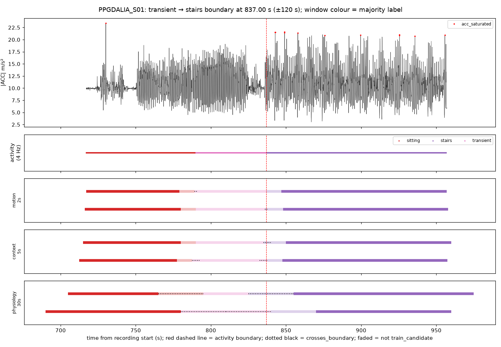

**motion_2s**

| window_id | window_start | window_end | original_label | label_purity | crosses_boundary | seconds_to_nearest_boundary | context_class | eval_role | acc_saturated_frac |
|---|---|---|---|---|---|---|---|---|---|
| PPGDALIA_S01_mot2_000826 | 826.000 | 828.000 | transient | 1.000 | False | 9.000 | None | false_alert_eval | 0.000 |
| PPGDALIA_S01_mot2_000827 | 827.000 | 829.000 | transient | 1.000 | False | 8.000 | None | false_alert_eval | 0.000 |
| PPGDALIA_S01_mot2_000828 | 828.000 | 830.000 | transient | 1.000 | False | 7.000 | None | false_alert_eval | 0.000 |
| PPGDALIA_S01_mot2_000829 | 829.000 | 831.000 | transient | 1.000 | False | 6.000 | None | false_alert_eval | 0.000 |
| PPGDALIA_S01_mot2_000830 | 830.000 | 832.000 | transient | 1.000 | False | 5.000 | None | false_alert_eval | 0.000 |
| PPGDALIA_S01_mot2_000831 | 831.000 | 833.000 | transient | 1.000 | False | 4.000 | None | false_alert_eval | 0.000 |
| PPGDALIA_S01_mot2_000832 | 832.000 | 834.000 | transient | 1.000 | False | 3.000 | None | false_alert_eval | 0.000 |
| PPGDALIA_S01_mot2_000833 | 833.000 | 835.000 | transient | 1.000 | False | 2.000 | None | false_alert_eval | 0.000 |
| PPGDALIA_S01_mot2_000834 | 834.000 | 836.000 | transient | 1.000 | False | 1.000 | None | false_alert_eval | 0.000 |
| PPGDALIA_S01_mot2_000835 | 835.000 | 837.000 | transient | 1.000 | False | 0.000 | None | false_alert_eval | 0.000 |
| PPGDALIA_S01_mot2_000836 | 836.000 | 838.000 | stairs | 0.500 | True | 0.000 | vigorous_activity | false_alert_eval_only | 0.000 |
| PPGDALIA_S01_mot2_000837 | 837.000 | 839.000 | stairs | 1.000 | False | 0.000 | vigorous_activity | false_alert_eval | 0.000 |
| PPGDALIA_S01_mot2_000838 | 838.000 | 840.000 | stairs | 1.000 | False | 1.000 | vigorous_activity | false_alert_eval | 0.000 |
| PPGDALIA_S01_mot2_000839 | 839.000 | 841.000 | stairs | 1.000 | False | 2.000 | vigorous_activity | false_alert_eval | 0.000 |
| PPGDALIA_S01_mot2_000840 | 840.000 | 842.000 | stairs | 1.000 | False | 3.000 | vigorous_activity | false_alert_eval | 0.000 |
| PPGDALIA_S01_mot2_000841 | 841.000 | 843.000 | stairs | 1.000 | False | 4.000 | vigorous_activity | false_alert_eval | 0.031 |
| PPGDALIA_S01_mot2_000842 | 842.000 | 844.000 | stairs | 1.000 | False | 5.000 | vigorous_activity | false_alert_eval | 0.031 |
| PPGDALIA_S01_mot2_000843 | 843.000 | 845.000 | stairs | 1.000 | False | 6.000 | vigorous_activity | false_alert_eval | 0.000 |
| PPGDALIA_S01_mot2_000844 | 844.000 | 846.000 | stairs | 1.000 | False | 7.000 | vigorous_activity | false_alert_eval | 0.000 |
| PPGDALIA_S01_mot2_000845 | 845.000 | 847.000 | stairs | 1.000 | False | 8.000 | vigorous_activity | false_alert_eval | 0.000 |
| PPGDALIA_S01_mot2_000846 | 846.000 | 848.000 | stairs | 1.000 | False | 9.000 | vigorous_activity | false_alert_eval | 0.000 |

**context_5s**

| window_id | window_start | window_end | original_label | label_purity | crosses_boundary | seconds_to_nearest_boundary | context_class | eval_role | acc_saturated_frac |
|---|---|---|---|---|---|---|---|---|---|
| PPGDALIA_S01_ctx5_000329 | 822.500 | 827.500 | transient | 1.000 | False | 9.500 | None | false_alert_eval | 0.000 |
| PPGDALIA_S01_ctx5_000330 | 825.000 | 830.000 | transient | 1.000 | False | 7.000 | None | false_alert_eval | 0.000 |
| PPGDALIA_S01_ctx5_000331 | 827.500 | 832.500 | transient | 1.000 | False | 4.500 | None | false_alert_eval | 0.000 |
| PPGDALIA_S01_ctx5_000332 | 830.000 | 835.000 | transient | 1.000 | False | 2.000 | None | false_alert_eval | 0.000 |
| PPGDALIA_S01_ctx5_000333 | 832.500 | 837.500 | transient | 0.900 | True | 0.000 | None | false_alert_eval | 0.000 |
| PPGDALIA_S01_ctx5_000334 | 835.000 | 840.000 | stairs | 0.600 | True | 0.000 | vigorous_activity | false_alert_eval_only | 0.000 |
| PPGDALIA_S01_ctx5_000335 | 837.500 | 842.500 | stairs | 1.000 | False | 0.500 | vigorous_activity | false_alert_eval | 0.000 |
| PPGDALIA_S01_ctx5_000336 | 840.000 | 845.000 | stairs | 1.000 | False | 3.000 | vigorous_activity | false_alert_eval | 0.013 |
| PPGDALIA_S01_ctx5_000337 | 842.500 | 847.500 | stairs | 1.000 | False | 5.500 | vigorous_activity | false_alert_eval | 0.013 |
| PPGDALIA_S01_ctx5_000338 | 845.000 | 850.000 | stairs | 1.000 | False | 8.000 | vigorous_activity | false_alert_eval | 0.013 |

**physiology_30s**

| window_id | window_start | window_end | original_label | label_purity | crosses_boundary | seconds_to_nearest_boundary | context_class | eval_role | acc_saturated_frac |
|---|---|---|---|---|---|---|---|---|---|
| PPGDALIA_S01_phy30_000052 | 780.000 | 810.000 | transient | 0.667 | True | 0.000 | None | false_alert_eval | 0.000 |
| PPGDALIA_S01_phy30_000053 | 795.000 | 825.000 | transient | 1.000 | False | 5.000 | None | false_alert_eval | 0.000 |
| PPGDALIA_S01_phy30_000054 | 810.000 | 840.000 | transient | 0.900 | True | 0.000 | None | false_alert_eval | 0.000 |
| PPGDALIA_S01_phy30_000055 | 825.000 | 855.000 | stairs | 0.600 | True | 0.000 | vigorous_activity | false_alert_eval_only | 0.004 |
| PPGDALIA_S01_phy30_000056 | 840.000 | 870.000 | stairs | 1.000 | False | 3.000 | vigorous_activity | false_alert_eval | 0.005 |
| PPGDALIA_S01_phy30_000057 | 855.000 | 885.000 | stairs | 1.000 | False | 18.000 | vigorous_activity | train_candidate | 0.002 |

### PPGDALIA_S02: transient → stairs at 978.50 s

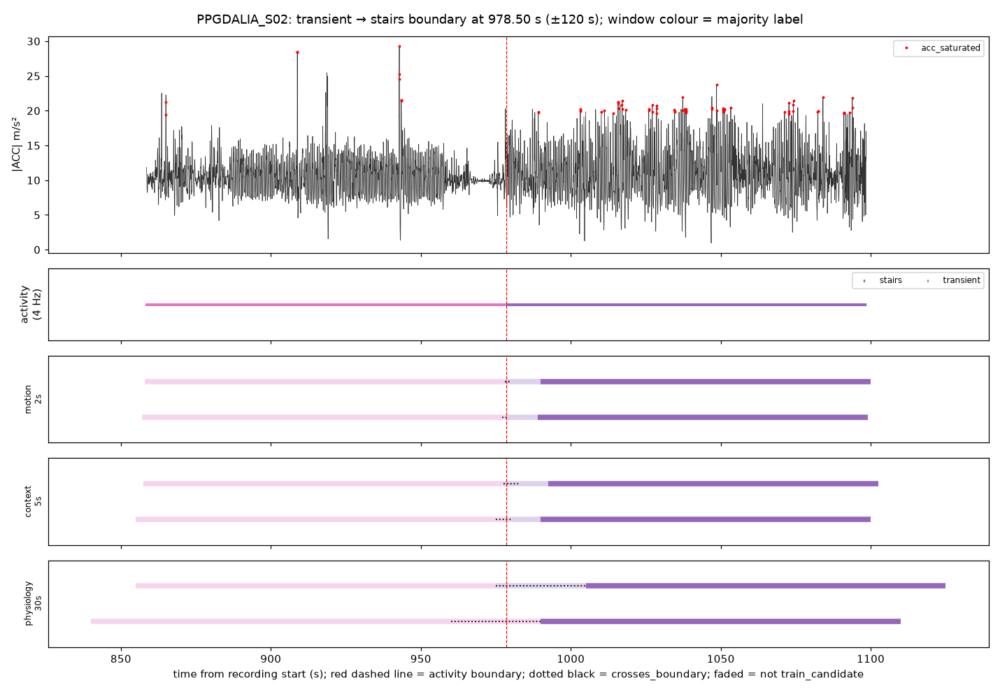

**motion_2s**

| window_id | window_start | window_end | original_label | label_purity | crosses_boundary | seconds_to_nearest_boundary | context_class | eval_role | acc_saturated_frac |
|---|---|---|---|---|---|---|---|---|---|
| PPGDALIA_S02_mot2_000967 | 967.000 | 969.000 | transient | 1.000 | False | 9.500 | None | false_alert_eval | 0.000 |
| PPGDALIA_S02_mot2_000968 | 968.000 | 970.000 | transient | 1.000 | False | 8.500 | None | false_alert_eval | 0.000 |
| PPGDALIA_S02_mot2_000969 | 969.000 | 971.000 | transient | 1.000 | False | 7.500 | None | false_alert_eval | 0.000 |
| PPGDALIA_S02_mot2_000970 | 970.000 | 972.000 | transient | 1.000 | False | 6.500 | None | false_alert_eval | 0.000 |
| PPGDALIA_S02_mot2_000971 | 971.000 | 973.000 | transient | 1.000 | False | 5.500 | None | false_alert_eval | 0.000 |
| PPGDALIA_S02_mot2_000972 | 972.000 | 974.000 | transient | 1.000 | False | 4.500 | None | false_alert_eval | 0.000 |
| PPGDALIA_S02_mot2_000973 | 973.000 | 975.000 | transient | 1.000 | False | 3.500 | None | false_alert_eval | 0.000 |
| PPGDALIA_S02_mot2_000974 | 974.000 | 976.000 | transient | 1.000 | False | 2.500 | None | false_alert_eval | 0.000 |
| PPGDALIA_S02_mot2_000975 | 975.000 | 977.000 | transient | 1.000 | False | 1.500 | None | false_alert_eval | 0.000 |
| PPGDALIA_S02_mot2_000976 | 976.000 | 978.000 | transient | 1.000 | False | 0.500 | None | false_alert_eval | 0.000 |
| PPGDALIA_S02_mot2_000977 | 977.000 | 979.000 | transient | 0.750 | True | 0.000 | None | false_alert_eval | 0.000 |
| PPGDALIA_S02_mot2_000978 | 978.000 | 980.000 | stairs | 0.750 | True | 0.000 | vigorous_activity | false_alert_eval_only | 0.000 |
| PPGDALIA_S02_mot2_000979 | 979.000 | 981.000 | stairs | 1.000 | False | 0.500 | vigorous_activity | false_alert_eval | 0.000 |
| PPGDALIA_S02_mot2_000980 | 980.000 | 982.000 | stairs | 1.000 | False | 1.500 | vigorous_activity | false_alert_eval | 0.000 |
| PPGDALIA_S02_mot2_000981 | 981.000 | 983.000 | stairs | 1.000 | False | 2.500 | vigorous_activity | false_alert_eval | 0.000 |
| PPGDALIA_S02_mot2_000982 | 982.000 | 984.000 | stairs | 1.000 | False | 3.500 | vigorous_activity | false_alert_eval | 0.000 |
| PPGDALIA_S02_mot2_000983 | 983.000 | 985.000 | stairs | 1.000 | False | 4.500 | vigorous_activity | false_alert_eval | 0.000 |
| PPGDALIA_S02_mot2_000984 | 984.000 | 986.000 | stairs | 1.000 | False | 5.500 | vigorous_activity | false_alert_eval | 0.000 |
| PPGDALIA_S02_mot2_000985 | 985.000 | 987.000 | stairs | 1.000 | False | 6.500 | vigorous_activity | false_alert_eval | 0.000 |
| PPGDALIA_S02_mot2_000986 | 986.000 | 988.000 | stairs | 1.000 | False | 7.500 | vigorous_activity | false_alert_eval | 0.000 |
| PPGDALIA_S02_mot2_000987 | 987.000 | 989.000 | stairs | 1.000 | False | 8.500 | vigorous_activity | false_alert_eval | 0.000 |
| PPGDALIA_S02_mot2_000988 | 988.000 | 990.000 | stairs | 1.000 | False | 9.500 | vigorous_activity | false_alert_eval | 0.031 |

**context_5s**

| window_id | window_start | window_end | original_label | label_purity | crosses_boundary | seconds_to_nearest_boundary | context_class | eval_role | acc_saturated_frac |
|---|---|---|---|---|---|---|---|---|---|
| PPGDALIA_S02_ctx5_000386 | 965.000 | 970.000 | transient | 1.000 | False | 8.500 | None | false_alert_eval | 0.000 |
| PPGDALIA_S02_ctx5_000387 | 967.500 | 972.500 | transient | 1.000 | False | 6.000 | None | false_alert_eval | 0.000 |
| PPGDALIA_S02_ctx5_000388 | 970.000 | 975.000 | transient | 1.000 | False | 3.500 | None | false_alert_eval | 0.000 |
| PPGDALIA_S02_ctx5_000389 | 972.500 | 977.500 | transient | 1.000 | False | 1.000 | None | false_alert_eval | 0.000 |
| PPGDALIA_S02_ctx5_000390 | 975.000 | 980.000 | transient | 0.700 | True | 0.000 | None | false_alert_eval | 0.000 |
| PPGDALIA_S02_ctx5_000391 | 977.500 | 982.500 | stairs | 0.800 | True | 0.000 | vigorous_activity | false_alert_eval_only | 0.000 |
| PPGDALIA_S02_ctx5_000392 | 980.000 | 985.000 | stairs | 1.000 | False | 1.500 | vigorous_activity | false_alert_eval | 0.000 |
| PPGDALIA_S02_ctx5_000393 | 982.500 | 987.500 | stairs | 1.000 | False | 4.000 | vigorous_activity | false_alert_eval | 0.000 |
| PPGDALIA_S02_ctx5_000394 | 985.000 | 990.000 | stairs | 1.000 | False | 6.500 | vigorous_activity | false_alert_eval | 0.013 |
| PPGDALIA_S02_ctx5_000395 | 987.500 | 992.500 | stairs | 1.000 | False | 9.000 | vigorous_activity | false_alert_eval | 0.013 |

**physiology_30s**

| window_id | window_start | window_end | original_label | label_purity | crosses_boundary | seconds_to_nearest_boundary | context_class | eval_role | acc_saturated_frac |
|---|---|---|---|---|---|---|---|---|---|
| PPGDALIA_S02_phy30_000062 | 930.000 | 960.000 | transient | 1.000 | False | 18.500 | None | false_alert_eval | 0.006 |
| PPGDALIA_S02_phy30_000063 | 945.000 | 975.000 | transient | 1.000 | False | 3.500 | None | false_alert_eval | 0.000 |
| PPGDALIA_S02_phy30_000064 | 960.000 | 990.000 | transient | 0.617 | True | 0.000 | None | false_alert_eval | 0.002 |
| PPGDALIA_S02_phy30_000065 | 975.000 | 1005.000 | stairs | 0.883 | True | 0.000 | vigorous_activity | false_alert_eval_only | 0.005 |
| PPGDALIA_S02_phy30_000066 | 990.000 | 1020.000 | stairs | 1.000 | False | 11.500 | vigorous_activity | train_candidate | 0.016 |
| PPGDALIA_S02_phy30_000067 | 1005.000 | 1035.000 | stairs | 1.000 | False | 26.500 | vigorous_activity | train_candidate | 0.023 |

### PPGDALIA_S03: transient → stairs at 849.75 s

**motion_2s**

| window_id | window_start | window_end | original_label | label_purity | crosses_boundary | seconds_to_nearest_boundary | context_class | eval_role | acc_saturated_frac |
|---|---|---|---|---|---|---|---|---|---|
| PPGDALIA_S03_mot2_000838 | 838.000 | 840.000 | transient | 1.000 | False | 9.750 | None | false_alert_eval | 0.000 |
| PPGDALIA_S03_mot2_000839 | 839.000 | 841.000 | transient | 1.000 | False | 8.750 | None | false_alert_eval | 0.000 |
| PPGDALIA_S03_mot2_000840 | 840.000 | 842.000 | transient | 1.000 | False | 7.750 | None | false_alert_eval | 0.000 |
| PPGDALIA_S03_mot2_000841 | 841.000 | 843.000 | transient | 1.000 | False | 6.750 | None | false_alert_eval | 0.000 |
| PPGDALIA_S03_mot2_000842 | 842.000 | 844.000 | transient | 1.000 | False | 5.750 | None | false_alert_eval | 0.000 |
| PPGDALIA_S03_mot2_000843 | 843.000 | 845.000 | transient | 1.000 | False | 4.750 | None | false_alert_eval | 0.000 |
| PPGDALIA_S03_mot2_000844 | 844.000 | 846.000 | transient | 1.000 | False | 3.750 | None | false_alert_eval | 0.000 |
| PPGDALIA_S03_mot2_000845 | 845.000 | 847.000 | transient | 1.000 | False | 2.750 | None | false_alert_eval | 0.000 |
| PPGDALIA_S03_mot2_000846 | 846.000 | 848.000 | transient | 1.000 | False | 1.750 | None | false_alert_eval | 0.000 |
| PPGDALIA_S03_mot2_000847 | 847.000 | 849.000 | transient | 1.000 | False | 0.750 | None | false_alert_eval | 0.000 |
| PPGDALIA_S03_mot2_000848 | 848.000 | 850.000 | transient | 0.875 | True | 0.000 | None | false_alert_eval | 0.000 |
| PPGDALIA_S03_mot2_000849 | 849.000 | 851.000 | stairs | 0.625 | True | 0.000 | vigorous_activity | false_alert_eval_only | 0.000 |
| PPGDALIA_S03_mot2_000850 | 850.000 | 852.000 | stairs | 1.000 | False | 0.250 | vigorous_activity | false_alert_eval | 0.000 |
| PPGDALIA_S03_mot2_000851 | 851.000 | 853.000 | stairs | 1.000 | False | 1.250 | vigorous_activity | false_alert_eval | 0.000 |
| PPGDALIA_S03_mot2_000852 | 852.000 | 854.000 | stairs | 1.000 | False | 2.250 | vigorous_activity | false_alert_eval | 0.000 |
| PPGDALIA_S03_mot2_000853 | 853.000 | 855.000 | stairs | 1.000 | False | 3.250 | vigorous_activity | false_alert_eval | 0.016 |
| PPGDALIA_S03_mot2_000854 | 854.000 | 856.000 | stairs | 1.000 | False | 4.250 | vigorous_activity | false_alert_eval | 0.016 |
| PPGDALIA_S03_mot2_000855 | 855.000 | 857.000 | stairs | 1.000 | False | 5.250 | vigorous_activity | false_alert_eval | 0.000 |
| PPGDALIA_S03_mot2_000856 | 856.000 | 858.000 | stairs | 1.000 | False | 6.250 | vigorous_activity | false_alert_eval | 0.000 |
| PPGDALIA_S03_mot2_000857 | 857.000 | 859.000 | stairs | 1.000 | False | 7.250 | vigorous_activity | false_alert_eval | 0.000 |
| PPGDALIA_S03_mot2_000858 | 858.000 | 860.000 | stairs | 1.000 | False | 8.250 | vigorous_activity | false_alert_eval | 0.000 |
| PPGDALIA_S03_mot2_000859 | 859.000 | 861.000 | stairs | 1.000 | False | 9.250 | vigorous_activity | false_alert_eval | 0.000 |

**context_5s**

| window_id | window_start | window_end | original_label | label_purity | crosses_boundary | seconds_to_nearest_boundary | context_class | eval_role | acc_saturated_frac |
|---|---|---|---|---|---|---|---|---|---|
| PPGDALIA_S03_ctx5_000334 | 835.000 | 840.000 | transient | 1.000 | False | 9.750 | None | false_alert_eval | 0.000 |
| PPGDALIA_S03_ctx5_000335 | 837.500 | 842.500 | transient | 1.000 | False | 7.250 | None | false_alert_eval | 0.000 |
| PPGDALIA_S03_ctx5_000336 | 840.000 | 845.000 | transient | 1.000 | False | 4.750 | None | false_alert_eval | 0.000 |
| PPGDALIA_S03_ctx5_000337 | 842.500 | 847.500 | transient | 1.000 | False | 2.250 | None | false_alert_eval | 0.000 |
| PPGDALIA_S03_ctx5_000338 | 845.000 | 850.000 | transient | 0.950 | True | 0.000 | None | false_alert_eval | 0.000 |
| PPGDALIA_S03_ctx5_000339 | 847.500 | 852.500 | stairs | 0.550 | True | 0.000 | vigorous_activity | false_alert_eval_only | 0.000 |
| PPGDALIA_S03_ctx5_000340 | 850.000 | 855.000 | stairs | 1.000 | False | 0.250 | vigorous_activity | false_alert_eval | 0.006 |
| PPGDALIA_S03_ctx5_000341 | 852.500 | 857.500 | stairs | 1.000 | False | 2.750 | vigorous_activity | false_alert_eval | 0.006 |
| PPGDALIA_S03_ctx5_000342 | 855.000 | 860.000 | stairs | 1.000 | False | 5.250 | vigorous_activity | false_alert_eval | 0.000 |
| PPGDALIA_S03_ctx5_000343 | 857.500 | 862.500 | stairs | 1.000 | False | 7.750 | vigorous_activity | false_alert_eval | 0.000 |

**physiology_30s**

| window_id | window_start | window_end | original_label | label_purity | crosses_boundary | seconds_to_nearest_boundary | context_class | eval_role | acc_saturated_frac |
|---|---|---|---|---|---|---|---|---|---|
| PPGDALIA_S03_phy30_000053 | 795.000 | 825.000 | transient | 1.000 | False | 24.750 | None | false_alert_eval | 0.000 |
| PPGDALIA_S03_phy30_000054 | 810.000 | 840.000 | transient | 1.000 | False | 9.750 | None | false_alert_eval | 0.000 |
| PPGDALIA_S03_phy30_000055 | 825.000 | 855.000 | transient | 0.825 | True | 0.000 | None | false_alert_eval | 0.001 |
| PPGDALIA_S03_phy30_000056 | 840.000 | 870.000 | stairs | 0.675 | True | 0.000 | vigorous_activity | false_alert_eval_only | 0.001 |
| PPGDALIA_S03_phy30_000057 | 855.000 | 885.000 | stairs | 1.000 | False | 5.250 | vigorous_activity | false_alert_eval | 0.000 |
| PPGDALIA_S03_phy30_000058 | 870.000 | 900.000 | stairs | 1.000 | False | 20.250 | vigorous_activity | train_candidate | 0.000 |

### PPGDALIA_S04: transient → stairs at 830.00 s

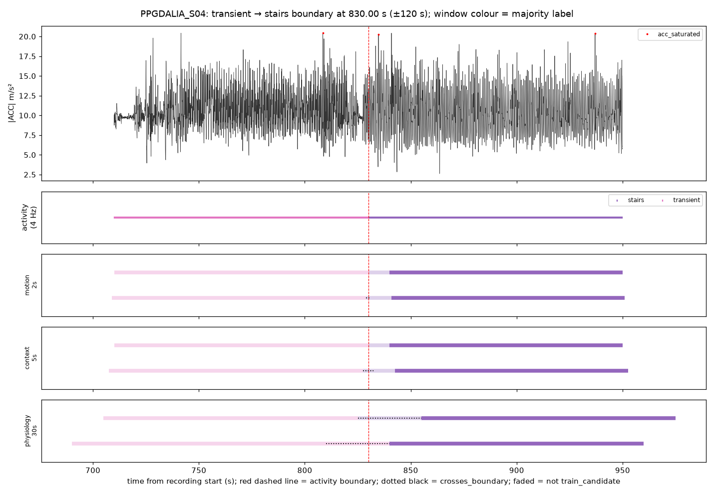

**motion_2s**

| window_id | window_start | window_end | original_label | label_purity | crosses_boundary | seconds_to_nearest_boundary | context_class | eval_role | acc_saturated_frac |
|---|---|---|---|---|---|---|---|---|---|
| PPGDALIA_S04_mot2_000819 | 819.000 | 821.000 | transient | 1.000 | False | 9.000 | None | false_alert_eval | 0.000 |
| PPGDALIA_S04_mot2_000820 | 820.000 | 822.000 | transient | 1.000 | False | 8.000 | None | false_alert_eval | 0.000 |
| PPGDALIA_S04_mot2_000821 | 821.000 | 823.000 | transient | 1.000 | False | 7.000 | None | false_alert_eval | 0.000 |
| PPGDALIA_S04_mot2_000822 | 822.000 | 824.000 | transient | 1.000 | False | 6.000 | None | false_alert_eval | 0.000 |
| PPGDALIA_S04_mot2_000823 | 823.000 | 825.000 | transient | 1.000 | False | 5.000 | None | false_alert_eval | 0.000 |
| PPGDALIA_S04_mot2_000824 | 824.000 | 826.000 | transient | 1.000 | False | 4.000 | None | false_alert_eval | 0.000 |
| PPGDALIA_S04_mot2_000825 | 825.000 | 827.000 | transient | 1.000 | False | 3.000 | None | false_alert_eval | 0.000 |
| PPGDALIA_S04_mot2_000826 | 826.000 | 828.000 | transient | 1.000 | False | 2.000 | None | false_alert_eval | 0.000 |
| PPGDALIA_S04_mot2_000827 | 827.000 | 829.000 | transient | 1.000 | False | 1.000 | None | false_alert_eval | 0.000 |
| PPGDALIA_S04_mot2_000828 | 828.000 | 830.000 | transient | 1.000 | False | 0.000 | None | false_alert_eval | 0.000 |
| PPGDALIA_S04_mot2_000829 | 829.000 | 831.000 | stairs | 0.500 | True | 0.000 | vigorous_activity | false_alert_eval_only | 0.000 |
| PPGDALIA_S04_mot2_000830 | 830.000 | 832.000 | stairs | 1.000 | False | 0.000 | vigorous_activity | false_alert_eval | 0.000 |
| PPGDALIA_S04_mot2_000831 | 831.000 | 833.000 | stairs | 1.000 | False | 1.000 | vigorous_activity | false_alert_eval | 0.000 |
| PPGDALIA_S04_mot2_000832 | 832.000 | 834.000 | stairs | 1.000 | False | 2.000 | vigorous_activity | false_alert_eval | 0.000 |
| PPGDALIA_S04_mot2_000833 | 833.000 | 835.000 | stairs | 1.000 | False | 3.000 | vigorous_activity | false_alert_eval | 0.016 |
| PPGDALIA_S04_mot2_000834 | 834.000 | 836.000 | stairs | 1.000 | False | 4.000 | vigorous_activity | false_alert_eval | 0.016 |
| PPGDALIA_S04_mot2_000835 | 835.000 | 837.000 | stairs | 1.000 | False | 5.000 | vigorous_activity | false_alert_eval | 0.000 |
| PPGDALIA_S04_mot2_000836 | 836.000 | 838.000 | stairs | 1.000 | False | 6.000 | vigorous_activity | false_alert_eval | 0.000 |
| PPGDALIA_S04_mot2_000837 | 837.000 | 839.000 | stairs | 1.000 | False | 7.000 | vigorous_activity | false_alert_eval | 0.000 |
| PPGDALIA_S04_mot2_000838 | 838.000 | 840.000 | stairs | 1.000 | False | 8.000 | vigorous_activity | false_alert_eval | 0.000 |
| PPGDALIA_S04_mot2_000839 | 839.000 | 841.000 | stairs | 1.000 | False | 9.000 | vigorous_activity | false_alert_eval | 0.000 |

**context_5s**

| window_id | window_start | window_end | original_label | label_purity | crosses_boundary | seconds_to_nearest_boundary | context_class | eval_role | acc_saturated_frac |
|---|---|---|---|---|---|---|---|---|---|
| PPGDALIA_S04_ctx5_000327 | 817.500 | 822.500 | transient | 1.000 | False | 7.500 | None | false_alert_eval | 0.000 |
| PPGDALIA_S04_ctx5_000328 | 820.000 | 825.000 | transient | 1.000 | False | 5.000 | None | false_alert_eval | 0.000 |
| PPGDALIA_S04_ctx5_000329 | 822.500 | 827.500 | transient | 1.000 | False | 2.500 | None | false_alert_eval | 0.000 |
| PPGDALIA_S04_ctx5_000330 | 825.000 | 830.000 | transient | 1.000 | False | 0.000 | None | false_alert_eval | 0.000 |
| PPGDALIA_S04_ctx5_000331 | 827.500 | 832.500 | stairs | 0.500 | True | 0.000 | vigorous_activity | false_alert_eval_only | 0.000 |
| PPGDALIA_S04_ctx5_000332 | 830.000 | 835.000 | stairs | 1.000 | False | 0.000 | vigorous_activity | false_alert_eval | 0.006 |
| PPGDALIA_S04_ctx5_000333 | 832.500 | 837.500 | stairs | 1.000 | False | 2.500 | vigorous_activity | false_alert_eval | 0.006 |
| PPGDALIA_S04_ctx5_000334 | 835.000 | 840.000 | stairs | 1.000 | False | 5.000 | vigorous_activity | false_alert_eval | 0.000 |
| PPGDALIA_S04_ctx5_000335 | 837.500 | 842.500 | stairs | 1.000 | False | 7.500 | vigorous_activity | false_alert_eval | 0.000 |

**physiology_30s**

| window_id | window_start | window_end | original_label | label_purity | crosses_boundary | seconds_to_nearest_boundary | context_class | eval_role | acc_saturated_frac |
|---|---|---|---|---|---|---|---|---|---|
| PPGDALIA_S04_phy30_000052 | 780.000 | 810.000 | transient | 1.000 | False | 20.000 | None | false_alert_eval | 0.001 |
| PPGDALIA_S04_phy30_000053 | 795.000 | 825.000 | transient | 1.000 | False | 5.000 | None | false_alert_eval | 0.001 |
| PPGDALIA_S04_phy30_000054 | 810.000 | 840.000 | transient | 0.667 | True | 0.000 | None | false_alert_eval | 0.001 |
| PPGDALIA_S04_phy30_000055 | 825.000 | 855.000 | stairs | 0.833 | True | 0.000 | vigorous_activity | false_alert_eval_only | 0.001 |
| PPGDALIA_S04_phy30_000056 | 840.000 | 870.000 | stairs | 1.000 | False | 10.000 | vigorous_activity | train_candidate | 0.000 |
| PPGDALIA_S04_phy30_000057 | 855.000 | 885.000 | stairs | 1.000 | False | 25.000 | vigorous_activity | train_candidate | 0.000 |

### PPGDALIA_S05: transient → stairs at 888.00 s

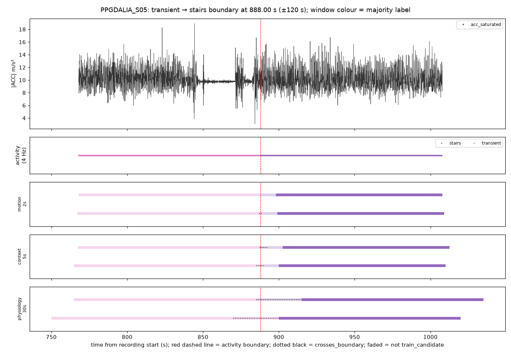

**motion_2s**

| window_id | window_start | window_end | original_label | label_purity | crosses_boundary | seconds_to_nearest_boundary | context_class | eval_role | acc_saturated_frac |
|---|---|---|---|---|---|---|---|---|---|
| PPGDALIA_S05_mot2_000877 | 877.000 | 879.000 | transient | 1.000 | False | 9.000 | None | false_alert_eval | 0.000 |
| PPGDALIA_S05_mot2_000878 | 878.000 | 880.000 | transient | 1.000 | False | 8.000 | None | false_alert_eval | 0.000 |
| PPGDALIA_S05_mot2_000879 | 879.000 | 881.000 | transient | 1.000 | False | 7.000 | None | false_alert_eval | 0.000 |
| PPGDALIA_S05_mot2_000880 | 880.000 | 882.000 | transient | 1.000 | False | 6.000 | None | false_alert_eval | 0.000 |
| PPGDALIA_S05_mot2_000881 | 881.000 | 883.000 | transient | 1.000 | False | 5.000 | None | false_alert_eval | 0.000 |
| PPGDALIA_S05_mot2_000882 | 882.000 | 884.000 | transient | 1.000 | False | 4.000 | None | false_alert_eval | 0.000 |
| PPGDALIA_S05_mot2_000883 | 883.000 | 885.000 | transient | 1.000 | False | 3.000 | None | false_alert_eval | 0.000 |
| PPGDALIA_S05_mot2_000884 | 884.000 | 886.000 | transient | 1.000 | False | 2.000 | None | false_alert_eval | 0.000 |
| PPGDALIA_S05_mot2_000885 | 885.000 | 887.000 | transient | 1.000 | False | 1.000 | None | false_alert_eval | 0.000 |
| PPGDALIA_S05_mot2_000886 | 886.000 | 888.000 | transient | 1.000 | False | 0.000 | None | false_alert_eval | 0.000 |
| PPGDALIA_S05_mot2_000887 | 887.000 | 889.000 | stairs | 0.500 | True | 0.000 | vigorous_activity | false_alert_eval_only | 0.000 |
| PPGDALIA_S05_mot2_000888 | 888.000 | 890.000 | stairs | 1.000 | False | 0.000 | vigorous_activity | false_alert_eval | 0.000 |
| PPGDALIA_S05_mot2_000889 | 889.000 | 891.000 | stairs | 1.000 | False | 1.000 | vigorous_activity | false_alert_eval | 0.000 |
| PPGDALIA_S05_mot2_000890 | 890.000 | 892.000 | stairs | 1.000 | False | 2.000 | vigorous_activity | false_alert_eval | 0.000 |
| PPGDALIA_S05_mot2_000891 | 891.000 | 893.000 | stairs | 1.000 | False | 3.000 | vigorous_activity | false_alert_eval | 0.000 |
| PPGDALIA_S05_mot2_000892 | 892.000 | 894.000 | stairs | 1.000 | False | 4.000 | vigorous_activity | false_alert_eval | 0.000 |
| PPGDALIA_S05_mot2_000893 | 893.000 | 895.000 | stairs | 1.000 | False | 5.000 | vigorous_activity | false_alert_eval | 0.000 |
| PPGDALIA_S05_mot2_000894 | 894.000 | 896.000 | stairs | 1.000 | False | 6.000 | vigorous_activity | false_alert_eval | 0.000 |
| PPGDALIA_S05_mot2_000895 | 895.000 | 897.000 | stairs | 1.000 | False | 7.000 | vigorous_activity | false_alert_eval | 0.000 |
| PPGDALIA_S05_mot2_000896 | 896.000 | 898.000 | stairs | 1.000 | False | 8.000 | vigorous_activity | false_alert_eval | 0.000 |
| PPGDALIA_S05_mot2_000897 | 897.000 | 899.000 | stairs | 1.000 | False | 9.000 | vigorous_activity | false_alert_eval | 0.000 |

**context_5s**

| window_id | window_start | window_end | original_label | label_purity | crosses_boundary | seconds_to_nearest_boundary | context_class | eval_role | acc_saturated_frac |
|---|---|---|---|---|---|---|---|---|---|
| PPGDALIA_S05_ctx5_000350 | 875.000 | 880.000 | transient | 1.000 | False | 8.000 | None | false_alert_eval | 0.000 |
| PPGDALIA_S05_ctx5_000351 | 877.500 | 882.500 | transient | 1.000 | False | 5.500 | None | false_alert_eval | 0.000 |
| PPGDALIA_S05_ctx5_000352 | 880.000 | 885.000 | transient | 1.000 | False | 3.000 | None | false_alert_eval | 0.000 |
| PPGDALIA_S05_ctx5_000353 | 882.500 | 887.500 | transient | 1.000 | False | 0.500 | None | false_alert_eval | 0.000 |
| PPGDALIA_S05_ctx5_000354 | 885.000 | 890.000 | transient | 0.600 | True | 0.000 | None | false_alert_eval | 0.000 |
| PPGDALIA_S05_ctx5_000355 | 887.500 | 892.500 | stairs | 0.900 | True | 0.000 | vigorous_activity | false_alert_eval_only | 0.000 |
| PPGDALIA_S05_ctx5_000356 | 890.000 | 895.000 | stairs | 1.000 | False | 2.000 | vigorous_activity | false_alert_eval | 0.000 |
| PPGDALIA_S05_ctx5_000357 | 892.500 | 897.500 | stairs | 1.000 | False | 4.500 | vigorous_activity | false_alert_eval | 0.000 |
| PPGDALIA_S05_ctx5_000358 | 895.000 | 900.000 | stairs | 1.000 | False | 7.000 | vigorous_activity | false_alert_eval | 0.000 |
| PPGDALIA_S05_ctx5_000359 | 897.500 | 902.500 | stairs | 1.000 | False | 9.500 | vigorous_activity | false_alert_eval | 0.000 |

**physiology_30s**

| window_id | window_start | window_end | original_label | label_purity | crosses_boundary | seconds_to_nearest_boundary | context_class | eval_role | acc_saturated_frac |
|---|---|---|---|---|---|---|---|---|---|
| PPGDALIA_S05_phy30_000056 | 840.000 | 870.000 | transient | 1.000 | False | 18.000 | None | false_alert_eval | 0.000 |
| PPGDALIA_S05_phy30_000057 | 855.000 | 885.000 | transient | 1.000 | False | 3.000 | None | false_alert_eval | 0.000 |
| PPGDALIA_S05_phy30_000058 | 870.000 | 900.000 | transient | 0.600 | True | 0.000 | None | false_alert_eval | 0.000 |
| PPGDALIA_S05_phy30_000059 | 885.000 | 915.000 | stairs | 0.900 | True | 0.000 | vigorous_activity | false_alert_eval_only | 0.000 |
| PPGDALIA_S05_phy30_000060 | 900.000 | 930.000 | stairs | 1.000 | False | 12.000 | vigorous_activity | train_candidate | 0.000 |
| PPGDALIA_S05_phy30_000061 | 915.000 | 945.000 | stairs | 1.000 | False | 27.000 | vigorous_activity | train_candidate | 0.000 |

### PPGDALIA_S06: transient → stairs at 922.25 s

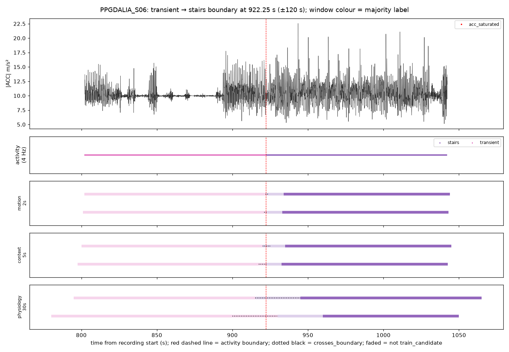

**motion_2s**

| window_id | window_start | window_end | original_label | label_purity | crosses_boundary | seconds_to_nearest_boundary | context_class | eval_role | acc_saturated_frac |
|---|---|---|---|---|---|---|---|---|---|
| PPGDALIA_S06_mot2_000911 | 911.000 | 913.000 | transient | 1.000 | False | 9.250 | None | false_alert_eval | 0.000 |
| PPGDALIA_S06_mot2_000912 | 912.000 | 914.000 | transient | 1.000 | False | 8.250 | None | false_alert_eval | 0.000 |
| PPGDALIA_S06_mot2_000913 | 913.000 | 915.000 | transient | 1.000 | False | 7.250 | None | false_alert_eval | 0.000 |
| PPGDALIA_S06_mot2_000914 | 914.000 | 916.000 | transient | 1.000 | False | 6.250 | None | false_alert_eval | 0.000 |
| PPGDALIA_S06_mot2_000915 | 915.000 | 917.000 | transient | 1.000 | False | 5.250 | None | false_alert_eval | 0.000 |
| PPGDALIA_S06_mot2_000916 | 916.000 | 918.000 | transient | 1.000 | False | 4.250 | None | false_alert_eval | 0.000 |
| PPGDALIA_S06_mot2_000917 | 917.000 | 919.000 | transient | 1.000 | False | 3.250 | None | false_alert_eval | 0.000 |
| PPGDALIA_S06_mot2_000918 | 918.000 | 920.000 | transient | 1.000 | False | 2.250 | None | false_alert_eval | 0.000 |
| PPGDALIA_S06_mot2_000919 | 919.000 | 921.000 | transient | 1.000 | False | 1.250 | None | false_alert_eval | 0.000 |
| PPGDALIA_S06_mot2_000920 | 920.000 | 922.000 | transient | 1.000 | False | 0.250 | None | false_alert_eval | 0.000 |
| PPGDALIA_S06_mot2_000921 | 921.000 | 923.000 | transient | 0.625 | True | 0.000 | None | false_alert_eval | 0.000 |
| PPGDALIA_S06_mot2_000922 | 922.000 | 924.000 | stairs | 0.875 | True | 0.000 | vigorous_activity | false_alert_eval_only | 0.000 |
| PPGDALIA_S06_mot2_000923 | 923.000 | 925.000 | stairs | 1.000 | False | 0.750 | vigorous_activity | false_alert_eval | 0.000 |
| PPGDALIA_S06_mot2_000924 | 924.000 | 926.000 | stairs | 1.000 | False | 1.750 | vigorous_activity | false_alert_eval | 0.000 |
| PPGDALIA_S06_mot2_000925 | 925.000 | 927.000 | stairs | 1.000 | False | 2.750 | vigorous_activity | false_alert_eval | 0.000 |
| PPGDALIA_S06_mot2_000926 | 926.000 | 928.000 | stairs | 1.000 | False | 3.750 | vigorous_activity | false_alert_eval | 0.000 |
| PPGDALIA_S06_mot2_000927 | 927.000 | 929.000 | stairs | 1.000 | False | 4.750 | vigorous_activity | false_alert_eval | 0.000 |
| PPGDALIA_S06_mot2_000928 | 928.000 | 930.000 | stairs | 1.000 | False | 5.750 | vigorous_activity | false_alert_eval | 0.000 |
| PPGDALIA_S06_mot2_000929 | 929.000 | 931.000 | stairs | 1.000 | False | 6.750 | vigorous_activity | false_alert_eval | 0.000 |
| PPGDALIA_S06_mot2_000930 | 930.000 | 932.000 | stairs | 1.000 | False | 7.750 | vigorous_activity | false_alert_eval | 0.000 |
| PPGDALIA_S06_mot2_000931 | 931.000 | 933.000 | stairs | 1.000 | False | 8.750 | vigorous_activity | false_alert_eval | 0.000 |
| PPGDALIA_S06_mot2_000932 | 932.000 | 934.000 | stairs | 1.000 | False | 9.750 | vigorous_activity | false_alert_eval | 0.000 |

**context_5s**

| window_id | window_start | window_end | original_label | label_purity | crosses_boundary | seconds_to_nearest_boundary | context_class | eval_role | acc_saturated_frac |
|---|---|---|---|---|---|---|---|---|---|
| PPGDALIA_S06_ctx5_000363 | 907.500 | 912.500 | transient | 1.000 | False | 9.750 | None | false_alert_eval | 0.000 |
| PPGDALIA_S06_ctx5_000364 | 910.000 | 915.000 | transient | 1.000 | False | 7.250 | None | false_alert_eval | 0.000 |
| PPGDALIA_S06_ctx5_000365 | 912.500 | 917.500 | transient | 1.000 | False | 4.750 | None | false_alert_eval | 0.000 |
| PPGDALIA_S06_ctx5_000366 | 915.000 | 920.000 | transient | 1.000 | False | 2.250 | None | false_alert_eval | 0.000 |
| PPGDALIA_S06_ctx5_000367 | 917.500 | 922.500 | transient | 0.950 | True | 0.000 | None | false_alert_eval | 0.000 |
| PPGDALIA_S06_ctx5_000368 | 920.000 | 925.000 | stairs | 0.550 | True | 0.000 | vigorous_activity | false_alert_eval_only | 0.000 |
| PPGDALIA_S06_ctx5_000369 | 922.500 | 927.500 | stairs | 1.000 | False | 0.250 | vigorous_activity | false_alert_eval | 0.000 |
| PPGDALIA_S06_ctx5_000370 | 925.000 | 930.000 | stairs | 1.000 | False | 2.750 | vigorous_activity | false_alert_eval | 0.000 |
| PPGDALIA_S06_ctx5_000371 | 927.500 | 932.500 | stairs | 1.000 | False | 5.250 | vigorous_activity | false_alert_eval | 0.000 |
| PPGDALIA_S06_ctx5_000372 | 930.000 | 935.000 | stairs | 1.000 | False | 7.750 | vigorous_activity | false_alert_eval | 0.000 |

**physiology_30s**

| window_id | window_start | window_end | original_label | label_purity | crosses_boundary | seconds_to_nearest_boundary | context_class | eval_role | acc_saturated_frac |
|---|---|---|---|---|---|---|---|---|---|
| PPGDALIA_S06_phy30_000058 | 870.000 | 900.000 | transient | 1.000 | False | 22.250 | None | false_alert_eval | 0.000 |
| PPGDALIA_S06_phy30_000059 | 885.000 | 915.000 | transient | 1.000 | False | 7.250 | None | false_alert_eval | 0.000 |
| PPGDALIA_S06_phy30_000060 | 900.000 | 930.000 | transient | 0.742 | True | 0.000 | None | false_alert_eval | 0.000 |
| PPGDALIA_S06_phy30_000061 | 915.000 | 945.000 | stairs | 0.758 | True | 0.000 | vigorous_activity | false_alert_eval_only | 0.000 |
| PPGDALIA_S06_phy30_000062 | 930.000 | 960.000 | stairs | 1.000 | False | 7.750 | vigorous_activity | false_alert_eval | 0.000 |
| PPGDALIA_S06_phy30_000063 | 945.000 | 975.000 | stairs | 1.000 | False | 22.750 | vigorous_activity | train_candidate | 0.000 |

### PPGDALIA_S07: transient → stairs at 866.25 s

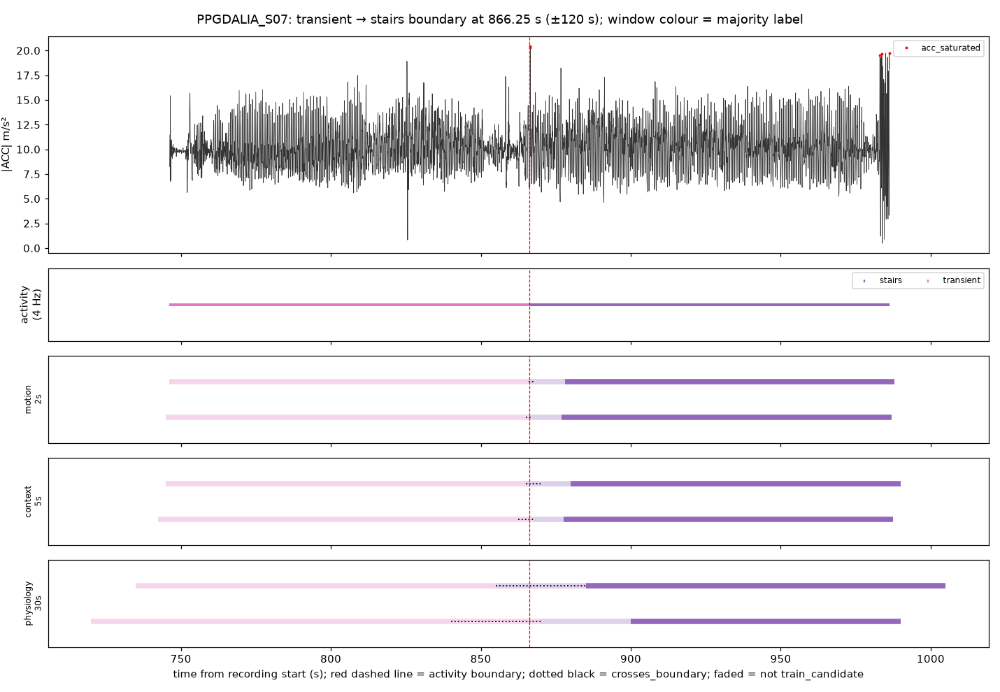

**motion_2s**

| window_id | window_start | window_end | original_label | label_purity | crosses_boundary | seconds_to_nearest_boundary | context_class | eval_role | acc_saturated_frac |
|---|---|---|---|---|---|---|---|---|---|
| PPGDALIA_S07_mot2_000855 | 855.000 | 857.000 | transient | 1.000 | False | 9.250 | None | false_alert_eval | 0.000 |
| PPGDALIA_S07_mot2_000856 | 856.000 | 858.000 | transient | 1.000 | False | 8.250 | None | false_alert_eval | 0.000 |
| PPGDALIA_S07_mot2_000857 | 857.000 | 859.000 | transient | 1.000 | False | 7.250 | None | false_alert_eval | 0.000 |
| PPGDALIA_S07_mot2_000858 | 858.000 | 860.000 | transient | 1.000 | False | 6.250 | None | false_alert_eval | 0.000 |
| PPGDALIA_S07_mot2_000859 | 859.000 | 861.000 | transient | 1.000 | False | 5.250 | None | false_alert_eval | 0.000 |
| PPGDALIA_S07_mot2_000860 | 860.000 | 862.000 | transient | 1.000 | False | 4.250 | None | false_alert_eval | 0.000 |
| PPGDALIA_S07_mot2_000861 | 861.000 | 863.000 | transient | 1.000 | False | 3.250 | None | false_alert_eval | 0.000 |
| PPGDALIA_S07_mot2_000862 | 862.000 | 864.000 | transient | 1.000 | False | 2.250 | None | false_alert_eval | 0.000 |
| PPGDALIA_S07_mot2_000863 | 863.000 | 865.000 | transient | 1.000 | False | 1.250 | None | false_alert_eval | 0.000 |
| PPGDALIA_S07_mot2_000864 | 864.000 | 866.000 | transient | 1.000 | False | 0.250 | None | false_alert_eval | 0.000 |
| PPGDALIA_S07_mot2_000865 | 865.000 | 867.000 | transient | 0.625 | True | 0.000 | None | false_alert_eval | 0.031 |
| PPGDALIA_S07_mot2_000866 | 866.000 | 868.000 | stairs | 0.875 | True | 0.000 | vigorous_activity | false_alert_eval_only | 0.031 |
| PPGDALIA_S07_mot2_000867 | 867.000 | 869.000 | stairs | 1.000 | False | 0.750 | vigorous_activity | false_alert_eval | 0.000 |
| PPGDALIA_S07_mot2_000868 | 868.000 | 870.000 | stairs | 1.000 | False | 1.750 | vigorous_activity | false_alert_eval | 0.000 |
| PPGDALIA_S07_mot2_000869 | 869.000 | 871.000 | stairs | 1.000 | False | 2.750 | vigorous_activity | false_alert_eval | 0.000 |
| PPGDALIA_S07_mot2_000870 | 870.000 | 872.000 | stairs | 1.000 | False | 3.750 | vigorous_activity | false_alert_eval | 0.000 |
| PPGDALIA_S07_mot2_000871 | 871.000 | 873.000 | stairs | 1.000 | False | 4.750 | vigorous_activity | false_alert_eval | 0.000 |
| PPGDALIA_S07_mot2_000872 | 872.000 | 874.000 | stairs | 1.000 | False | 5.750 | vigorous_activity | false_alert_eval | 0.000 |
| PPGDALIA_S07_mot2_000873 | 873.000 | 875.000 | stairs | 1.000 | False | 6.750 | vigorous_activity | false_alert_eval | 0.000 |
| PPGDALIA_S07_mot2_000874 | 874.000 | 876.000 | stairs | 1.000 | False | 7.750 | vigorous_activity | false_alert_eval | 0.000 |
| PPGDALIA_S07_mot2_000875 | 875.000 | 877.000 | stairs | 1.000 | False | 8.750 | vigorous_activity | false_alert_eval | 0.000 |
| PPGDALIA_S07_mot2_000876 | 876.000 | 878.000 | stairs | 1.000 | False | 9.750 | vigorous_activity | false_alert_eval | 0.000 |

**context_5s**

| window_id | window_start | window_end | original_label | label_purity | crosses_boundary | seconds_to_nearest_boundary | context_class | eval_role | acc_saturated_frac |
|---|---|---|---|---|---|---|---|---|---|
| PPGDALIA_S07_ctx5_000341 | 852.500 | 857.500 | transient | 1.000 | False | 8.750 | None | false_alert_eval | 0.000 |
| PPGDALIA_S07_ctx5_000342 | 855.000 | 860.000 | transient | 1.000 | False | 6.250 | None | false_alert_eval | 0.000 |
| PPGDALIA_S07_ctx5_000343 | 857.500 | 862.500 | transient | 1.000 | False | 3.750 | None | false_alert_eval | 0.000 |
| PPGDALIA_S07_ctx5_000344 | 860.000 | 865.000 | transient | 1.000 | False | 1.250 | None | false_alert_eval | 0.000 |
| PPGDALIA_S07_ctx5_000345 | 862.500 | 867.500 | transient | 0.750 | True | 0.000 | None | false_alert_eval | 0.013 |
| PPGDALIA_S07_ctx5_000346 | 865.000 | 870.000 | stairs | 0.750 | True | 0.000 | vigorous_activity | false_alert_eval_only | 0.013 |
| PPGDALIA_S07_ctx5_000347 | 867.500 | 872.500 | stairs | 1.000 | False | 1.250 | vigorous_activity | false_alert_eval | 0.000 |
| PPGDALIA_S07_ctx5_000348 | 870.000 | 875.000 | stairs | 1.000 | False | 3.750 | vigorous_activity | false_alert_eval | 0.000 |
| PPGDALIA_S07_ctx5_000349 | 872.500 | 877.500 | stairs | 1.000 | False | 6.250 | vigorous_activity | false_alert_eval | 0.000 |
| PPGDALIA_S07_ctx5_000350 | 875.000 | 880.000 | stairs | 1.000 | False | 8.750 | vigorous_activity | false_alert_eval | 0.000 |

**physiology_30s**

| window_id | window_start | window_end | original_label | label_purity | crosses_boundary | seconds_to_nearest_boundary | context_class | eval_role | acc_saturated_frac |
|---|---|---|---|---|---|---|---|---|---|
| PPGDALIA_S07_phy30_000054 | 810.000 | 840.000 | transient | 1.000 | False | 26.250 | None | false_alert_eval | 0.000 |
| PPGDALIA_S07_phy30_000055 | 825.000 | 855.000 | transient | 1.000 | False | 11.250 | None | false_alert_eval | 0.000 |
| PPGDALIA_S07_phy30_000056 | 840.000 | 870.000 | transient | 0.875 | True | 0.000 | None | false_alert_eval | 0.002 |
| PPGDALIA_S07_phy30_000057 | 855.000 | 885.000 | stairs | 0.625 | True | 0.000 | vigorous_activity | false_alert_eval_only | 0.002 |
| PPGDALIA_S07_phy30_000058 | 870.000 | 900.000 | stairs | 1.000 | False | 3.750 | vigorous_activity | false_alert_eval | 0.000 |
| PPGDALIA_S07_phy30_000059 | 885.000 | 915.000 | stairs | 1.000 | False | 18.750 | vigorous_activity | train_candidate | 0.000 |

### PPGDALIA_S08: transient → stairs at 801.00 s

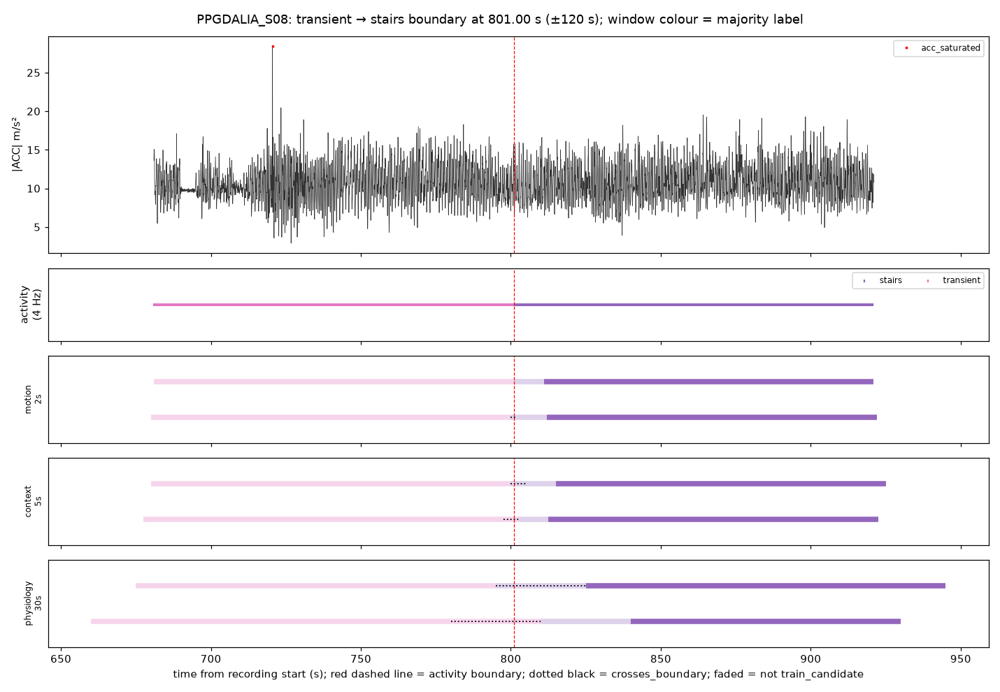

**motion_2s**

| window_id | window_start | window_end | original_label | label_purity | crosses_boundary | seconds_to_nearest_boundary | context_class | eval_role | acc_saturated_frac |
|---|---|---|---|---|---|---|---|---|---|
| PPGDALIA_S08_mot2_000790 | 790.000 | 792.000 | transient | 1.000 | False | 9.000 | None | false_alert_eval | 0.000 |
| PPGDALIA_S08_mot2_000791 | 791.000 | 793.000 | transient | 1.000 | False | 8.000 | None | false_alert_eval | 0.000 |
| PPGDALIA_S08_mot2_000792 | 792.000 | 794.000 | transient | 1.000 | False | 7.000 | None | false_alert_eval | 0.000 |
| PPGDALIA_S08_mot2_000793 | 793.000 | 795.000 | transient | 1.000 | False | 6.000 | None | false_alert_eval | 0.000 |
| PPGDALIA_S08_mot2_000794 | 794.000 | 796.000 | transient | 1.000 | False | 5.000 | None | false_alert_eval | 0.000 |
| PPGDALIA_S08_mot2_000795 | 795.000 | 797.000 | transient | 1.000 | False | 4.000 | None | false_alert_eval | 0.000 |
| PPGDALIA_S08_mot2_000796 | 796.000 | 798.000 | transient | 1.000 | False | 3.000 | None | false_alert_eval | 0.000 |
| PPGDALIA_S08_mot2_000797 | 797.000 | 799.000 | transient | 1.000 | False | 2.000 | None | false_alert_eval | 0.000 |
| PPGDALIA_S08_mot2_000798 | 798.000 | 800.000 | transient | 1.000 | False | 1.000 | None | false_alert_eval | 0.000 |
| PPGDALIA_S08_mot2_000799 | 799.000 | 801.000 | transient | 1.000 | False | 0.000 | None | false_alert_eval | 0.000 |
| PPGDALIA_S08_mot2_000800 | 800.000 | 802.000 | stairs | 0.500 | True | 0.000 | vigorous_activity | false_alert_eval_only | 0.000 |
| PPGDALIA_S08_mot2_000801 | 801.000 | 803.000 | stairs | 1.000 | False | 0.000 | vigorous_activity | false_alert_eval | 0.000 |
| PPGDALIA_S08_mot2_000802 | 802.000 | 804.000 | stairs | 1.000 | False | 1.000 | vigorous_activity | false_alert_eval | 0.000 |
| PPGDALIA_S08_mot2_000803 | 803.000 | 805.000 | stairs | 1.000 | False | 2.000 | vigorous_activity | false_alert_eval | 0.000 |
| PPGDALIA_S08_mot2_000804 | 804.000 | 806.000 | stairs | 1.000 | False | 3.000 | vigorous_activity | false_alert_eval | 0.000 |
| PPGDALIA_S08_mot2_000805 | 805.000 | 807.000 | stairs | 1.000 | False | 4.000 | vigorous_activity | false_alert_eval | 0.000 |
| PPGDALIA_S08_mot2_000806 | 806.000 | 808.000 | stairs | 1.000 | False | 5.000 | vigorous_activity | false_alert_eval | 0.000 |
| PPGDALIA_S08_mot2_000807 | 807.000 | 809.000 | stairs | 1.000 | False | 6.000 | vigorous_activity | false_alert_eval | 0.000 |
| PPGDALIA_S08_mot2_000808 | 808.000 | 810.000 | stairs | 1.000 | False | 7.000 | vigorous_activity | false_alert_eval | 0.000 |
| PPGDALIA_S08_mot2_000809 | 809.000 | 811.000 | stairs | 1.000 | False | 8.000 | vigorous_activity | false_alert_eval | 0.000 |
| PPGDALIA_S08_mot2_000810 | 810.000 | 812.000 | stairs | 1.000 | False | 9.000 | vigorous_activity | false_alert_eval | 0.000 |

**context_5s**

| window_id | window_start | window_end | original_label | label_purity | crosses_boundary | seconds_to_nearest_boundary | context_class | eval_role | acc_saturated_frac |
|---|---|---|---|---|---|---|---|---|---|
| PPGDALIA_S08_ctx5_000315 | 787.500 | 792.500 | transient | 1.000 | False | 8.500 | None | false_alert_eval | 0.000 |
| PPGDALIA_S08_ctx5_000316 | 790.000 | 795.000 | transient | 1.000 | False | 6.000 | None | false_alert_eval | 0.000 |
| PPGDALIA_S08_ctx5_000317 | 792.500 | 797.500 | transient | 1.000 | False | 3.500 | None | false_alert_eval | 0.000 |
| PPGDALIA_S08_ctx5_000318 | 795.000 | 800.000 | transient | 1.000 | False | 1.000 | None | false_alert_eval | 0.000 |
| PPGDALIA_S08_ctx5_000319 | 797.500 | 802.500 | transient | 0.700 | True | 0.000 | None | false_alert_eval | 0.000 |
| PPGDALIA_S08_ctx5_000320 | 800.000 | 805.000 | stairs | 0.800 | True | 0.000 | vigorous_activity | false_alert_eval_only | 0.000 |
| PPGDALIA_S08_ctx5_000321 | 802.500 | 807.500 | stairs | 1.000 | False | 1.500 | vigorous_activity | false_alert_eval | 0.000 |
| PPGDALIA_S08_ctx5_000322 | 805.000 | 810.000 | stairs | 1.000 | False | 4.000 | vigorous_activity | false_alert_eval | 0.000 |
| PPGDALIA_S08_ctx5_000323 | 807.500 | 812.500 | stairs | 1.000 | False | 6.500 | vigorous_activity | false_alert_eval | 0.000 |
| PPGDALIA_S08_ctx5_000324 | 810.000 | 815.000 | stairs | 1.000 | False | 9.000 | vigorous_activity | false_alert_eval | 0.000 |

**physiology_30s**

| window_id | window_start | window_end | original_label | label_purity | crosses_boundary | seconds_to_nearest_boundary | context_class | eval_role | acc_saturated_frac |
|---|---|---|---|---|---|---|---|---|---|
| PPGDALIA_S08_phy30_000050 | 750.000 | 780.000 | transient | 1.000 | False | 21.000 | None | false_alert_eval | 0.000 |
| PPGDALIA_S08_phy30_000051 | 765.000 | 795.000 | transient | 1.000 | False | 6.000 | None | false_alert_eval | 0.000 |
| PPGDALIA_S08_phy30_000052 | 780.000 | 810.000 | transient | 0.700 | True | 0.000 | None | false_alert_eval | 0.000 |
| PPGDALIA_S08_phy30_000053 | 795.000 | 825.000 | stairs | 0.800 | True | 0.000 | vigorous_activity | false_alert_eval_only | 0.000 |
| PPGDALIA_S08_phy30_000054 | 810.000 | 840.000 | stairs | 1.000 | False | 9.000 | vigorous_activity | false_alert_eval | 0.000 |
| PPGDALIA_S08_phy30_000055 | 825.000 | 855.000 | stairs | 1.000 | False | 24.000 | vigorous_activity | train_candidate | 0.000 |

### PPGDALIA_S09: transient → stairs at 840.75 s

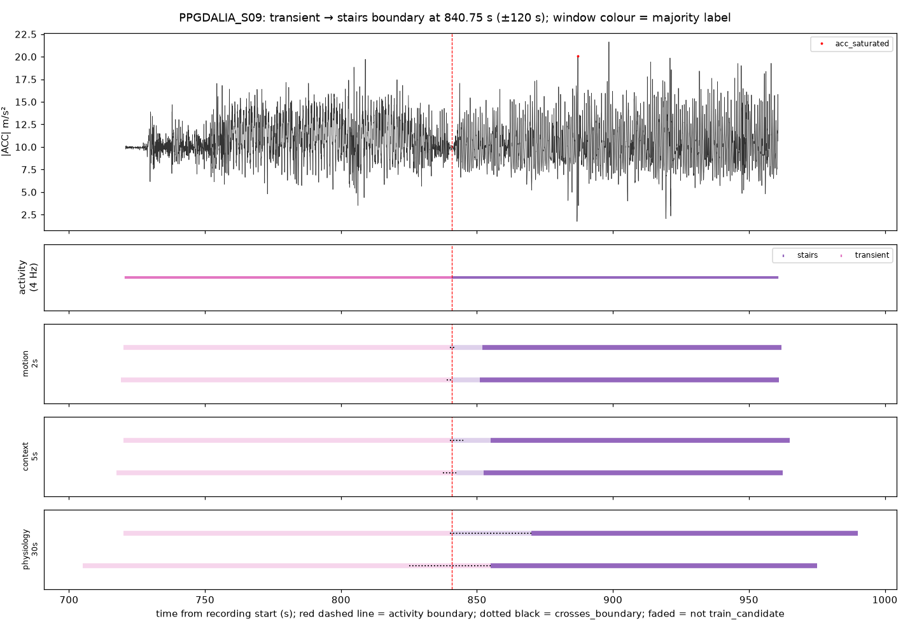

**motion_2s**

| window_id | window_start | window_end | original_label | label_purity | crosses_boundary | seconds_to_nearest_boundary | context_class | eval_role | acc_saturated_frac |
|---|---|---|---|---|---|---|---|---|---|
| PPGDALIA_S09_mot2_000829 | 829.000 | 831.000 | transient | 1.000 | False | 9.750 | None | false_alert_eval | 0.000 |
| PPGDALIA_S09_mot2_000830 | 830.000 | 832.000 | transient | 1.000 | False | 8.750 | None | false_alert_eval | 0.000 |
| PPGDALIA_S09_mot2_000831 | 831.000 | 833.000 | transient | 1.000 | False | 7.750 | None | false_alert_eval | 0.000 |
| PPGDALIA_S09_mot2_000832 | 832.000 | 834.000 | transient | 1.000 | False | 6.750 | None | false_alert_eval | 0.000 |
| PPGDALIA_S09_mot2_000833 | 833.000 | 835.000 | transient | 1.000 | False | 5.750 | None | false_alert_eval | 0.000 |
| PPGDALIA_S09_mot2_000834 | 834.000 | 836.000 | transient | 1.000 | False | 4.750 | None | false_alert_eval | 0.000 |
| PPGDALIA_S09_mot2_000835 | 835.000 | 837.000 | transient | 1.000 | False | 3.750 | None | false_alert_eval | 0.000 |
| PPGDALIA_S09_mot2_000836 | 836.000 | 838.000 | transient | 1.000 | False | 2.750 | None | false_alert_eval | 0.000 |
| PPGDALIA_S09_mot2_000837 | 837.000 | 839.000 | transient | 1.000 | False | 1.750 | None | false_alert_eval | 0.000 |
| PPGDALIA_S09_mot2_000838 | 838.000 | 840.000 | transient | 1.000 | False | 0.750 | None | false_alert_eval | 0.000 |
| PPGDALIA_S09_mot2_000839 | 839.000 | 841.000 | transient | 0.875 | True | 0.000 | None | false_alert_eval | 0.000 |
| PPGDALIA_S09_mot2_000840 | 840.000 | 842.000 | stairs | 0.625 | True | 0.000 | vigorous_activity | false_alert_eval_only | 0.000 |
| PPGDALIA_S09_mot2_000841 | 841.000 | 843.000 | stairs | 1.000 | False | 0.250 | vigorous_activity | false_alert_eval | 0.000 |
| PPGDALIA_S09_mot2_000842 | 842.000 | 844.000 | stairs | 1.000 | False | 1.250 | vigorous_activity | false_alert_eval | 0.000 |
| PPGDALIA_S09_mot2_000843 | 843.000 | 845.000 | stairs | 1.000 | False | 2.250 | vigorous_activity | false_alert_eval | 0.000 |
| PPGDALIA_S09_mot2_000844 | 844.000 | 846.000 | stairs | 1.000 | False | 3.250 | vigorous_activity | false_alert_eval | 0.000 |
| PPGDALIA_S09_mot2_000845 | 845.000 | 847.000 | stairs | 1.000 | False | 4.250 | vigorous_activity | false_alert_eval | 0.000 |
| PPGDALIA_S09_mot2_000846 | 846.000 | 848.000 | stairs | 1.000 | False | 5.250 | vigorous_activity | false_alert_eval | 0.000 |
| PPGDALIA_S09_mot2_000847 | 847.000 | 849.000 | stairs | 1.000 | False | 6.250 | vigorous_activity | false_alert_eval | 0.000 |
| PPGDALIA_S09_mot2_000848 | 848.000 | 850.000 | stairs | 1.000 | False | 7.250 | vigorous_activity | false_alert_eval | 0.000 |
| PPGDALIA_S09_mot2_000849 | 849.000 | 851.000 | stairs | 1.000 | False | 8.250 | vigorous_activity | false_alert_eval | 0.000 |
| PPGDALIA_S09_mot2_000850 | 850.000 | 852.000 | stairs | 1.000 | False | 9.250 | vigorous_activity | false_alert_eval | 0.000 |

**context_5s**

| window_id | window_start | window_end | original_label | label_purity | crosses_boundary | seconds_to_nearest_boundary | context_class | eval_role | acc_saturated_frac |
|---|---|---|---|---|---|---|---|---|---|
| PPGDALIA_S09_ctx5_000331 | 827.500 | 832.500 | transient | 1.000 | False | 8.250 | None | false_alert_eval | 0.000 |
| PPGDALIA_S09_ctx5_000332 | 830.000 | 835.000 | transient | 1.000 | False | 5.750 | None | false_alert_eval | 0.000 |
| PPGDALIA_S09_ctx5_000333 | 832.500 | 837.500 | transient | 1.000 | False | 3.250 | None | false_alert_eval | 0.000 |
| PPGDALIA_S09_ctx5_000334 | 835.000 | 840.000 | transient | 1.000 | False | 0.750 | None | false_alert_eval | 0.000 |
| PPGDALIA_S09_ctx5_000335 | 837.500 | 842.500 | transient | 0.650 | True | 0.000 | None | false_alert_eval | 0.000 |
| PPGDALIA_S09_ctx5_000336 | 840.000 | 845.000 | stairs | 0.850 | True | 0.000 | vigorous_activity | false_alert_eval_only | 0.000 |
| PPGDALIA_S09_ctx5_000337 | 842.500 | 847.500 | stairs | 1.000 | False | 1.750 | vigorous_activity | false_alert_eval | 0.000 |
| PPGDALIA_S09_ctx5_000338 | 845.000 | 850.000 | stairs | 1.000 | False | 4.250 | vigorous_activity | false_alert_eval | 0.000 |
| PPGDALIA_S09_ctx5_000339 | 847.500 | 852.500 | stairs | 1.000 | False | 6.750 | vigorous_activity | false_alert_eval | 0.000 |
| PPGDALIA_S09_ctx5_000340 | 850.000 | 855.000 | stairs | 1.000 | False | 9.250 | vigorous_activity | false_alert_eval | 0.000 |

**physiology_30s**

| window_id | window_start | window_end | original_label | label_purity | crosses_boundary | seconds_to_nearest_boundary | context_class | eval_role | acc_saturated_frac |
|---|---|---|---|---|---|---|---|---|---|
| PPGDALIA_S09_phy30_000053 | 795.000 | 825.000 | transient | 1.000 | False | 15.750 | None | false_alert_eval | 0.000 |
| PPGDALIA_S09_phy30_000054 | 810.000 | 840.000 | transient | 1.000 | False | 0.750 | None | false_alert_eval | 0.000 |
| PPGDALIA_S09_phy30_000055 | 825.000 | 855.000 | transient | 0.525 | True | 0.000 | None | false_alert_eval | 0.000 |
| PPGDALIA_S09_phy30_000056 | 840.000 | 870.000 | stairs | 0.975 | True | 0.000 | vigorous_activity | false_alert_eval_only | 0.000 |
| PPGDALIA_S09_phy30_000057 | 855.000 | 885.000 | stairs | 1.000 | False | 14.250 | vigorous_activity | train_candidate | 0.000 |
| PPGDALIA_S09_phy30_000058 | 870.000 | 900.000 | stairs | 1.000 | False | 29.250 | vigorous_activity | train_candidate | 0.001 |

### PPGDALIA_S10: transient → stairs at 1235.00 s

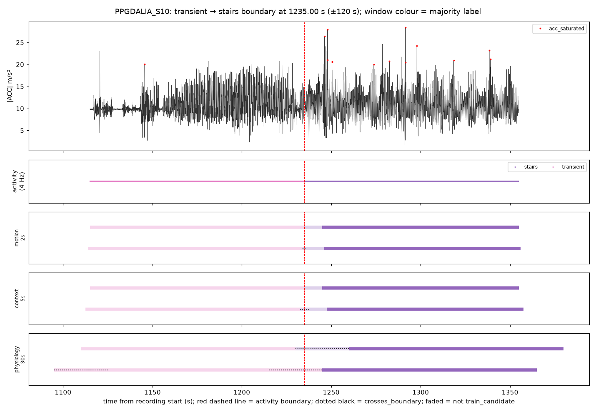

**motion_2s**

| window_id | window_start | window_end | original_label | label_purity | crosses_boundary | seconds_to_nearest_boundary | context_class | eval_role | acc_saturated_frac |
|---|---|---|---|---|---|---|---|---|---|
| PPGDALIA_S10_mot2_001224 | 1224.000 | 1226.000 | transient | 1.000 | False | 9.000 | None | false_alert_eval | 0.000 |
| PPGDALIA_S10_mot2_001225 | 1225.000 | 1227.000 | transient | 1.000 | False | 8.000 | None | false_alert_eval | 0.000 |
| PPGDALIA_S10_mot2_001226 | 1226.000 | 1228.000 | transient | 1.000 | False | 7.000 | None | false_alert_eval | 0.000 |
| PPGDALIA_S10_mot2_001227 | 1227.000 | 1229.000 | transient | 1.000 | False | 6.000 | None | false_alert_eval | 0.000 |
| PPGDALIA_S10_mot2_001228 | 1228.000 | 1230.000 | transient | 1.000 | False | 5.000 | None | false_alert_eval | 0.000 |
| PPGDALIA_S10_mot2_001229 | 1229.000 | 1231.000 | transient | 1.000 | False | 4.000 | None | false_alert_eval | 0.000 |
| PPGDALIA_S10_mot2_001230 | 1230.000 | 1232.000 | transient | 1.000 | False | 3.000 | None | false_alert_eval | 0.000 |
| PPGDALIA_S10_mot2_001231 | 1231.000 | 1233.000 | transient | 1.000 | False | 2.000 | None | false_alert_eval | 0.000 |
| PPGDALIA_S10_mot2_001232 | 1232.000 | 1234.000 | transient | 1.000 | False | 1.000 | None | false_alert_eval | 0.000 |
| PPGDALIA_S10_mot2_001233 | 1233.000 | 1235.000 | transient | 1.000 | False | 0.000 | None | false_alert_eval | 0.000 |
| PPGDALIA_S10_mot2_001234 | 1234.000 | 1236.000 | stairs | 0.500 | True | 0.000 | vigorous_activity | false_alert_eval_only | 0.000 |
| PPGDALIA_S10_mot2_001235 | 1235.000 | 1237.000 | stairs | 1.000 | False | 0.000 | vigorous_activity | false_alert_eval | 0.000 |
| PPGDALIA_S10_mot2_001236 | 1236.000 | 1238.000 | stairs | 1.000 | False | 1.000 | vigorous_activity | false_alert_eval | 0.000 |
| PPGDALIA_S10_mot2_001237 | 1237.000 | 1239.000 | stairs | 1.000 | False | 2.000 | vigorous_activity | false_alert_eval | 0.000 |
| PPGDALIA_S10_mot2_001238 | 1238.000 | 1240.000 | stairs | 1.000 | False | 3.000 | vigorous_activity | false_alert_eval | 0.000 |
| PPGDALIA_S10_mot2_001239 | 1239.000 | 1241.000 | stairs | 1.000 | False | 4.000 | vigorous_activity | false_alert_eval | 0.000 |
| PPGDALIA_S10_mot2_001240 | 1240.000 | 1242.000 | stairs | 1.000 | False | 5.000 | vigorous_activity | false_alert_eval | 0.000 |
| PPGDALIA_S10_mot2_001241 | 1241.000 | 1243.000 | stairs | 1.000 | False | 6.000 | vigorous_activity | false_alert_eval | 0.000 |
| PPGDALIA_S10_mot2_001242 | 1242.000 | 1244.000 | stairs | 1.000 | False | 7.000 | vigorous_activity | false_alert_eval | 0.000 |
| PPGDALIA_S10_mot2_001243 | 1243.000 | 1245.000 | stairs | 1.000 | False | 8.000 | vigorous_activity | false_alert_eval | 0.000 |
| PPGDALIA_S10_mot2_001244 | 1244.000 | 1246.000 | stairs | 1.000 | False | 9.000 | vigorous_activity | false_alert_eval | 0.000 |

**context_5s**

| window_id | window_start | window_end | original_label | label_purity | crosses_boundary | seconds_to_nearest_boundary | context_class | eval_role | acc_saturated_frac |
|---|---|---|---|---|---|---|---|---|---|
| PPGDALIA_S10_ctx5_000489 | 1222.500 | 1227.500 | transient | 1.000 | False | 7.500 | None | false_alert_eval | 0.000 |
| PPGDALIA_S10_ctx5_000490 | 1225.000 | 1230.000 | transient | 1.000 | False | 5.000 | None | false_alert_eval | 0.000 |
| PPGDALIA_S10_ctx5_000491 | 1227.500 | 1232.500 | transient | 1.000 | False | 2.500 | None | false_alert_eval | 0.000 |
| PPGDALIA_S10_ctx5_000492 | 1230.000 | 1235.000 | transient | 1.000 | False | 0.000 | None | false_alert_eval | 0.000 |
| PPGDALIA_S10_ctx5_000493 | 1232.500 | 1237.500 | stairs | 0.500 | True | 0.000 | vigorous_activity | false_alert_eval_only | 0.000 |
| PPGDALIA_S10_ctx5_000494 | 1235.000 | 1240.000 | stairs | 1.000 | False | 0.000 | vigorous_activity | false_alert_eval | 0.000 |
| PPGDALIA_S10_ctx5_000495 | 1237.500 | 1242.500 | stairs | 1.000 | False | 2.500 | vigorous_activity | false_alert_eval | 0.000 |
| PPGDALIA_S10_ctx5_000496 | 1240.000 | 1245.000 | stairs | 1.000 | False | 5.000 | vigorous_activity | false_alert_eval | 0.000 |
| PPGDALIA_S10_ctx5_000497 | 1242.500 | 1247.500 | stairs | 1.000 | False | 7.500 | vigorous_activity | false_alert_eval | 0.006 |

**physiology_30s**

| window_id | window_start | window_end | original_label | label_purity | crosses_boundary | seconds_to_nearest_boundary | context_class | eval_role | acc_saturated_frac |
|---|---|---|---|---|---|---|---|---|---|
| PPGDALIA_S10_phy30_000079 | 1185.000 | 1215.000 | transient | 1.000 | False | 20.000 | None | false_alert_eval | 0.000 |
| PPGDALIA_S10_phy30_000080 | 1200.000 | 1230.000 | transient | 1.000 | False | 5.000 | None | false_alert_eval | 0.000 |
| PPGDALIA_S10_phy30_000081 | 1215.000 | 1245.000 | transient | 0.667 | True | 0.000 | None | false_alert_eval | 0.000 |
| PPGDALIA_S10_phy30_000082 | 1230.000 | 1260.000 | stairs | 0.833 | True | 0.000 | vigorous_activity | false_alert_eval_only | 0.005 |
| PPGDALIA_S10_phy30_000083 | 1245.000 | 1275.000 | stairs | 1.000 | False | 10.000 | vigorous_activity | train_candidate | 0.006 |
| PPGDALIA_S10_phy30_000084 | 1260.000 | 1290.000 | stairs | 1.000 | False | 25.000 | vigorous_activity | train_candidate | 0.002 |

### PPGDALIA_S11: transient → stairs at 792.50 s

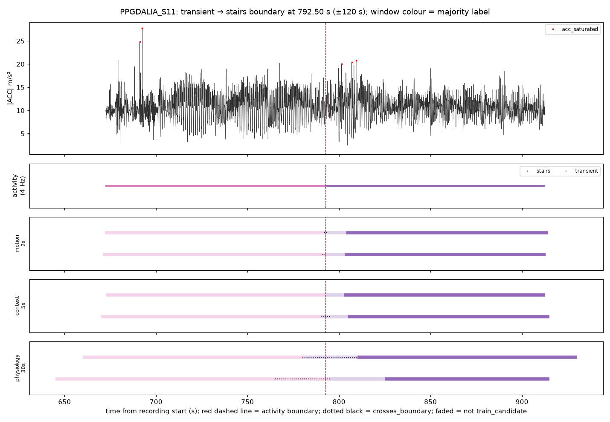

**motion_2s**

| window_id | window_start | window_end | original_label | label_purity | crosses_boundary | seconds_to_nearest_boundary | context_class | eval_role | acc_saturated_frac |
|---|---|---|---|---|---|---|---|---|---|
| PPGDALIA_S11_mot2_000781 | 781.000 | 783.000 | transient | 1.000 | False | 9.500 | None | false_alert_eval | 0.000 |
| PPGDALIA_S11_mot2_000782 | 782.000 | 784.000 | transient | 1.000 | False | 8.500 | None | false_alert_eval | 0.000 |
| PPGDALIA_S11_mot2_000783 | 783.000 | 785.000 | transient | 1.000 | False | 7.500 | None | false_alert_eval | 0.000 |
| PPGDALIA_S11_mot2_000784 | 784.000 | 786.000 | transient | 1.000 | False | 6.500 | None | false_alert_eval | 0.000 |
| PPGDALIA_S11_mot2_000785 | 785.000 | 787.000 | transient | 1.000 | False | 5.500 | None | false_alert_eval | 0.000 |
| PPGDALIA_S11_mot2_000786 | 786.000 | 788.000 | transient | 1.000 | False | 4.500 | None | false_alert_eval | 0.000 |
| PPGDALIA_S11_mot2_000787 | 787.000 | 789.000 | transient | 1.000 | False | 3.500 | None | false_alert_eval | 0.000 |
| PPGDALIA_S11_mot2_000788 | 788.000 | 790.000 | transient | 1.000 | False | 2.500 | None | false_alert_eval | 0.000 |
| PPGDALIA_S11_mot2_000789 | 789.000 | 791.000 | transient | 1.000 | False | 1.500 | None | false_alert_eval | 0.000 |
| PPGDALIA_S11_mot2_000790 | 790.000 | 792.000 | transient | 1.000 | False | 0.500 | None | false_alert_eval | 0.000 |
| PPGDALIA_S11_mot2_000791 | 791.000 | 793.000 | transient | 0.750 | True | 0.000 | None | false_alert_eval | 0.000 |
| PPGDALIA_S11_mot2_000792 | 792.000 | 794.000 | stairs | 0.750 | True | 0.000 | vigorous_activity | false_alert_eval_only | 0.000 |
| PPGDALIA_S11_mot2_000793 | 793.000 | 795.000 | stairs | 1.000 | False | 0.500 | vigorous_activity | false_alert_eval | 0.000 |
| PPGDALIA_S11_mot2_000794 | 794.000 | 796.000 | stairs | 1.000 | False | 1.500 | vigorous_activity | false_alert_eval | 0.000 |
| PPGDALIA_S11_mot2_000795 | 795.000 | 797.000 | stairs | 1.000 | False | 2.500 | vigorous_activity | false_alert_eval | 0.000 |
| PPGDALIA_S11_mot2_000796 | 796.000 | 798.000 | stairs | 1.000 | False | 3.500 | vigorous_activity | false_alert_eval | 0.000 |
| PPGDALIA_S11_mot2_000797 | 797.000 | 799.000 | stairs | 1.000 | False | 4.500 | vigorous_activity | false_alert_eval | 0.000 |
| PPGDALIA_S11_mot2_000798 | 798.000 | 800.000 | stairs | 1.000 | False | 5.500 | vigorous_activity | false_alert_eval | 0.000 |
| PPGDALIA_S11_mot2_000799 | 799.000 | 801.000 | stairs | 1.000 | False | 6.500 | vigorous_activity | false_alert_eval | 0.000 |
| PPGDALIA_S11_mot2_000800 | 800.000 | 802.000 | stairs | 1.000 | False | 7.500 | vigorous_activity | false_alert_eval | 0.016 |
| PPGDALIA_S11_mot2_000801 | 801.000 | 803.000 | stairs | 1.000 | False | 8.500 | vigorous_activity | false_alert_eval | 0.016 |
| PPGDALIA_S11_mot2_000802 | 802.000 | 804.000 | stairs | 1.000 | False | 9.500 | vigorous_activity | false_alert_eval | 0.000 |

**context_5s**

| window_id | window_start | window_end | original_label | label_purity | crosses_boundary | seconds_to_nearest_boundary | context_class | eval_role | acc_saturated_frac |
|---|---|---|---|---|---|---|---|---|---|
| PPGDALIA_S11_ctx5_000312 | 780.000 | 785.000 | transient | 1.000 | False | 7.500 | None | false_alert_eval | 0.000 |
| PPGDALIA_S11_ctx5_000313 | 782.500 | 787.500 | transient | 1.000 | False | 5.000 | None | false_alert_eval | 0.000 |
| PPGDALIA_S11_ctx5_000314 | 785.000 | 790.000 | transient | 1.000 | False | 2.500 | None | false_alert_eval | 0.000 |
| PPGDALIA_S11_ctx5_000315 | 787.500 | 792.500 | transient | 1.000 | False | 0.000 | None | false_alert_eval | 0.000 |
| PPGDALIA_S11_ctx5_000316 | 790.000 | 795.000 | stairs | 0.500 | True | 0.000 | vigorous_activity | false_alert_eval_only | 0.000 |
| PPGDALIA_S11_ctx5_000317 | 792.500 | 797.500 | stairs | 1.000 | False | 0.000 | vigorous_activity | false_alert_eval | 0.000 |
| PPGDALIA_S11_ctx5_000318 | 795.000 | 800.000 | stairs | 1.000 | False | 2.500 | vigorous_activity | false_alert_eval | 0.000 |
| PPGDALIA_S11_ctx5_000319 | 797.500 | 802.500 | stairs | 1.000 | False | 5.000 | vigorous_activity | false_alert_eval | 0.006 |
| PPGDALIA_S11_ctx5_000320 | 800.000 | 805.000 | stairs | 1.000 | False | 7.500 | vigorous_activity | false_alert_eval | 0.006 |

**physiology_30s**

| window_id | window_start | window_end | original_label | label_purity | crosses_boundary | seconds_to_nearest_boundary | context_class | eval_role | acc_saturated_frac |
|---|---|---|---|---|---|---|---|---|---|
| PPGDALIA_S11_phy30_000049 | 735.000 | 765.000 | transient | 1.000 | False | 27.500 | None | false_alert_eval | 0.000 |
| PPGDALIA_S11_phy30_000050 | 750.000 | 780.000 | transient | 1.000 | False | 12.500 | None | false_alert_eval | 0.000 |
| PPGDALIA_S11_phy30_000051 | 765.000 | 795.000 | transient | 0.917 | True | 0.000 | None | false_alert_eval | 0.000 |
| PPGDALIA_S11_phy30_000052 | 780.000 | 810.000 | stairs | 0.583 | True | 0.000 | vigorous_activity | false_alert_eval_only | 0.003 |
| PPGDALIA_S11_phy30_000053 | 795.000 | 825.000 | stairs | 1.000 | False | 2.500 | vigorous_activity | false_alert_eval | 0.003 |
| PPGDALIA_S11_phy30_000054 | 810.000 | 840.000 | stairs | 1.000 | False | 17.500 | vigorous_activity | train_candidate | 0.000 |

### PPGDALIA_S12: transient → stairs at 828.50 s

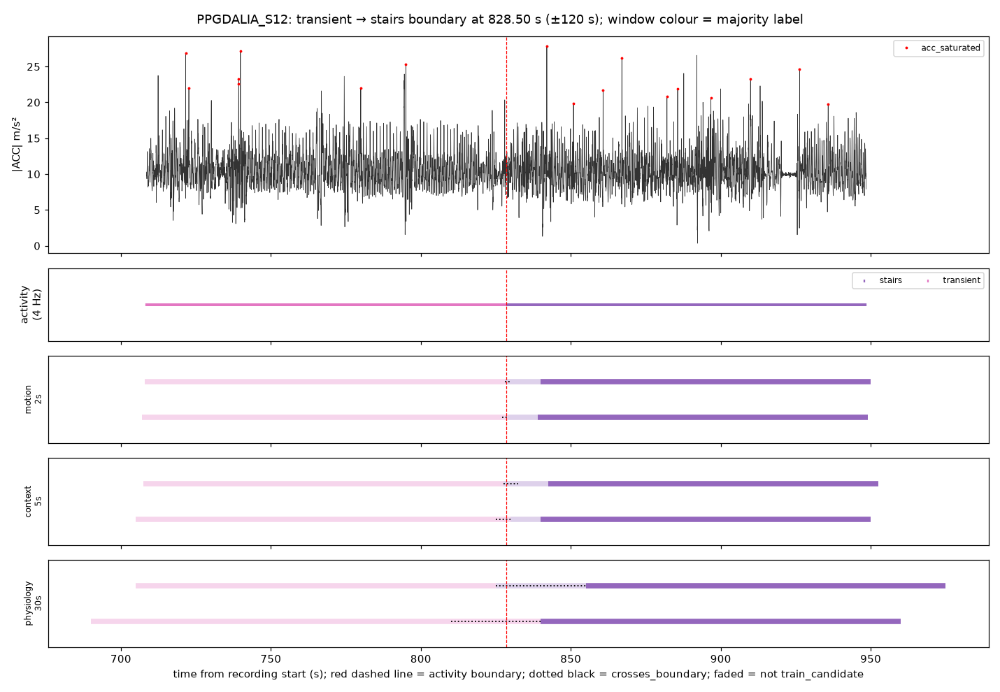

**motion_2s**

| window_id | window_start | window_end | original_label | label_purity | crosses_boundary | seconds_to_nearest_boundary | context_class | eval_role | acc_saturated_frac |
|---|---|---|---|---|---|---|---|---|---|
| PPGDALIA_S12_mot2_000817 | 817.000 | 819.000 | transient | 1.000 | False | 9.500 | None | false_alert_eval | 0.000 |
| PPGDALIA_S12_mot2_000818 | 818.000 | 820.000 | transient | 1.000 | False | 8.500 | None | false_alert_eval | 0.000 |
| PPGDALIA_S12_mot2_000819 | 819.000 | 821.000 | transient | 1.000 | False | 7.500 | None | false_alert_eval | 0.000 |
| PPGDALIA_S12_mot2_000820 | 820.000 | 822.000 | transient | 1.000 | False | 6.500 | None | false_alert_eval | 0.000 |
| PPGDALIA_S12_mot2_000821 | 821.000 | 823.000 | transient | 1.000 | False | 5.500 | None | false_alert_eval | 0.000 |
| PPGDALIA_S12_mot2_000822 | 822.000 | 824.000 | transient | 1.000 | False | 4.500 | None | false_alert_eval | 0.000 |
| PPGDALIA_S12_mot2_000823 | 823.000 | 825.000 | transient | 1.000 | False | 3.500 | None | false_alert_eval | 0.000 |
| PPGDALIA_S12_mot2_000824 | 824.000 | 826.000 | transient | 1.000 | False | 2.500 | None | false_alert_eval | 0.000 |
| PPGDALIA_S12_mot2_000825 | 825.000 | 827.000 | transient | 1.000 | False | 1.500 | None | false_alert_eval | 0.000 |
| PPGDALIA_S12_mot2_000826 | 826.000 | 828.000 | transient | 1.000 | False | 0.500 | None | false_alert_eval | 0.000 |
| PPGDALIA_S12_mot2_000827 | 827.000 | 829.000 | transient | 0.750 | True | 0.000 | None | false_alert_eval | 0.000 |
| PPGDALIA_S12_mot2_000828 | 828.000 | 830.000 | stairs | 0.750 | True | 0.000 | vigorous_activity | false_alert_eval_only | 0.000 |
| PPGDALIA_S12_mot2_000829 | 829.000 | 831.000 | stairs | 1.000 | False | 0.500 | vigorous_activity | false_alert_eval | 0.000 |
| PPGDALIA_S12_mot2_000830 | 830.000 | 832.000 | stairs | 1.000 | False | 1.500 | vigorous_activity | false_alert_eval | 0.000 |
| PPGDALIA_S12_mot2_000831 | 831.000 | 833.000 | stairs | 1.000 | False | 2.500 | vigorous_activity | false_alert_eval | 0.000 |
| PPGDALIA_S12_mot2_000832 | 832.000 | 834.000 | stairs | 1.000 | False | 3.500 | vigorous_activity | false_alert_eval | 0.000 |
| PPGDALIA_S12_mot2_000833 | 833.000 | 835.000 | stairs | 1.000 | False | 4.500 | vigorous_activity | false_alert_eval | 0.000 |
| PPGDALIA_S12_mot2_000834 | 834.000 | 836.000 | stairs | 1.000 | False | 5.500 | vigorous_activity | false_alert_eval | 0.000 |
| PPGDALIA_S12_mot2_000835 | 835.000 | 837.000 | stairs | 1.000 | False | 6.500 | vigorous_activity | false_alert_eval | 0.000 |
| PPGDALIA_S12_mot2_000836 | 836.000 | 838.000 | stairs | 1.000 | False | 7.500 | vigorous_activity | false_alert_eval | 0.000 |
| PPGDALIA_S12_mot2_000837 | 837.000 | 839.000 | stairs | 1.000 | False | 8.500 | vigorous_activity | false_alert_eval | 0.000 |
| PPGDALIA_S12_mot2_000838 | 838.000 | 840.000 | stairs | 1.000 | False | 9.500 | vigorous_activity | false_alert_eval | 0.000 |

**context_5s**

| window_id | window_start | window_end | original_label | label_purity | crosses_boundary | seconds_to_nearest_boundary | context_class | eval_role | acc_saturated_frac |
|---|---|---|---|---|---|---|---|---|---|
| PPGDALIA_S12_ctx5_000326 | 815.000 | 820.000 | transient | 1.000 | False | 8.500 | None | false_alert_eval | 0.000 |
| PPGDALIA_S12_ctx5_000327 | 817.500 | 822.500 | transient | 1.000 | False | 6.000 | None | false_alert_eval | 0.000 |
| PPGDALIA_S12_ctx5_000328 | 820.000 | 825.000 | transient | 1.000 | False | 3.500 | None | false_alert_eval | 0.000 |
| PPGDALIA_S12_ctx5_000329 | 822.500 | 827.500 | transient | 1.000 | False | 1.000 | None | false_alert_eval | 0.000 |
| PPGDALIA_S12_ctx5_000330 | 825.000 | 830.000 | transient | 0.700 | True | 0.000 | None | false_alert_eval | 0.000 |
| PPGDALIA_S12_ctx5_000331 | 827.500 | 832.500 | stairs | 0.800 | True | 0.000 | vigorous_activity | false_alert_eval_only | 0.000 |
| PPGDALIA_S12_ctx5_000332 | 830.000 | 835.000 | stairs | 1.000 | False | 1.500 | vigorous_activity | false_alert_eval | 0.000 |
| PPGDALIA_S12_ctx5_000333 | 832.500 | 837.500 | stairs | 1.000 | False | 4.000 | vigorous_activity | false_alert_eval | 0.000 |
| PPGDALIA_S12_ctx5_000334 | 835.000 | 840.000 | stairs | 1.000 | False | 6.500 | vigorous_activity | false_alert_eval | 0.000 |
| PPGDALIA_S12_ctx5_000335 | 837.500 | 842.500 | stairs | 1.000 | False | 9.000 | vigorous_activity | false_alert_eval | 0.006 |

**physiology_30s**

| window_id | window_start | window_end | original_label | label_purity | crosses_boundary | seconds_to_nearest_boundary | context_class | eval_role | acc_saturated_frac |
|---|---|---|---|---|---|---|---|---|---|
| PPGDALIA_S12_phy30_000052 | 780.000 | 810.000 | transient | 1.000 | False | 18.500 | None | false_alert_eval | 0.001 |
| PPGDALIA_S12_phy30_000053 | 795.000 | 825.000 | transient | 1.000 | False | 3.500 | None | false_alert_eval | 0.001 |
| PPGDALIA_S12_phy30_000054 | 810.000 | 840.000 | transient | 0.617 | True | 0.000 | None | false_alert_eval | 0.000 |
| PPGDALIA_S12_phy30_000055 | 825.000 | 855.000 | stairs | 0.883 | True | 0.000 | vigorous_activity | false_alert_eval_only | 0.002 |
| PPGDALIA_S12_phy30_000056 | 840.000 | 870.000 | stairs | 1.000 | False | 11.500 | vigorous_activity | train_candidate | 0.004 |
| PPGDALIA_S12_phy30_000057 | 855.000 | 885.000 | stairs | 1.000 | False | 26.500 | vigorous_activity | train_candidate | 0.003 |

### PPGDALIA_S13: transient → stairs at 816.75 s

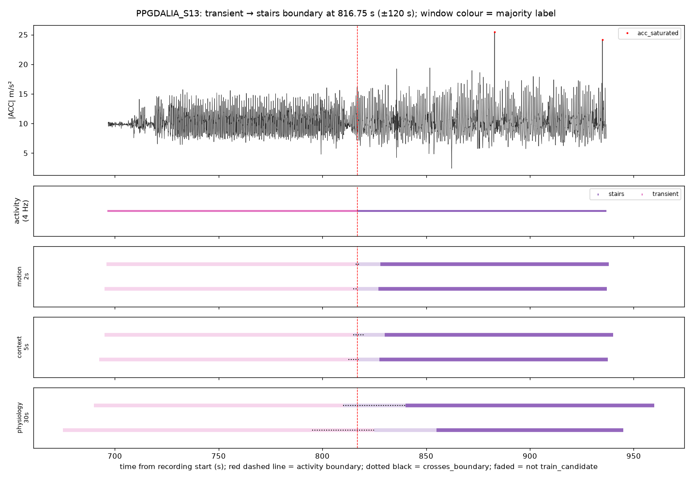

**motion_2s**

| window_id | window_start | window_end | original_label | label_purity | crosses_boundary | seconds_to_nearest_boundary | context_class | eval_role | acc_saturated_frac |
|---|---|---|---|---|---|---|---|---|---|
| PPGDALIA_S13_mot2_000805 | 805.000 | 807.000 | transient | 1.000 | False | 9.750 | None | false_alert_eval | 0.000 |
| PPGDALIA_S13_mot2_000806 | 806.000 | 808.000 | transient | 1.000 | False | 8.750 | None | false_alert_eval | 0.000 |
| PPGDALIA_S13_mot2_000807 | 807.000 | 809.000 | transient | 1.000 | False | 7.750 | None | false_alert_eval | 0.000 |
| PPGDALIA_S13_mot2_000808 | 808.000 | 810.000 | transient | 1.000 | False | 6.750 | None | false_alert_eval | 0.000 |
| PPGDALIA_S13_mot2_000809 | 809.000 | 811.000 | transient | 1.000 | False | 5.750 | None | false_alert_eval | 0.000 |
| PPGDALIA_S13_mot2_000810 | 810.000 | 812.000 | transient | 1.000 | False | 4.750 | None | false_alert_eval | 0.000 |
| PPGDALIA_S13_mot2_000811 | 811.000 | 813.000 | transient | 1.000 | False | 3.750 | None | false_alert_eval | 0.000 |
| PPGDALIA_S13_mot2_000812 | 812.000 | 814.000 | transient | 1.000 | False | 2.750 | None | false_alert_eval | 0.000 |
| PPGDALIA_S13_mot2_000813 | 813.000 | 815.000 | transient | 1.000 | False | 1.750 | None | false_alert_eval | 0.000 |
| PPGDALIA_S13_mot2_000814 | 814.000 | 816.000 | transient | 1.000 | False | 0.750 | None | false_alert_eval | 0.000 |
| PPGDALIA_S13_mot2_000815 | 815.000 | 817.000 | transient | 0.875 | True | 0.000 | None | false_alert_eval | 0.000 |
| PPGDALIA_S13_mot2_000816 | 816.000 | 818.000 | stairs | 0.625 | True | 0.000 | vigorous_activity | false_alert_eval_only | 0.000 |
| PPGDALIA_S13_mot2_000817 | 817.000 | 819.000 | stairs | 1.000 | False | 0.250 | vigorous_activity | false_alert_eval | 0.000 |
| PPGDALIA_S13_mot2_000818 | 818.000 | 820.000 | stairs | 1.000 | False | 1.250 | vigorous_activity | false_alert_eval | 0.000 |
| PPGDALIA_S13_mot2_000819 | 819.000 | 821.000 | stairs | 1.000 | False | 2.250 | vigorous_activity | false_alert_eval | 0.000 |
| PPGDALIA_S13_mot2_000820 | 820.000 | 822.000 | stairs | 1.000 | False | 3.250 | vigorous_activity | false_alert_eval | 0.000 |
| PPGDALIA_S13_mot2_000821 | 821.000 | 823.000 | stairs | 1.000 | False | 4.250 | vigorous_activity | false_alert_eval | 0.000 |
| PPGDALIA_S13_mot2_000822 | 822.000 | 824.000 | stairs | 1.000 | False | 5.250 | vigorous_activity | false_alert_eval | 0.000 |
| PPGDALIA_S13_mot2_000823 | 823.000 | 825.000 | stairs | 1.000 | False | 6.250 | vigorous_activity | false_alert_eval | 0.000 |
| PPGDALIA_S13_mot2_000824 | 824.000 | 826.000 | stairs | 1.000 | False | 7.250 | vigorous_activity | false_alert_eval | 0.000 |
| PPGDALIA_S13_mot2_000825 | 825.000 | 827.000 | stairs | 1.000 | False | 8.250 | vigorous_activity | false_alert_eval | 0.000 |
| PPGDALIA_S13_mot2_000826 | 826.000 | 828.000 | stairs | 1.000 | False | 9.250 | vigorous_activity | false_alert_eval | 0.000 |

**context_5s**

| window_id | window_start | window_end | original_label | label_purity | crosses_boundary | seconds_to_nearest_boundary | context_class | eval_role | acc_saturated_frac |
|---|---|---|---|---|---|---|---|---|---|
| PPGDALIA_S13_ctx5_000321 | 802.500 | 807.500 | transient | 1.000 | False | 9.250 | None | false_alert_eval | 0.000 |
| PPGDALIA_S13_ctx5_000322 | 805.000 | 810.000 | transient | 1.000 | False | 6.750 | None | false_alert_eval | 0.000 |
| PPGDALIA_S13_ctx5_000323 | 807.500 | 812.500 | transient | 1.000 | False | 4.250 | None | false_alert_eval | 0.000 |
| PPGDALIA_S13_ctx5_000324 | 810.000 | 815.000 | transient | 1.000 | False | 1.750 | None | false_alert_eval | 0.000 |
| PPGDALIA_S13_ctx5_000325 | 812.500 | 817.500 | transient | 0.850 | True | 0.000 | None | false_alert_eval | 0.000 |
| PPGDALIA_S13_ctx5_000326 | 815.000 | 820.000 | stairs | 0.650 | True | 0.000 | vigorous_activity | false_alert_eval_only | 0.000 |
| PPGDALIA_S13_ctx5_000327 | 817.500 | 822.500 | stairs | 1.000 | False | 0.750 | vigorous_activity | false_alert_eval | 0.000 |
| PPGDALIA_S13_ctx5_000328 | 820.000 | 825.000 | stairs | 1.000 | False | 3.250 | vigorous_activity | false_alert_eval | 0.000 |
| PPGDALIA_S13_ctx5_000329 | 822.500 | 827.500 | stairs | 1.000 | False | 5.750 | vigorous_activity | false_alert_eval | 0.000 |
| PPGDALIA_S13_ctx5_000330 | 825.000 | 830.000 | stairs | 1.000 | False | 8.250 | vigorous_activity | false_alert_eval | 0.000 |

**physiology_30s**

| window_id | window_start | window_end | original_label | label_purity | crosses_boundary | seconds_to_nearest_boundary | context_class | eval_role | acc_saturated_frac |
|---|---|---|---|---|---|---|---|---|---|
| PPGDALIA_S13_phy30_000051 | 765.000 | 795.000 | transient | 1.000 | False | 21.750 | None | false_alert_eval | 0.000 |
| PPGDALIA_S13_phy30_000052 | 780.000 | 810.000 | transient | 1.000 | False | 6.750 | None | false_alert_eval | 0.000 |
| PPGDALIA_S13_phy30_000053 | 795.000 | 825.000 | transient | 0.725 | True | 0.000 | None | false_alert_eval | 0.000 |
| PPGDALIA_S13_phy30_000054 | 810.000 | 840.000 | stairs | 0.775 | True | 0.000 | vigorous_activity | false_alert_eval_only | 0.000 |
| PPGDALIA_S13_phy30_000055 | 825.000 | 855.000 | stairs | 1.000 | False | 8.250 | vigorous_activity | false_alert_eval | 0.000 |
| PPGDALIA_S13_phy30_000056 | 840.000 | 870.000 | stairs | 1.000 | False | 23.250 | vigorous_activity | train_candidate | 0.000 |

### PPGDALIA_S14: transient → stairs at 814.00 s

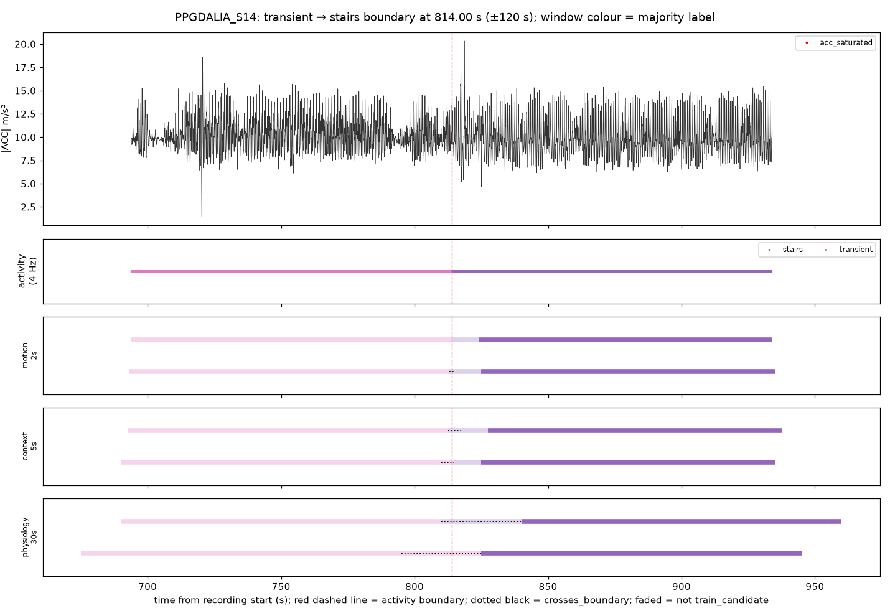

**motion_2s**

| window_id | window_start | window_end | original_label | label_purity | crosses_boundary | seconds_to_nearest_boundary | context_class | eval_role | acc_saturated_frac |
|---|---|---|---|---|---|---|---|---|---|
| PPGDALIA_S14_mot2_000803 | 803.000 | 805.000 | transient | 1.000 | False | 9.000 | None | false_alert_eval | 0.000 |
| PPGDALIA_S14_mot2_000804 | 804.000 | 806.000 | transient | 1.000 | False | 8.000 | None | false_alert_eval | 0.000 |
| PPGDALIA_S14_mot2_000805 | 805.000 | 807.000 | transient | 1.000 | False | 7.000 | None | false_alert_eval | 0.000 |
| PPGDALIA_S14_mot2_000806 | 806.000 | 808.000 | transient | 1.000 | False | 6.000 | None | false_alert_eval | 0.000 |
| PPGDALIA_S14_mot2_000807 | 807.000 | 809.000 | transient | 1.000 | False | 5.000 | None | false_alert_eval | 0.000 |
| PPGDALIA_S14_mot2_000808 | 808.000 | 810.000 | transient | 1.000 | False | 4.000 | None | false_alert_eval | 0.000 |
| PPGDALIA_S14_mot2_000809 | 809.000 | 811.000 | transient | 1.000 | False | 3.000 | None | false_alert_eval | 0.000 |
| PPGDALIA_S14_mot2_000810 | 810.000 | 812.000 | transient | 1.000 | False | 2.000 | None | false_alert_eval | 0.000 |
| PPGDALIA_S14_mot2_000811 | 811.000 | 813.000 | transient | 1.000 | False | 1.000 | None | false_alert_eval | 0.000 |
| PPGDALIA_S14_mot2_000812 | 812.000 | 814.000 | transient | 1.000 | False | 0.000 | None | false_alert_eval | 0.000 |
| PPGDALIA_S14_mot2_000813 | 813.000 | 815.000 | stairs | 0.500 | True | 0.000 | vigorous_activity | false_alert_eval_only | 0.000 |
| PPGDALIA_S14_mot2_000814 | 814.000 | 816.000 | stairs | 1.000 | False | 0.000 | vigorous_activity | false_alert_eval | 0.000 |
| PPGDALIA_S14_mot2_000815 | 815.000 | 817.000 | stairs | 1.000 | False | 1.000 | vigorous_activity | false_alert_eval | 0.000 |
| PPGDALIA_S14_mot2_000816 | 816.000 | 818.000 | stairs | 1.000 | False | 2.000 | vigorous_activity | false_alert_eval | 0.000 |
| PPGDALIA_S14_mot2_000817 | 817.000 | 819.000 | stairs | 1.000 | False | 3.000 | vigorous_activity | false_alert_eval | 0.000 |
| PPGDALIA_S14_mot2_000818 | 818.000 | 820.000 | stairs | 1.000 | False | 4.000 | vigorous_activity | false_alert_eval | 0.000 |
| PPGDALIA_S14_mot2_000819 | 819.000 | 821.000 | stairs | 1.000 | False | 5.000 | vigorous_activity | false_alert_eval | 0.000 |
| PPGDALIA_S14_mot2_000820 | 820.000 | 822.000 | stairs | 1.000 | False | 6.000 | vigorous_activity | false_alert_eval | 0.000 |
| PPGDALIA_S14_mot2_000821 | 821.000 | 823.000 | stairs | 1.000 | False | 7.000 | vigorous_activity | false_alert_eval | 0.000 |
| PPGDALIA_S14_mot2_000822 | 822.000 | 824.000 | stairs | 1.000 | False | 8.000 | vigorous_activity | false_alert_eval | 0.000 |
| PPGDALIA_S14_mot2_000823 | 823.000 | 825.000 | stairs | 1.000 | False | 9.000 | vigorous_activity | false_alert_eval | 0.000 |

**context_5s**

| window_id | window_start | window_end | original_label | label_purity | crosses_boundary | seconds_to_nearest_boundary | context_class | eval_role | acc_saturated_frac |
|---|---|---|---|---|---|---|---|---|---|
| PPGDALIA_S14_ctx5_000320 | 800.000 | 805.000 | transient | 1.000 | False | 9.000 | None | false_alert_eval | 0.000 |
| PPGDALIA_S14_ctx5_000321 | 802.500 | 807.500 | transient | 1.000 | False | 6.500 | None | false_alert_eval | 0.000 |
| PPGDALIA_S14_ctx5_000322 | 805.000 | 810.000 | transient | 1.000 | False | 4.000 | None | false_alert_eval | 0.000 |
| PPGDALIA_S14_ctx5_000323 | 807.500 | 812.500 | transient | 1.000 | False | 1.500 | None | false_alert_eval | 0.000 |
| PPGDALIA_S14_ctx5_000324 | 810.000 | 815.000 | transient | 0.800 | True | 0.000 | None | false_alert_eval | 0.000 |
| PPGDALIA_S14_ctx5_000325 | 812.500 | 817.500 | stairs | 0.700 | True | 0.000 | vigorous_activity | false_alert_eval_only | 0.000 |
| PPGDALIA_S14_ctx5_000326 | 815.000 | 820.000 | stairs | 1.000 | False | 1.000 | vigorous_activity | false_alert_eval | 0.000 |
| PPGDALIA_S14_ctx5_000327 | 817.500 | 822.500 | stairs | 1.000 | False | 3.500 | vigorous_activity | false_alert_eval | 0.000 |
| PPGDALIA_S14_ctx5_000328 | 820.000 | 825.000 | stairs | 1.000 | False | 6.000 | vigorous_activity | false_alert_eval | 0.000 |
| PPGDALIA_S14_ctx5_000329 | 822.500 | 827.500 | stairs | 1.000 | False | 8.500 | vigorous_activity | false_alert_eval | 0.000 |

**physiology_30s**

| window_id | window_start | window_end | original_label | label_purity | crosses_boundary | seconds_to_nearest_boundary | context_class | eval_role | acc_saturated_frac |
|---|---|---|---|---|---|---|---|---|---|
| PPGDALIA_S14_phy30_000051 | 765.000 | 795.000 | transient | 1.000 | False | 19.000 | None | false_alert_eval | 0.000 |
| PPGDALIA_S14_phy30_000052 | 780.000 | 810.000 | transient | 1.000 | False | 4.000 | None | false_alert_eval | 0.000 |
| PPGDALIA_S14_phy30_000053 | 795.000 | 825.000 | transient | 0.633 | True | 0.000 | None | false_alert_eval | 0.000 |
| PPGDALIA_S14_phy30_000054 | 810.000 | 840.000 | stairs | 0.867 | True | 0.000 | vigorous_activity | false_alert_eval_only | 0.000 |
| PPGDALIA_S14_phy30_000055 | 825.000 | 855.000 | stairs | 1.000 | False | 11.000 | vigorous_activity | train_candidate | 0.000 |
| PPGDALIA_S14_phy30_000056 | 840.000 | 870.000 | stairs | 1.000 | False | 26.000 | vigorous_activity | train_candidate | 0.000 |

### PPGDALIA_S15: transient → stairs at 776.50 s

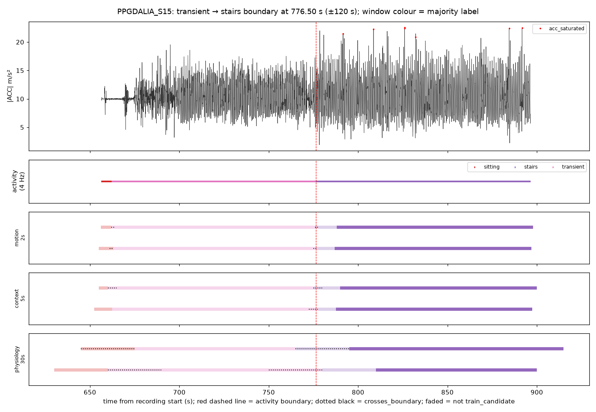

**motion_2s**

| window_id | window_start | window_end | original_label | label_purity | crosses_boundary | seconds_to_nearest_boundary | context_class | eval_role | acc_saturated_frac |
|---|---|---|---|---|---|---|---|---|---|
| PPGDALIA_S15_mot2_000765 | 765.000 | 767.000 | transient | 1.000 | False | 9.500 | None | false_alert_eval | 0.000 |
| PPGDALIA_S15_mot2_000766 | 766.000 | 768.000 | transient | 1.000 | False | 8.500 | None | false_alert_eval | 0.000 |
| PPGDALIA_S15_mot2_000767 | 767.000 | 769.000 | transient | 1.000 | False | 7.500 | None | false_alert_eval | 0.000 |
| PPGDALIA_S15_mot2_000768 | 768.000 | 770.000 | transient | 1.000 | False | 6.500 | None | false_alert_eval | 0.000 |
| PPGDALIA_S15_mot2_000769 | 769.000 | 771.000 | transient | 1.000 | False | 5.500 | None | false_alert_eval | 0.000 |
| PPGDALIA_S15_mot2_000770 | 770.000 | 772.000 | transient | 1.000 | False | 4.500 | None | false_alert_eval | 0.000 |
| PPGDALIA_S15_mot2_000771 | 771.000 | 773.000 | transient | 1.000 | False | 3.500 | None | false_alert_eval | 0.000 |
| PPGDALIA_S15_mot2_000772 | 772.000 | 774.000 | transient | 1.000 | False | 2.500 | None | false_alert_eval | 0.000 |
| PPGDALIA_S15_mot2_000773 | 773.000 | 775.000 | transient | 1.000 | False | 1.500 | None | false_alert_eval | 0.000 |
| PPGDALIA_S15_mot2_000774 | 774.000 | 776.000 | transient | 1.000 | False | 0.500 | None | false_alert_eval | 0.000 |
| PPGDALIA_S15_mot2_000775 | 775.000 | 777.000 | transient | 0.750 | True | 0.000 | None | false_alert_eval | 0.000 |
| PPGDALIA_S15_mot2_000776 | 776.000 | 778.000 | stairs | 0.750 | True | 0.000 | vigorous_activity | false_alert_eval_only | 0.000 |
| PPGDALIA_S15_mot2_000777 | 777.000 | 779.000 | stairs | 1.000 | False | 0.500 | vigorous_activity | false_alert_eval | 0.000 |
| PPGDALIA_S15_mot2_000778 | 778.000 | 780.000 | stairs | 1.000 | False | 1.500 | vigorous_activity | false_alert_eval | 0.000 |
| PPGDALIA_S15_mot2_000779 | 779.000 | 781.000 | stairs | 1.000 | False | 2.500 | vigorous_activity | false_alert_eval | 0.000 |
| PPGDALIA_S15_mot2_000780 | 780.000 | 782.000 | stairs | 1.000 | False | 3.500 | vigorous_activity | false_alert_eval | 0.000 |
| PPGDALIA_S15_mot2_000781 | 781.000 | 783.000 | stairs | 1.000 | False | 4.500 | vigorous_activity | false_alert_eval | 0.000 |
| PPGDALIA_S15_mot2_000782 | 782.000 | 784.000 | stairs | 1.000 | False | 5.500 | vigorous_activity | false_alert_eval | 0.000 |
| PPGDALIA_S15_mot2_000783 | 783.000 | 785.000 | stairs | 1.000 | False | 6.500 | vigorous_activity | false_alert_eval | 0.000 |
| PPGDALIA_S15_mot2_000784 | 784.000 | 786.000 | stairs | 1.000 | False | 7.500 | vigorous_activity | false_alert_eval | 0.000 |
| PPGDALIA_S15_mot2_000785 | 785.000 | 787.000 | stairs | 1.000 | False | 8.500 | vigorous_activity | false_alert_eval | 0.000 |
| PPGDALIA_S15_mot2_000786 | 786.000 | 788.000 | stairs | 1.000 | False | 9.500 | vigorous_activity | false_alert_eval | 0.000 |

**context_5s**

| window_id | window_start | window_end | original_label | label_purity | crosses_boundary | seconds_to_nearest_boundary | context_class | eval_role | acc_saturated_frac |
|---|---|---|---|---|---|---|---|---|---|
| PPGDALIA_S15_ctx5_000305 | 762.500 | 767.500 | transient | 1.000 | False | 9.000 | None | false_alert_eval | 0.000 |
| PPGDALIA_S15_ctx5_000306 | 765.000 | 770.000 | transient | 1.000 | False | 6.500 | None | false_alert_eval | 0.000 |
| PPGDALIA_S15_ctx5_000307 | 767.500 | 772.500 | transient | 1.000 | False | 4.000 | None | false_alert_eval | 0.000 |
| PPGDALIA_S15_ctx5_000308 | 770.000 | 775.000 | transient | 1.000 | False | 1.500 | None | false_alert_eval | 0.000 |
| PPGDALIA_S15_ctx5_000309 | 772.500 | 777.500 | transient | 0.800 | True | 0.000 | None | false_alert_eval | 0.000 |
| PPGDALIA_S15_ctx5_000310 | 775.000 | 780.000 | stairs | 0.700 | True | 0.000 | vigorous_activity | false_alert_eval_only | 0.000 |
| PPGDALIA_S15_ctx5_000311 | 777.500 | 782.500 | stairs | 1.000 | False | 1.000 | vigorous_activity | false_alert_eval | 0.000 |
| PPGDALIA_S15_ctx5_000312 | 780.000 | 785.000 | stairs | 1.000 | False | 3.500 | vigorous_activity | false_alert_eval | 0.000 |
| PPGDALIA_S15_ctx5_000313 | 782.500 | 787.500 | stairs | 1.000 | False | 6.000 | vigorous_activity | false_alert_eval | 0.000 |
| PPGDALIA_S15_ctx5_000314 | 785.000 | 790.000 | stairs | 1.000 | False | 8.500 | vigorous_activity | false_alert_eval | 0.000 |

**physiology_30s**

| window_id | window_start | window_end | original_label | label_purity | crosses_boundary | seconds_to_nearest_boundary | context_class | eval_role | acc_saturated_frac |
|---|---|---|---|---|---|---|---|---|---|
| PPGDALIA_S15_phy30_000048 | 720.000 | 750.000 | transient | 1.000 | False | 26.500 | None | false_alert_eval | 0.000 |
| PPGDALIA_S15_phy30_000049 | 735.000 | 765.000 | transient | 1.000 | False | 11.500 | None | false_alert_eval | 0.000 |
| PPGDALIA_S15_phy30_000050 | 750.000 | 780.000 | transient | 0.883 | True | 0.000 | None | false_alert_eval | 0.000 |
| PPGDALIA_S15_phy30_000051 | 765.000 | 795.000 | stairs | 0.617 | True | 0.000 | vigorous_activity | false_alert_eval_only | 0.001 |
| PPGDALIA_S15_phy30_000052 | 780.000 | 810.000 | stairs | 1.000 | False | 3.500 | vigorous_activity | false_alert_eval | 0.002 |
| PPGDALIA_S15_phy30_000053 | 795.000 | 825.000 | stairs | 1.000 | False | 18.500 | vigorous_activity | train_candidate | 0.001 |

## 9. Determinism (independent re-run compared table by table)

| file | result |
|---|---|
| PPGDALIA_S01/activity.parquet | identical |
| PPGDALIA_S01/hr_ref.parquet | identical |
| PPGDALIA_S01/wrist_acc.parquet | identical |
| PPGDALIA_S01/wrist_bvp.parquet | identical |
| PPGDALIA_S02/activity.parquet | identical |
| PPGDALIA_S02/hr_ref.parquet | identical |
| PPGDALIA_S02/wrist_acc.parquet | identical |
| PPGDALIA_S02/wrist_bvp.parquet | identical |
| PPGDALIA_S03/activity.parquet | identical |
| PPGDALIA_S03/hr_ref.parquet | identical |
| PPGDALIA_S03/wrist_acc.parquet | identical |
| PPGDALIA_S03/wrist_bvp.parquet | identical |
| PPGDALIA_S04/activity.parquet | identical |
| PPGDALIA_S04/hr_ref.parquet | identical |
| PPGDALIA_S04/wrist_acc.parquet | identical |
| PPGDALIA_S04/wrist_bvp.parquet | identical |
| PPGDALIA_S05/activity.parquet | identical |
| PPGDALIA_S05/hr_ref.parquet | identical |
| PPGDALIA_S05/wrist_acc.parquet | identical |
| PPGDALIA_S05/wrist_bvp.parquet | identical |
| PPGDALIA_S06/activity.parquet | identical |
| PPGDALIA_S06/hr_ref.parquet | identical |
| PPGDALIA_S06/wrist_acc.parquet | identical |
| PPGDALIA_S06/wrist_bvp.parquet | identical |
| PPGDALIA_S07/activity.parquet | identical |
| PPGDALIA_S07/hr_ref.parquet | identical |
| PPGDALIA_S07/wrist_acc.parquet | identical |
| PPGDALIA_S07/wrist_bvp.parquet | identical |
| PPGDALIA_S08/activity.parquet | identical |
| PPGDALIA_S08/hr_ref.parquet | identical |
| PPGDALIA_S08/wrist_acc.parquet | identical |
| PPGDALIA_S08/wrist_bvp.parquet | identical |
| PPGDALIA_S09/activity.parquet | identical |
| PPGDALIA_S09/hr_ref.parquet | identical |
| PPGDALIA_S09/wrist_acc.parquet | identical |
| PPGDALIA_S09/wrist_bvp.parquet | identical |
| PPGDALIA_S10/activity.parquet | identical |
| PPGDALIA_S10/hr_ref.parquet | identical |
| PPGDALIA_S10/wrist_acc.parquet | identical |
| PPGDALIA_S10/wrist_bvp.parquet | identical |
| PPGDALIA_S11/activity.parquet | identical |
| PPGDALIA_S11/hr_ref.parquet | identical |
| PPGDALIA_S11/wrist_acc.parquet | identical |
| PPGDALIA_S11/wrist_bvp.parquet | identical |
| PPGDALIA_S12/activity.parquet | identical |
| PPGDALIA_S12/hr_ref.parquet | identical |
| PPGDALIA_S12/wrist_acc.parquet | identical |
| PPGDALIA_S12/wrist_bvp.parquet | identical |
| PPGDALIA_S13/activity.parquet | identical |
| PPGDALIA_S13/hr_ref.parquet | identical |
| PPGDALIA_S13/wrist_acc.parquet | identical |
| PPGDALIA_S13/wrist_bvp.parquet | identical |
| PPGDALIA_S14/activity.parquet | identical |
| PPGDALIA_S14/hr_ref.parquet | identical |
| PPGDALIA_S14/wrist_acc.parquet | identical |
| PPGDALIA_S14/wrist_bvp.parquet | identical |
| PPGDALIA_S15/activity.parquet | identical |
| PPGDALIA_S15/hr_ref.parquet | identical |
| PPGDALIA_S15/wrist_acc.parquet | identical |
| PPGDALIA_S15/wrist_bvp.parquet | identical |
| context_5s.parquet | identical |
| motion_2s.parquet | identical |
| physiology_30s.parquet | identical |
| window_counts_by_label_role.csv | identical |

metadata/ppg_dalia_subjects_v1.csv: identical
