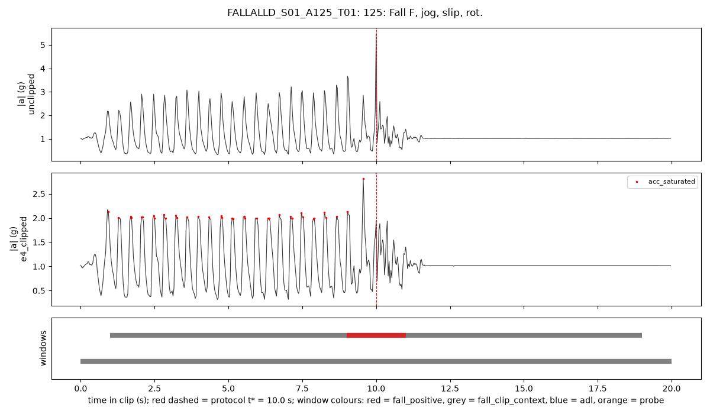

# D08 FallAllD wrist tables (smoke_v1) — auto-generated by scripts/d08_report.py

## 1. Invariant checks

36 of 36 checks passed.

| stage | scope | check | passed |
|---|---|---|---|
| build | ALL | 25 label_uncertain_fall clips in metadata/fallalld_label_uncertain_v1.csv | pass |
| build | ALL | every wrist record has an overlap_group_id | pass |
| build | ALL | wrist record counts equal the D00c audit (2515 / 523 falls / 1992 ADLs; got 2515) | pass |
| build | ALL | per-subject (adl, fall) counts equal D00c table A6 | pass |
| build | FALLALLD_S01 | FALLALLD_S01 has wrist records | pass |
| build | FALLALLD_S01 | 236 records: input 4760 → output 640 samples, no NaN, unclipped/input unaltered by the e4 step, e4 within rails, on the 1/64 g grid, saturation flag ⇔ rails | pass |
| build | FALLALLD_S04 | FALLALLD_S04 has wrist records | pass |
| build | FALLALLD_S04 | 108 records: input 4760 → output 640 samples, no NaN, unclipped/input unaltered by the e4 step, e4 within rails, on the 1/64 g grid, saturation flag ⇔ rails | pass |
| build | windows | exactly 19 windows per record | pass |
| build | windows | every window has 64 samples within [0, 640) | pass |
| build | windows | window_id unique | pass |
| build | windows | no window spans two records | pass |
| build | labels | exactly one positive window per (non-label-uncertain) fall clip, starting at 9 s | pass |
| build | labels | label-uncertain clips: all windows label_uncertain_fall, never train_candidate, clip-level fall | pass |
| build | labels | every window carries its record's overlap_group_id | pass |
| build | labels | probes 15/23: all windows hard_negative_probe, never train_candidate | pass |
| build | labels | fall_clip_context never train_candidate and has no motion class | pass |
| build | FALLALLD_S01 | window role counts equal the formula {'fall_positive': 73, 'fall_clip_context': 1314, 'adl': 2983, 'hard_negative_probe': 114, 'label_uncertain_fall': 0} | pass |
| build | FALLALLD_S04 | window role counts equal the formula {'fall_positive': 0, 'fall_clip_context': 0, 'adl': 1976, 'hard_negative_probe': 76, 'label_uncertain_fall': 0} | pass |
| features | unclipped | one feature row per window, aligned by window_id (6536) | pass |
| features | unclipped | features_v1: 0 NaN | pass |
| features | unclipped | features_v2: NaN only by the documented rules (post-peak < 8 samples; peak at first sample) | pass |
| features | unclipped | no forbidden column among feature columns | pass |
| features | unclipped | dominant_freq in [0, 16] Hz and spectral_entropy in [0, 1] | pass |
| features | unclipped | unclipped: no saturation (FallAllD ±8 g rails never reached) | pass |
| features | e4_clipped | one feature row per window, aligned by window_id (6536) | pass |
| features | e4_clipped | features_v1: 0 NaN | pass |
| features | e4_clipped | features_v2: NaN only by the documented rules (post-peak < 8 samples; peak at first sample) | pass |
| features | e4_clipped | no forbidden column among feature columns | pass |
| features | e4_clipped | dominant_freq in [0, 16] Hz and spectral_entropy in [0, 1] | pass |
| features | e4_clipped | e4_clipped: |a| <= sqrt(3) * 2 g | pass |
| features | ALL | same rows in the same order for both versions | pass |
| features | unclipped | edge-artefact (redefined): first window, converted vs native 238 Hz, median |rel diff| 0.0649% < 1% | pass |
| features | unclipped | edge-artefact (redefined): last window, converted vs native 238 Hz, median |rel diff| 0.0572% < 1% | pass |
| features | e4_clipped | edge-artefact (redefined): first window, converted vs native 238 Hz, median |rel diff| 0.1870% < 1% | pass |
| features | e4_clipped | edge-artefact (redefined): last window, converted vs native 238 Hz, median |rel diff| 0.1484% < 1% | pass |

## 2. Records and windows per subject (class balance)

| subject_id | adl | fall |
|---|---|---|
| FALLALLD_S01 | 163 | 73 |
| FALLALLD_S04 | 108 | 0 |

| subject_id | fall_positive | fall_clip_context | label_uncertain_fall | adl | hard_negative_probe | train_candidate | positive:negative |
|---|---|---|---|---|---|---|---|
| FALLALLD_S01 | 73 | 1314 | 0 | 2983 | 114 | 3056 | 1:40.9 |
| FALLALLD_S04 | 0 | 0 | 0 | 1976 | 76 | 1976 | no positives |

### 2b. Deduplicated view (one clip per overlap group; user decision 4)

| subject_id | clips | overlap_groups | clips_in_shared_groups | dedup_adl | dedup_fall_clip_context | dedup_fall_positive | dedup_hard_negative_probe |
|---|---|---|---|---|---|---|---|
| FALLALLD_S01 | 236 | 151 | 122 | 1425 | 1314 | 73 | 57 |
| FALLALLD_S04 | 108 | 59 | 70 | 1083 | 0 | 0 | 38 |

## 3. e4_clipped saturation (fraction of 32 Hz samples with any axis at the E4 rail)

| kind | records | median_saturated_frac | mean_saturated_frac | records_with_any_saturation_pct |
|---|---|---|---|---|
| adl | 271 | 0.0 | 0.0085 | 26.1993 |
| fall | 73 | 0.0031 | 0.0093 | 79.4521 |

## 4. Feature summary by window role and version (median; features_v2 table)

| version | window_role | windows | median acc_mag_max (m/s²) | windows with saturation (%) | median sat_longest_run_s | median post_peak_stillness | median pre_peak_min_mag |
|---|---|---|---|---|---|---|---|
| unclipped | adl | 4959 | 11.636 | 0.0 | 0.0 | 0.53 | 9.285 |
| unclipped | fall_clip_context | 1314 | 12.802 | 0.0 | 0.0 | 0.799 | 9.187 |
| unclipped | fall_positive | 73 | 40.921 | 0.0 | 0.0 | 3.889 | 4.997 |
| unclipped | hard_negative_probe | 190 | 14.047 | 0.0 | 0.0 | 1.374 | 8.823 |
| e4_clipped | adl | 4959 | 11.65 | 7.804 | 0.0 | 0.489 | 9.196 |
| e4_clipped | fall_clip_context | 1314 | 12.807 | 13.47 | 0.0 | 0.639 | 8.66 |
| e4_clipped | fall_positive | 73 | 24.687 | 72.603 | 0.031 | 3.416 | 4.663 |
| e4_clipped | hard_negative_probe | 190 | 14.027 | 4.737 | 0.0 | 1.359 | 8.451 |

## 5. features_v2 NaN rates (%) by version

| version | sat_longest_run_s | sat_n_runs | sat_max_axes | post_peak_stillness | pre_peak_min_mag |
|---|---|---|---|---|---|
| unclipped | 0.0 | 0.0 | 0.0 | 15.116 | 5.003 |
| e4_clipped | 0.0 | 0.0 | 0.0 | 12.515 | 9.18 |

## 6. Edge-artefact check (REDEFINED: converted edge window vs the same window at native 238 Hz; median |relative difference| over cyclic ADL clips; limit < 1%)

| version | edge | n_clips | median_abs_rel_diff | p95_abs_rel_diff | interior_median_abs_rel_diff |
|---|---|---|---|---|---|
| unclipped | first | 51 | 0.00065 | 0.00539 | 0.00113 |
| unclipped | last | 51 | 0.00057 | 0.0055 | 0.00113 |
| e4_clipped | first | 51 | 0.00187 | 0.00553 | 0.00152 |
| e4_clipped | last | 51 | 0.00148 | 0.00472 | 0.00152 |

## 7. Smoke fall clips listed in metadata/fallalld_label_uncertain_v1.csv

4 of 73 smoke fall clips.

| record_id | original_label | status | peak_t_238hz | peak_t_32hz |
|---|---|---|---|---|
| FALLALLD_S01_A118_T01 | 118: Fall B, try sit, rec. | info_238hz_outside_32hz_inside | 12.7689 | 10.0312 |
| FALLALLD_S01_A102_T02 | 102: Fall F, walking, trip, rec. | kept_conversion_moved_peak | 10.0168 | 12.7812 |
| FALLALLD_S01_A123_T01 | 123: Fall F, jog, slip | kept_conversion_moved_peak | 10.0084 | 7.2188 |
| FALLALLD_S01_A124_T01 | 124: Fall F, jog, slip, rev. | kept_conversion_moved_peak | 10.021 | 11.1875 |

## 7b. Clip-centre intensity pattern (dataset property; cyclic ADL clips; median window acc_mag_mean vs interior)

| window_start | e4_clipped | unclipped |
|---|---|---|
| 0.0 | -0.25 | -0.35 |
| 1.0 | -1.9 | -1.96 |
| 2.0 | -2.07 | -2.07 |
| 3.0 | -0.09 | -0.17 |
| 4.0 | -0.31 | -0.29 |
| 5.0 | -0.73 | -0.73 |
| 6.0 | 0.9 | 0.84 |
| 7.0 | 4.06 | 3.94 |
| 8.0 | 3.38 | 3.67 |
| 9.0 | 2.92 | 2.93 |
| 10.0 | 2.99 | 2.98 |
| 11.0 | 1.34 | 1.53 |
| 12.0 | -0.07 | 0.02 |
| 13.0 | -0.25 | -0.28 |
| 14.0 | -0.82 | -0.79 |
| 15.0 | -1.88 | -1.86 |
| 16.0 | -1.35 | -1.33 |
| 17.0 | -1.82 | -1.87 |
| 18.0 | -2.03 | -2.08 |

## 8. Example clips (figures)

## 9. Determinism (independent re-run, table by table)

| file | result |
|---|---|
| normalized_signals/unclipped/FALLALLD_S01.parquet | identical |
| normalized_signals/unclipped/FALLALLD_S04.parquet | identical |
| normalized_signals/e4_clipped/FALLALLD_S01.parquet | identical |
| normalized_signals/e4_clipped/FALLALLD_S04.parquet | identical |
| windows.parquet | identical |
| fallalld_unclipped_features-v1_smoke_v1.parquet | identical |
| fallalld_unclipped_features-v2_smoke_v1.parquet | identical |
| fallalld_e4_clipped_features-v1_smoke_v1.parquet | identical |
| fallalld_e4_clipped_features-v2_smoke_v1.parquet | identical |
| fallalld_records_smoke_v1.csv | identical |
