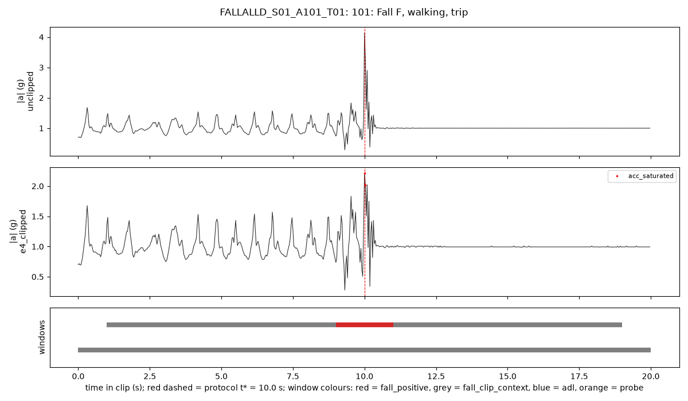
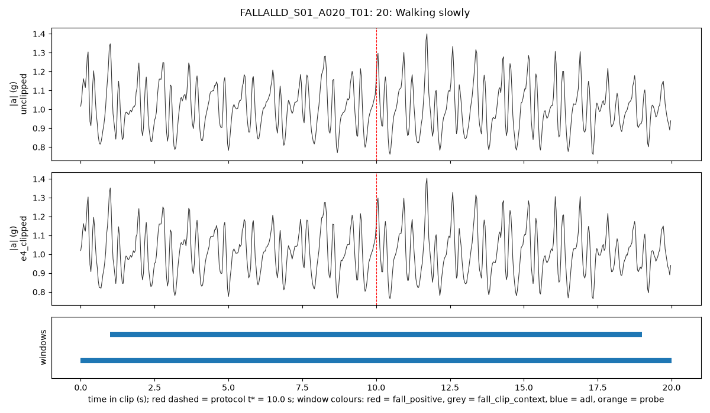
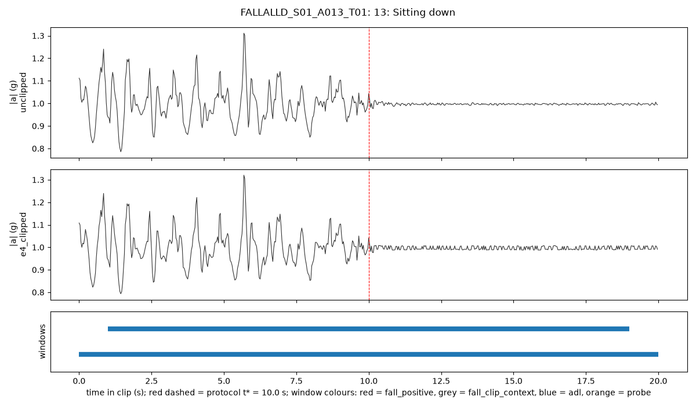
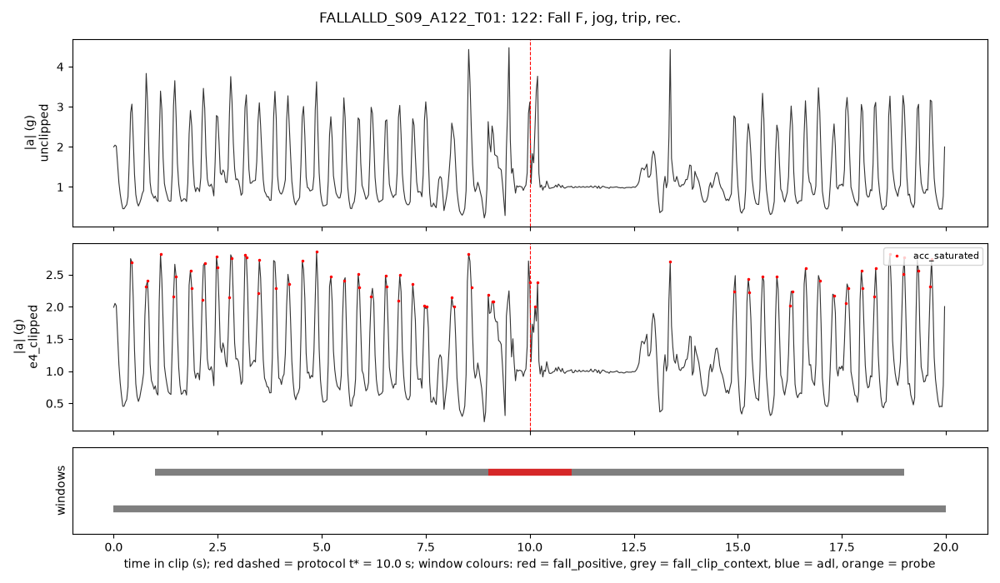

# D08 FallAllD wrist tables (v1) — auto-generated by scripts/d08_report.py

## 1. Invariant checks

69 of 69 checks passed.

| stage | scope | check | passed |
|---|---|---|---|
| build | ALL | 25 label_uncertain_fall clips in metadata/fallalld_label_uncertain_v1.csv | pass |
| build | ALL | every wrist record has an overlap_group_id | pass |
| build | ALL | wrist record counts equal the D00c audit (2515 / 523 falls / 1992 ADLs; got 2515) | pass |
| build | ALL | per-subject (adl, fall) counts equal D00c table A6 | pass |
| build | FALLALLD_S01 | FALLALLD_S01 has wrist records | pass |
| build | FALLALLD_S01 | 236 records: input 4760 → output 640 samples, no NaN, unclipped/input unaltered by the e4 step, e4 within rails, on the 1/64 g grid, saturation flag ⇔ rails | pass |
| build | FALLALLD_S02 | FALLALLD_S02 has wrist records | pass |
| build | FALLALLD_S02 | 239 records: input 4760 → output 640 samples, no NaN, unclipped/input unaltered by the e4 step, e4 within rails, on the 1/64 g grid, saturation flag ⇔ rails | pass |
| build | FALLALLD_S03 | FALLALLD_S03 has wrist records | pass |
| build | FALLALLD_S03 | 242 records: input 4760 → output 640 samples, no NaN, unclipped/input unaltered by the e4 step, e4 within rails, on the 1/64 g grid, saturation flag ⇔ rails | pass |
| build | FALLALLD_S04 | FALLALLD_S04 has wrist records | pass |
| build | FALLALLD_S04 | 108 records: input 4760 → output 640 samples, no NaN, unclipped/input unaltered by the e4 step, e4 within rails, on the 1/64 g grid, saturation flag ⇔ rails | pass |
| build | FALLALLD_S05 | FALLALLD_S05 has wrist records | pass |
| build | FALLALLD_S05 | 216 records: input 4760 → output 640 samples, no NaN, unclipped/input unaltered by the e4 step, e4 within rails, on the 1/64 g grid, saturation flag ⇔ rails | pass |
| build | FALLALLD_S06 | FALLALLD_S06 has wrist records | pass |
| build | FALLALLD_S06 | 234 records: input 4760 → output 640 samples, no NaN, unclipped/input unaltered by the e4 step, e4 within rails, on the 1/64 g grid, saturation flag ⇔ rails | pass |
| build | FALLALLD_S09 | FALLALLD_S09 has wrist records | pass |
| build | FALLALLD_S09 | 218 records: input 4760 → output 640 samples, no NaN, unclipped/input unaltered by the e4 step, e4 within rails, on the 1/64 g grid, saturation flag ⇔ rails | pass |
| build | FALLALLD_S10 | FALLALLD_S10 has wrist records | pass |
| build | FALLALLD_S10 | 159 records: input 4760 → output 640 samples, no NaN, unclipped/input unaltered by the e4 step, e4 within rails, on the 1/64 g grid, saturation flag ⇔ rails | pass |
| build | FALLALLD_S11 | FALLALLD_S11 has wrist records | pass |
| build | FALLALLD_S11 | 155 records: input 4760 → output 640 samples, no NaN, unclipped/input unaltered by the e4 step, e4 within rails, on the 1/64 g grid, saturation flag ⇔ rails | pass |
| build | FALLALLD_S12 | FALLALLD_S12 has wrist records | pass |
| build | FALLALLD_S12 | 163 records: input 4760 → output 640 samples, no NaN, unclipped/input unaltered by the e4 step, e4 within rails, on the 1/64 g grid, saturation flag ⇔ rails | pass |
| build | FALLALLD_S13 | FALLALLD_S13 has wrist records | pass |
| build | FALLALLD_S13 | 139 records: input 4760 → output 640 samples, no NaN, unclipped/input unaltered by the e4 step, e4 within rails, on the 1/64 g grid, saturation flag ⇔ rails | pass |
| build | FALLALLD_S14 | FALLALLD_S14 has wrist records | pass |
| build | FALLALLD_S14 | 225 records: input 4760 → output 640 samples, no NaN, unclipped/input unaltered by the e4 step, e4 within rails, on the 1/64 g grid, saturation flag ⇔ rails | pass |
| build | FALLALLD_S15 | FALLALLD_S15 has wrist records | pass |
| build | FALLALLD_S15 | 181 records: input 4760 → output 640 samples, no NaN, unclipped/input unaltered by the e4 step, e4 within rails, on the 1/64 g grid, saturation flag ⇔ rails | pass |
| build | windows | exactly 19 windows per record | pass |
| build | windows | every window has 64 samples within [0, 640) | pass |
| build | windows | window_id unique | pass |
| build | windows | no window spans two records | pass |
| build | labels | exactly one positive window per (non-label-uncertain) fall clip, starting at 9 s | pass |
| build | labels | label-uncertain clips: all windows label_uncertain_fall, never train_candidate, clip-level fall | pass |
| build | labels | every window carries its record's overlap_group_id | pass |
| build | labels | probes 15/23: all windows hard_negative_probe, never train_candidate | pass |
| build | labels | fall_clip_context never train_candidate and has no motion class | pass |
| build | FALLALLD_S01 | window role counts equal the formula {'fall_positive': 73, 'fall_clip_context': 1314, 'adl': 2983, 'hard_negative_probe': 114, 'label_uncertain_fall': 0} | pass |
| build | FALLALLD_S02 | window role counts equal the formula {'fall_positive': 50, 'fall_clip_context': 900, 'adl': 3382, 'hard_negative_probe': 114, 'label_uncertain_fall': 95} | pass |
| build | FALLALLD_S03 | window role counts equal the formula {'fall_positive': 60, 'fall_clip_context': 1080, 'adl': 3249, 'hard_negative_probe': 114, 'label_uncertain_fall': 95} | pass |
| build | FALLALLD_S04 | window role counts equal the formula {'fall_positive': 0, 'fall_clip_context': 0, 'adl': 1976, 'hard_negative_probe': 76, 'label_uncertain_fall': 0} | pass |
| build | FALLALLD_S05 | window role counts equal the formula {'fall_positive': 50, 'fall_clip_context': 900, 'adl': 2983, 'hard_negative_probe': 114, 'label_uncertain_fall': 57} | pass |
| build | FALLALLD_S06 | window role counts equal the formula {'fall_positive': 66, 'fall_clip_context': 1188, 'adl': 2983, 'hard_negative_probe': 114, 'label_uncertain_fall': 95} | pass |
| build | FALLALLD_S09 | window role counts equal the formula {'fall_positive': 54, 'fall_clip_context': 972, 'adl': 2964, 'hard_negative_probe': 114, 'label_uncertain_fall': 38} | pass |
| build | FALLALLD_S10 | window role counts equal the formula {'fall_positive': 0, 'fall_clip_context': 0, 'adl': 2907, 'hard_negative_probe': 114, 'label_uncertain_fall': 0} | pass |
| build | FALLALLD_S11 | window role counts equal the formula {'fall_positive': 0, 'fall_clip_context': 0, 'adl': 2831, 'hard_negative_probe': 114, 'label_uncertain_fall': 0} | pass |
| build | FALLALLD_S12 | window role counts equal the formula {'fall_positive': 0, 'fall_clip_context': 0, 'adl': 2983, 'hard_negative_probe': 114, 'label_uncertain_fall': 0} | pass |
| build | FALLALLD_S13 | window role counts equal the formula {'fall_positive': 22, 'fall_clip_context': 396, 'adl': 2166, 'hard_negative_probe': 57, 'label_uncertain_fall': 0} | pass |
| build | FALLALLD_S14 | window role counts equal the formula {'fall_positive': 62, 'fall_clip_context': 1116, 'adl': 2983, 'hard_negative_probe': 114, 'label_uncertain_fall': 0} | pass |
| build | FALLALLD_S15 | window role counts equal the formula {'fall_positive': 61, 'fall_clip_context': 1098, 'adl': 2128, 'hard_negative_probe': 57, 'label_uncertain_fall': 95} | pass |
| features | unclipped | one feature row per window, aligned by window_id (47785) | pass |
| features | unclipped | features_v1: 0 NaN | pass |
| features | unclipped | features_v2: NaN only by the documented rules (post-peak < 8 samples; peak at first sample) | pass |
| features | unclipped | no forbidden column among feature columns | pass |
| features | unclipped | dominant_freq in [0, 16] Hz and spectral_entropy in [0, 1] | pass |
| features | unclipped | unclipped: no saturation (FallAllD ±8 g rails never reached) | pass |
| features | e4_clipped | one feature row per window, aligned by window_id (47785) | pass |
| features | e4_clipped | features_v1: 0 NaN | pass |
| features | e4_clipped | features_v2: NaN only by the documented rules (post-peak < 8 samples; peak at first sample) | pass |
| features | e4_clipped | no forbidden column among feature columns | pass |
| features | e4_clipped | dominant_freq in [0, 16] Hz and spectral_entropy in [0, 1] | pass |
| features | e4_clipped | e4_clipped: |a| <= sqrt(3) * 2 g | pass |
| features | ALL | same rows in the same order for both versions | pass |
| features | unclipped | edge-artefact (redefined): first window, converted vs native 238 Hz, median |rel diff| 0.0687% < 1% | pass |
| features | unclipped | edge-artefact (redefined): last window, converted vs native 238 Hz, median |rel diff| 0.0706% < 1% | pass |
| features | e4_clipped | edge-artefact (redefined): first window, converted vs native 238 Hz, median |rel diff| 0.1545% < 1% | pass |
| features | e4_clipped | edge-artefact (redefined): last window, converted vs native 238 Hz, median |rel diff| 0.1428% < 1% | pass |

## 2. Records and windows per subject (class balance)

| subject_id | adl | fall |
|---|---|---|
| FALLALLD_S01 | 163 | 73 |
| FALLALLD_S02 | 184 | 55 |
| FALLALLD_S03 | 177 | 65 |
| FALLALLD_S04 | 108 | 0 |
| FALLALLD_S05 | 163 | 53 |
| FALLALLD_S06 | 163 | 71 |
| FALLALLD_S09 | 162 | 56 |
| FALLALLD_S10 | 159 | 0 |
| FALLALLD_S11 | 155 | 0 |
| FALLALLD_S12 | 163 | 0 |
| FALLALLD_S13 | 117 | 22 |
| FALLALLD_S14 | 163 | 62 |
| FALLALLD_S15 | 115 | 66 |

| subject_id | fall_positive | fall_clip_context | label_uncertain_fall | adl | hard_negative_probe | train_candidate | positive:negative |
|---|---|---|---|---|---|---|---|
| FALLALLD_S01 | 73 | 1314 | 0 | 2983 | 114 | 3056 | 1:40.9 |
| FALLALLD_S02 | 50 | 900 | 95 | 3382 | 114 | 3432 | 1:67.6 |
| FALLALLD_S03 | 60 | 1080 | 95 | 3249 | 114 | 3309 | 1:54.1 |
| FALLALLD_S04 | 0 | 0 | 0 | 1976 | 76 | 1976 | no positives |
| FALLALLD_S05 | 50 | 900 | 57 | 2983 | 114 | 3033 | 1:59.7 |
| FALLALLD_S06 | 66 | 1188 | 95 | 2983 | 114 | 3049 | 1:45.2 |
| FALLALLD_S09 | 54 | 972 | 38 | 2964 | 114 | 3018 | 1:54.9 |
| FALLALLD_S10 | 0 | 0 | 0 | 2907 | 114 | 2907 | no positives |
| FALLALLD_S11 | 0 | 0 | 0 | 2831 | 114 | 2831 | no positives |
| FALLALLD_S12 | 0 | 0 | 0 | 2983 | 114 | 2983 | no positives |
| FALLALLD_S13 | 22 | 396 | 0 | 2166 | 57 | 2188 | 1:98.5 |
| FALLALLD_S14 | 62 | 1116 | 0 | 2983 | 114 | 3045 | 1:48.1 |
| FALLALLD_S15 | 61 | 1098 | 95 | 2128 | 57 | 2189 | 1:34.9 |

### 2b. Deduplicated view (one clip per overlap group; user decision 4)

| subject_id | clips | overlap_groups | clips_in_shared_groups | dedup_adl | dedup_fall_clip_context | dedup_fall_positive | dedup_hard_negative_probe | dedup_label_uncertain_fall |
|---|---|---|---|---|---|---|---|---|
| FALLALLD_S01 | 236 | 151 | 122 | 1425 | 1314 | 73 | 57 | 0 |
| FALLALLD_S02 | 239 | 151 | 132 | 1767 | 900 | 50 | 57 | 95 |
| FALLALLD_S03 | 242 | 135 | 148 | 1349 | 1008 | 56 | 57 | 95 |
| FALLALLD_S04 | 108 | 59 | 70 | 1083 | 0 | 0 | 38 | 0 |
| FALLALLD_S05 | 216 | 125 | 125 | 1311 | 900 | 50 | 57 | 57 |
| FALLALLD_S06 | 234 | 127 | 147 | 1026 | 1170 | 65 | 57 | 95 |
| FALLALLD_S09 | 218 | 109 | 146 | 1045 | 882 | 49 | 57 | 38 |
| FALLALLD_S10 | 159 | 64 | 132 | 1159 | 0 | 0 | 57 | 0 |
| FALLALLD_S11 | 155 | 67 | 128 | 1216 | 0 | 0 | 57 | 0 |
| FALLALLD_S12 | 163 | 60 | 142 | 1083 | 0 | 0 | 57 | 0 |
| FALLALLD_S13 | 139 | 65 | 94 | 760 | 396 | 22 | 57 | 0 |
| FALLALLD_S14 | 225 | 119 | 140 | 1026 | 1116 | 62 | 57 | 0 |
| FALLALLD_S15 | 181 | 111 | 95 | 855 | 1098 | 61 | 0 | 95 |

## 3. e4_clipped saturation (fraction of 32 Hz samples with any axis at the E4 rail)

| kind | records | median_saturated_frac | mean_saturated_frac | records_with_any_saturation_pct |
|---|---|---|---|---|
| adl | 1992 | 0.0 | 0.0085 | 29.4177 |
| fall | 523 | 0.0016 | 0.0082 | 78.3939 |

Per subject (e4_clipped): records, mean saturated fraction, % records with any saturation, and % windows with any saturation by role:

| subject_id | records_adl | records_fall | mean_saturated_frac_adl | mean_saturated_frac_fall | records_with_any_pct_adl | records_with_any_pct_fall | windows_saturated_pct_adl | windows_saturated_pct_fall_clip_context | windows_saturated_pct_fall_positive | windows_saturated_pct_hard_negative_probe | windows_saturated_pct_label_uncertain_fall |
|---|---|---|---|---|---|---|---|---|---|---|---|
| FALLALLD_S01 | 163.0 | 73.0 | 0.0086 | 0.0093 | 22.6994 | 79.4521 | 8.55 | 13.47 | 72.6 | 6.14 | nan |
| FALLALLD_S02 | 184.0 | 55.0 | 0.0076 | 0.0021 | 24.4565 | 61.8182 | 8.63 | 6.78 | 56.0 | 8.77 | 4.21 |
| FALLALLD_S03 | 177.0 | 65.0 | 0.0045 | 0.0033 | 15.2542 | 73.8462 | 5.48 | 9.91 | 71.67 | 0.0 | 14.74 |
| FALLALLD_S04 | 108.0 | nan | 0.0082 | nan | 31.4815 | nan | 6.68 | nan | nan | 2.63 | nan |
| FALLALLD_S05 | 163.0 | 53.0 | 0.0067 | 0.0046 | 30.0613 | 62.2642 | 10.16 | 12.33 | 64.0 | 7.89 | 0.0 |
| FALLALLD_S06 | 163.0 | 71.0 | 0.0148 | 0.0129 | 38.6503 | 87.3239 | 13.44 | 17.42 | 86.36 | 6.14 | 16.84 |
| FALLALLD_S09 | 162.0 | 56.0 | 0.0094 | 0.015 | 38.8889 | 78.5714 | 10.66 | 16.87 | 75.93 | 7.02 | 15.79 |
| FALLALLD_S10 | 159.0 | nan | 0.0089 | nan | 29.5597 | nan | 9.53 | nan | nan | 7.02 | nan |
| FALLALLD_S11 | 155.0 | nan | 0.0047 | nan | 33.5484 | nan | 8.51 | nan | nan | 6.14 | nan |
| FALLALLD_S12 | 163.0 | nan | 0.0085 | nan | 32.5153 | nan | 10.53 | nan | nan | 7.89 | nan |
| FALLALLD_S13 | 117.0 | 22.0 | 0.0173 | 0.0137 | 35.0427 | 100.0 | 15.51 | 28.28 | 86.36 | 14.04 | nan |
| FALLALLD_S14 | 163.0 | 62.0 | 0.0102 | 0.0044 | 25.7669 | 80.6452 | 9.45 | 11.56 | 75.81 | 5.26 | nan |
| FALLALLD_S15 | 115.0 | 66.0 | 0.0015 | 0.0105 | 28.6957 | 89.3939 | 5.4 | 15.3 | 80.33 | 7.02 | 18.95 |

## 4. Feature summary by window role and version (median; features_v2 table)

| version | window_role | windows | median acc_mag_max (m/s²) | windows with saturation (%) | median sat_longest_run_s | median post_peak_stillness | median pre_peak_min_mag |
|---|---|---|---|---|---|---|---|
| unclipped | adl | 36518 | 11.443 | 0.0 | 0.0 | 0.437 | 9.333 |
| unclipped | fall_clip_context | 8964 | 13.344 | 0.0 | 0.0 | 0.854 | 9.144 |
| unclipped | fall_positive | 498 | 41.923 | 0.0 | 0.0 | 3.53 | 4.839 |
| unclipped | hard_negative_probe | 1330 | 14.156 | 0.0 | 0.0 | 1.312 | 8.38 |
| unclipped | label_uncertain_fall | 475 | 13.907 | 0.0 | 0.0 | 0.942 | 8.634 |
| e4_clipped | adl | 36518 | 11.45 | 9.425 | 0.0 | 0.395 | 9.262 |
| e4_clipped | fall_clip_context | 8964 | 13.33 | 13.788 | 0.0 | 0.762 | 8.75 |
| e4_clipped | fall_positive | 498 | 25.086 | 74.096 | 0.031 | 3.155 | 4.975 |
| e4_clipped | hard_negative_probe | 1330 | 14.132 | 6.391 | 0.0 | 1.275 | 8.202 |
| e4_clipped | label_uncertain_fall | 475 | 13.9 | 12.211 | 0.0 | 0.895 | 8.627 |

## 5. features_v2 NaN rates (%) by version

| version | sat_longest_run_s | sat_n_runs | sat_max_axes | post_peak_stillness | pre_peak_min_mag |
|---|---|---|---|---|---|
| unclipped | 0.0 | 0.0 | 0.0 | 14.538 | 5.186 |
| e4_clipped | 0.0 | 0.0 | 0.0 | 12.615 | 9.007 |

## 6. Edge-artefact check (REDEFINED: converted edge window vs the same window at native 238 Hz; median |relative difference| over cyclic ADL clips; limit < 1%)

| version | edge | n_clips | median_abs_rel_diff | p95_abs_rel_diff | interior_median_abs_rel_diff |
|---|---|---|---|---|---|
| unclipped | first | 413 | 0.00069 | 0.0064 | 0.00133 |
| unclipped | last | 413 | 0.00071 | 0.00593 | 0.00133 |
| e4_clipped | first | 413 | 0.00154 | 0.00627 | 0.00173 |
| e4_clipped | last | 413 | 0.00143 | 0.00629 | 0.00173 |

## 7. Smoke fall clips listed in metadata/fallalld_label_uncertain_v1.csv

47 of 523 smoke fall clips.

| record_id | original_label | status | peak_t_238hz | peak_t_32hz |
|---|---|---|---|---|
| FALLALLD_S01_A118_T01 | 118: Fall B, try sit, rec. | info_238hz_outside_32hz_inside | 12.7689 | 10.0312 |
| FALLALLD_S02_A102_T01 | 102: Fall F, walking, trip, rec. | info_238hz_outside_32hz_inside | 11.4958 | 10.0312 |
| FALLALLD_S02_A106_T01 | 106: Fall F, walking, slip, rot., rec. | info_238hz_outside_32hz_inside | 11.3319 | 10.0 |
| FALLALLD_S02_A110_T01 | 110: Fall B, walking, slip rot., rec. | info_238hz_outside_32hz_inside | 19.0168 | 10.0 |
| FALLALLD_S05_A109_T02 | 109: Fall B, walking, slip, rot. | info_238hz_outside_32hz_inside | 11.1092 | 9.9688 |
| FALLALLD_S06_A120_T01 | 120: Fall L, try sit, rec. | info_238hz_outside_32hz_inside | 14.1723 | 10.0 |
| FALLALLD_S06_A121_T02 | 121: Fall F, jog, trip | info_238hz_outside_32hz_inside | 18.8908 | 10.0 |
| FALLALLD_S15_A110_T02 | 110: Fall B, walking, slip rot., rec. | info_238hz_outside_32hz_inside | 13.6723 | 10.0 |
| FALLALLD_S01_A102_T02 | 102: Fall F, walking, trip, rec. | kept_conversion_moved_peak | 10.0168 | 12.7812 |
| FALLALLD_S01_A123_T01 | 123: Fall F, jog, slip | kept_conversion_moved_peak | 10.0084 | 7.2188 |
| FALLALLD_S01_A124_T01 | 124: Fall F, jog, slip, rev. | kept_conversion_moved_peak | 10.021 | 11.1875 |
| FALLALLD_S02_A122_T01 | 122: Fall F, jog, trip, rec. | kept_conversion_moved_peak | 10.0126 | 12.75 |
| FALLALLD_S03_A126_T02 | 126: Fall F, jog, slip, rot., rec. | kept_conversion_moved_peak | 9.8529 | 5.5938 |
| FALLALLD_S05_A123_T02 | 123: Fall F, jog, slip | kept_conversion_moved_peak | 10.021 | 0.8125 |
| FALLALLD_S05_A124_T01 | 124: Fall F, jog, slip, rev. | kept_conversion_moved_peak | 10.0084 | 2.9688 |
| FALLALLD_S05_A125_T02 | 125: Fall F, jog, slip, rot. | kept_conversion_moved_peak | 9.9874 | 8.8438 |
| FALLALLD_S09_A121_T02 | 121: Fall F, jog, trip | kept_conversion_moved_peak | 10.0042 | 2.0 |
| FALLALLD_S09_A124_T02 | 124: Fall F, jog, slip, rev. | kept_conversion_moved_peak | 9.8487 | 1.4688 |
| FALLALLD_S09_A125_T01 | 125: Fall F, jog, slip, rot. | kept_conversion_moved_peak | 10.0 | 2.5 |
| FALLALLD_S09_A125_T02 | 125: Fall F, jog, slip, rot. | kept_conversion_moved_peak | 10.0042 | 4.5 |
| FALLALLD_S13_A124_T02 | 124: Fall F, jog, slip, rev. | kept_conversion_moved_peak | 10.0042 | 12.6875 |
| FALLALLD_S15_A123_T01 | 123: Fall F, jog, slip | kept_conversion_moved_peak | 10.0042 | 8.7812 |
| FALLALLD_S02_A107_T02 | 107: Fall B, walking, slip | label_uncertain_fall | 11.5252 | 11.5312 |
| FALLALLD_S02_A108_T01 | 108: Fall B, walking, slip, rec. | label_uncertain_fall | 19.0126 | 19.0 |
| FALLALLD_S02_A108_T02 | 108: Fall B, walking, slip, rec. | label_uncertain_fall | 11.1807 | 11.1875 |
| FALLALLD_S02_A114_T02 | 114: Fall, syncope, table | label_uncertain_fall | 7.8992 | 7.9062 |
| FALLALLD_S02_A118_T01 | 118: Fall B, try sit, rec. | label_uncertain_fall | 16.3487 | 16.3438 |
| FALLALLD_S03_A108_T04 | 108: Fall B, walking, slip, rec. | label_uncertain_fall | 14.3655 | 14.375 |
| FALLALLD_S03_A114_T01 | 114: Fall, syncope, table | label_uncertain_fall | 8.9664 | 8.9688 |
| FALLALLD_S03_A114_T02 | 114: Fall, syncope, table | label_uncertain_fall | 8.895 | 8.9062 |
| FALLALLD_S03_A128_T02 | 128: Fall L, bed, rec. | label_uncertain_fall | 13.3571 | 13.3438 |
| FALLALLD_S03_A135_T01 | 135: Fall, syncope, slide over a wall | label_uncertain_fall | 11.2437 | 11.25 |
| FALLALLD_S05_A107_T02 | 107: Fall B, walking, slip | label_uncertain_fall | 7.7605 | 7.75 |
| FALLALLD_S05_A127_T03 | 127: Fall L, bed | label_uncertain_fall | 11.3025 | 11.3125 |
| FALLALLD_S05_A127_T04 | 127: Fall L, bed | label_uncertain_fall | 8.8529 | 8.8438 |
| FALLALLD_S06_A102_T01 | 102: Fall F, walking, trip, rec. | label_uncertain_fall | 8.8235 | 8.8438 |
| FALLALLD_S06_A128_T01 | 128: Fall L, bed, rec. | label_uncertain_fall | 12.7437 | 12.75 |
| FALLALLD_S06_A128_T03 | 128: Fall L, bed, rec. | label_uncertain_fall | 12.6513 | 12.6562 |
| FALLALLD_S06_A128_T05 | 128: Fall L, bed, rec. | label_uncertain_fall | 14.0966 | 14.0938 |
| FALLALLD_S06_A135_T02 | 135: Fall, syncope, slide over a wall | label_uncertain_fall | 5.6008 | 5.5938 |
| FALLALLD_S09_A120_T01 | 120: Fall L, try sit, rec. | label_uncertain_fall | 14.5168 | 14.5312 |
| FALLALLD_S09_A135_T02 | 135: Fall, syncope, slide over a wall | label_uncertain_fall | 7.0714 | 7.0625 |
| FALLALLD_S15_A101_T01 | 101: Fall F, walking, trip | label_uncertain_fall | 8.9118 | 8.9062 |
| FALLALLD_S15_A101_T02 | 101: Fall F, walking, trip | label_uncertain_fall | 8.9034 | 8.9062 |
| FALLALLD_S15_A102_T01 | 102: Fall F, walking, trip, rec. | label_uncertain_fall | 8.3277 | 8.3125 |
| FALLALLD_S15_A102_T02 | 102: Fall F, walking, trip, rec. | label_uncertain_fall | 8.3992 | 8.4062 |
| FALLALLD_S15_A106_T01 | 106: Fall F, walking, slip, rot., rec. | label_uncertain_fall | 17.6345 | 17.6562 |

## 7b. Clip-centre intensity pattern (dataset property; cyclic ADL clips; median window acc_mag_mean vs interior)

| window_start | e4_clipped | unclipped |
|---|---|---|
| 0.0 | -2.27 | -2.39 |
| 1.0 | -2.52 | -2.62 |
| 2.0 | -2.2 | -2.3 |
| 3.0 | -1.95 | -1.96 |
| 4.0 | -1.42 | -1.51 |
| 5.0 | -0.95 | -1.02 |
| 6.0 | 0.96 | 1.04 |
| 7.0 | 2.44 | 2.52 |
| 8.0 | 3.08 | 3.58 |
| 9.0 | 4.77 | 5.29 |
| 10.0 | 4.69 | 5.13 |
| 11.0 | 2.18 | 2.69 |
| 12.0 | 0.56 | 0.57 |
| 13.0 | -0.77 | -0.77 |
| 14.0 | -1.66 | -1.72 |
| 15.0 | -1.87 | -1.97 |
| 16.0 | -2.0 | -2.17 |
| 17.0 | -2.61 | -2.7 |
| 18.0 | -2.63 | -2.58 |

## 8. Example clips (figures)

## 9. Determinism (independent re-run, table by table)

| file | result |
|---|---|
| normalized_signals/unclipped/FALLALLD_S01.parquet | identical |
| normalized_signals/unclipped/FALLALLD_S02.parquet | identical |
| normalized_signals/unclipped/FALLALLD_S03.parquet | identical |
| normalized_signals/unclipped/FALLALLD_S04.parquet | identical |
| normalized_signals/unclipped/FALLALLD_S05.parquet | identical |
| normalized_signals/unclipped/FALLALLD_S06.parquet | identical |
| normalized_signals/unclipped/FALLALLD_S09.parquet | identical |
| normalized_signals/unclipped/FALLALLD_S10.parquet | identical |
| normalized_signals/unclipped/FALLALLD_S11.parquet | identical |
| normalized_signals/unclipped/FALLALLD_S12.parquet | identical |
| normalized_signals/unclipped/FALLALLD_S13.parquet | identical |
| normalized_signals/unclipped/FALLALLD_S14.parquet | identical |
| normalized_signals/unclipped/FALLALLD_S15.parquet | identical |
| normalized_signals/e4_clipped/FALLALLD_S01.parquet | identical |
| normalized_signals/e4_clipped/FALLALLD_S02.parquet | identical |
| normalized_signals/e4_clipped/FALLALLD_S03.parquet | identical |
| normalized_signals/e4_clipped/FALLALLD_S04.parquet | identical |
| normalized_signals/e4_clipped/FALLALLD_S05.parquet | identical |
| normalized_signals/e4_clipped/FALLALLD_S06.parquet | identical |
| normalized_signals/e4_clipped/FALLALLD_S09.parquet | identical |
| normalized_signals/e4_clipped/FALLALLD_S10.parquet | identical |
| normalized_signals/e4_clipped/FALLALLD_S11.parquet | identical |
| normalized_signals/e4_clipped/FALLALLD_S12.parquet | identical |
| normalized_signals/e4_clipped/FALLALLD_S13.parquet | identical |
| normalized_signals/e4_clipped/FALLALLD_S14.parquet | identical |
| normalized_signals/e4_clipped/FALLALLD_S15.parquet | identical |
| windows.parquet | identical |
| fallalld_unclipped_features-v1_v1.parquet | identical |
| fallalld_unclipped_features-v2_v1.parquet | identical |
| fallalld_e4_clipped_features-v1_v1.parquet | identical |
| fallalld_e4_clipped_features-v2_v1.parquet | identical |
| fallalld_records_v1.csv | identical |
